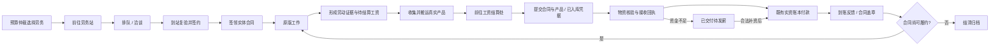

> **实装注记（2026-10-12，追加于设计正文之上）**
>
> 本单已由执行器**按一次性完整交付**实装（用户 2026-10-12 明确指示「按需求单实装落地，完整性一次性完成」）。
> 交付物与证据见变更标注 `docs/设计文档/架构/变更标注/变更标注_CHG-20261011-LABOR-VISUAL.md`（32 文件清单、
> 关键不变量、编译/测试/负面对照记录、回滚方案）。设计阶段判定的待决项由 GATE-ARCH 复核抓出并**已修复**：
> ① **P0-1** 新模式从未写入合同（起草/签约/承接三处均用默认旧模式 ⇒ 核心新链实机不可达）；
> ② P1 交付物筛选条件与批次查询语义互斥（实物永不转移）；③ P1 递交凭证未真正扣门；
> ④ P1 阶段链在"履约中→待发薪"处断裂（过程性阶段无写入点）；⑤ P1 新 Harmony 补丁未登记 EXC（已补为 #26）。
> 下述 §1–§13 正文保持**设计时的授权与状态描述原文**，用于留痕；当前生效状态以前面 front matter 与本节为准。

# CB-ECON-003：劳务履约过程可视化与实体合同

## 1. 交付目的、授权与状态

玩家目前能看到 Pawn 承接合同、完成劳动以及个人账户获得工资，但缺少地图上的可见手续。本任务让玩家在不打开任何窗口、不手动下达每一步指令的情况下，看懂以下真实过程：

**产生求职意图 → 寻路到劳务站 → 到站洽谈 → 签领实体合同 → 原版工作 → 收集真实产品或劳动凭证 → 到工资结算处 → 提交合同与交付物 → 验收 → 工资实际到账 → 盖章/归档反馈。**

用户本次明确要求先拟详细完整需求单，含开发指导、规范标准、验收工程。本轮仅设计，授权包括需求单落盘和索引登记；不实施、不编译、不部署，不替 CodeBuddy 创建 Accepted 回执。`approved` 表示用户授权创建文档，不代表以下新增运行设计已经批准编码。执行器须先完成本单要求的 SDD/架构审查，经理审查后再进入实现；当前真实状态为 **Prepared / ReadyForDesignReview / SDD Draft**。

本任务是行为流程与表现共同改造：当前远程自动签约、完成即支付的提交时点需要调整。它不是纯 OnGUI 装饰，也不是增加一段发生在交易之后的假动画。薪资单价、计件单位、预算补储判据、金融真值和幂等身份不因可视化改动。

工作区：`E:/SteamLibrary/steamapps/common/RimWorld/11/殖民地综合管理系统`。执行协议：[00-经理与执行器协作规范.md](../../任务派发/CodeBuddyCN/00-经理与执行器协作规范.md)。现有大量未提交改动和其他并行工作，禁止清仓、重置或覆盖其他任务；开工记录涉及路径的实际哈希。

### 1.1 新建理由与关联正本

| 存量 | 关联与处理 |
|---|---|
| CB-ECON-002 个人账户需求及执行回报 | 已交付的是只读账户、四循环解释；本单新增真实 Job、Thing、交接持久化及付款资格，独立任务，不重开002或改写其历史 |
| `经济AI全面审计_2026-10-10.md` 等审计文档 | 提供背景，不能承载本任务的具体流程、资源、存档与验收合同；不取代 |
| `经济需求驱动AI/游戏代码设计/06-就业与劳动合同_代码设计方案.md` | 保留就业领域规则，本单是地图执行与交验扩展；实施时更新该正本的接入说明，不另建第二份金融规则 |
| `经济需求驱动AI/实装落地/08-B2.4.2_真实交付与权益承接_实装记录.md` | 真实权益/交付链的现有基线，先读并复用；本单不声称旧交付链已支持实体合同 |
| 本轮用户两张截图 | 玩家报告主动劳务换薪已通过；截图1可见Niklas伐木合同，截图2账户可用16.80、旧计划采样8.40。属于用户观察，不能据截图补造完整时序或全场景PASS |

本单为需求、拟定技术设计与验收的唯一任务正本。细化 SDD 优先在本单对应章节增补，避免平行稿；若必须拆文件，应说明分层/大小理由并双向索引，使用同一需求 ID。

## 2. 当前源码基线与实际缺口

下表是设计时只读核对结果，实施者必须在自己的 ACK 对应版本再次验证。新增名称在后文均标为 **Proposed（拟定，尚不存在）**。

| 层/现有文件（Source路径相对 `Source/PersonalChronicle/`） | 现有符号/事实 | 本任务处理 |
|---|---|---|
| `Economy/PawnEconomy/EconomyEmployment.cs` | `OnPlanPublished` 直接 `TrySignForOpportunity`；`ReportVanillaWorkCompletion`、`ReportCraftIteration` 接受证据后立即 `TrySettlePayable`；`RetryOutstandingPayables` 自动补付 | 计划只形成办理意图；签约在柜台提交；新模式工资通过交验资格门 |
| `Economy/PawnEconomy/EconomyVanillaWork.cs` | `TrySignVanillaWork`、`TryOccupyPostedContract`；Posted原子承接；现有工作授权 | 复用ContractId和唯一占用规则，抵达前不占成Active、不启用合同工种 |
| `Economy/PawnEconomy/EconomyWorkOrders.cs` | `ReportVanillaOrderCompletion` 同样直接结算 | 必须一并接线，不能漏掉订单完成分支 |
| `Economy/PawnEconomy/EconomyRuntime.cs` | `Plan(Pawn)` 的 `!LegacyFeesAllowed` 新账本分支只包含国库、银币、服装、资产相关 Job | 新 Job 要接真实新账本分支；只改遗留 `PlanTradeOrEmployment` 无效 |
| `Application/PawnEconomy/Employment/EmploymentService.cs` | `TryOccupy`、`AcceptEvidence`、`Terminate`、`MarkPaid` | 继续权威合同、劳动证据、应付；终止不能清除欠薪 |
| `Domain/PawnEconomy/Employment/EmploymentContracts.cs` | `WorkEvidence.DedupeKey/EvidenceId`、`WageObligation.IdFor` | 保留已落盘身份；不得换ID造成旧事件重计工资 |
| `Economy/PawnEconomy/EconomyEmployment.cs` | `TrySettlePayable` 使用 `wage:<obligationId>`、实资账本及重放语义 | 唯一付款链继续使用；不增加“纸币兑换”或气泡付款链 |
| `Data/PawnEconomy/EmploymentSaveData.cs`、`Economy/PawnEconomy/EconomyVanillaWork.cs` | `SumOutstandingCommitments` 按尚未完成件数统计；派单/签约资金门减去该承诺额 | 延期付款后必须并入已完成未付负债，不能因CompletedJobs增加提前释放发薪能力 |
| `Defs/PawnEconomy_Institutions.xml` | `PC_PEA_LaborOffice`、`PC_PEA_SettlementOffice` 已存在且有四向贴图 | 复用劳务站与工资结算处，新增办理能力而非同义建筑 |
| `Economy/PawnEconomy/EconomyWorld.cs` | `JobDriver_EconomicVisit` 有预约、Goto、Toil骨架；`Building_EconomyInstitution` 有IThingHolder | 借鉴生命周期，不复用旧订单付款语义；既有Store只收衣物，新收货持有器必须隔离 |
| `Economy/PawnEconomy/EconomyCommands.cs` | 旧 `Settle` 调 `Service.SettlePayables`，处理旧EconomyReceipt | 不能作为新WageObligation交验入口或第二资金链 |
| `Economy/PawnEconomy/EconomyNeedSpeech.cs` | 既有需求气泡：有界、按Pawn单泡、限流 | 抽共享表现能力或薄适配；不以需求观察器决定交易成功 |
| `Capture/Patch_ItemFlowPlant.cs`、`Patch_ItemFlowMining.cs` | 按Def/数量统计，含推算产量；非真实产品实例来源 | 不能当交货证据；新增真实Thing产出关联捕获 |
| `Economy/PawnEconomy/EconomyStorage.cs` | `StoredItemRight`/CopyRights/CanMerge/AfterMerge 管权属，尚无ContractId/EvidenceId产出批次 | 新增交付来源明细，不把SourceKey冒充证据ID |
| `Data/PawnEconomy/WorkOrderTripSaveData.cs` | 专用于搬运取件/送达证明，有schema与上限 | 只借存档范式，不当通用产品交验账 |
| `Economy/PawnEconomy/EconomyNeedDashboard.cs`、`NeedAccountModelView.cs` | 只读账户/计划、四循环/执行证据及双采样 | 增加明确真实流程行，保留规划与执行区别及只读边界 |

### 2.1 不得破坏的基线

1. 工资以现有最小货币单位整数计算；不使用产品市价、气泡数字或浮点显示反推工资。
2. 求职仍由缺钱/预算/能力/工时/资金等现有判据驱动，不改成所有空闲Pawn无条件接单。
3. 原版 ThinkTree/WorkGiver 执行劳动；新 Job 负责办理和交接，不另造自动砍树/造物线程。
4. 已有 CompletedJobs 与产品数量是不同量；砍一棵树产28木材不等于28件工资。
5. 真实工资入个人账户；不同时生成等额实体银币。实体取款属于现有取款工程。
6. 查询和绘制不恢复账本、不注册账户、不发薪、不生成物品、不推进流程。

## 3. 需求清单与范围

以下 P0/P1 为首版必做，P2 为交付前的体验/工程项，不得用总测试通过数抵扣缺失。此处优先级为本任务实施次序，不替代全局规范违规等级。

| ID | 优先级 | 可观察结果/硬约束 |
|---|---|---|
| REQ-LaborVisual-001 | P1 | 无窗自主完整链；不需玩家逐步右键或点击发薪 |
| REQ-LaborVisual-002 | P1 | 真正寻路至劳务站并在合法交互位置办理；不存在远程先签后走动画 |
| REQ-LaborVisual-003 | P1 | 洽谈气泡、办理等待、签领反馈由真实阶段事件触发 |
| REQ-LaborVisual-004 | P1 | 可选中、可检查、可保存的实体合同Thing，绑定真实合同与劳动者 |
| REQ-LaborVisual-005 | P0 | 到站重新核验并原子签约，同合同多人竞争只成功一次 |
| REQ-LaborVisual-006 | P0 | 保留现有计件、能力、工时、定价、工作授权与金融幂等 |
| REQ-LaborVisual-007 | P1 | 实物劳务有真实产物来源、收集、多趟搬运与交接，不生成动画替身作为交货 |
| REQ-LaborVisual-008 | P0 | 拆分/合并/持有人变化后交付数量守恒，不能盗交同Def第三人物品 |
| REQ-LaborVisual-009 | P1 | 无产品劳务提交合同+成功完成证明，明确“无需实物产品” |
| REQ-LaborVisual-010 | P1 | 真正前往工资结算处并展示核验/交接，产品与纸张可同时合法持有 |
| REQ-LaborVisual-011 | P0 | 三类完成入口及自动补付统一交验资格门，不得提前/重复付款 |
| REQ-LaborVisual-012 | P0 | 交接与支付各自可恢复、可重放；中断不复制物品、不吞产品/欠薪 |
| REQ-LaborVisual-013 | P1 | 分批交货、按已核验应付分批结算，合同未结束时继续持约工作 |
| REQ-LaborVisual-014 | P0 | 合同丢失/烧毁/被盗/补发不转让债权，旧代次不能领款 |
| REQ-LaborVisual-015 | P1 | 征召、基本需求、危险、倒地、无法寻路、排队拥挤均有暂停原因与恢复点 |
| REQ-LaborVisual-016 | P0 | 设施拆毁、期限结束、制度关闭后，已完成劳动的交付/欠薪权利仍保留 |
| REQ-LaborVisual-017 | P1 | 劳务站/工资处/个人账户/地图对象显示同一真实阶段与下一步 |
| REQ-LaborVisual-018 | P1 | 阶段与规划四循环并列，已选择机会≠已签约，已签约≠正在工作，已交验≠已到账 |
| REQ-LaborVisual-019 | P1 | 气泡关闭、窗口关闭、切地图或屏幕外不影响业务正确性 |
| REQ-LaborVisual-020 | P0 | 新增schema与旧档迁移，新旧付款模式显式持久区分，未知版本保留原始载荷 |
| REQ-LaborVisual-021 | P1 | 全流程稳定追踪ID、有限事件、诊断快照及可复现实机证据 |
| REQ-LaborVisual-022 | P2 | 双语、窄宽、长文本、不同缩放及色觉兼容，无硬编码玩家文案 |
| REQ-LaborVisual-023 | P2 | 物品/图标/交接动作资产完整，缺资产降级不改变金融结论 |
| REQ-LaborVisual-024 | P1 | 有界查询、队列、重试、历史；未付权利不按普通历史裁剪 |
| REQ-LaborVisual-025 | P1 | 行为/主机/故障注入/负面对照/实机/性能/部署验收分层提供 |
| REQ-LaborVisual-026 | P1 | 完整ACK/PROGRESS/RESULT、Gate证据、版本绑定与回滚；缺证据不PASS |

### 3.1 首版范围与明确裁决

- 覆盖玩家发布的原版工作合同与工坊生产合同，三条完成证据入口必须统一规则。不得只做伐木演示而让其他入口提前付款。
- 首版柜台为自主办理服务点，不强制新增柜员Pawn；“柜台反馈”必须标明来自机构，不能凭空给不存在的NPC头像/名字。真实柜员排班系统不在本任务。
- 首版不引入合同议价、印刷工业、纸张采购、律师仲裁、印章消费、合同纸买卖或新的银行账户。
- 新签合同默认新实体办理模式；存量合同与已存在应付按明确迁移模式保留原权利，不强制重签，不用“演示模式”伪装新流程通过。
- 原版生产/物流目的地保留；工资站直接接收与合法雇主仓库已验收入库是两种真实交货方式，均须有证据。不能要求已成功搬运到目标库的货物再搬回工资站以制造动作。
- 死亡继承/跨势力债权转让不在首版。默认保留权利并显示待处理，不把工资给捡纸者，不默默清债。
- 首版始终走真实流程；气泡/纸张临时道具/轨迹线可关闭，业务不可借此退回远程签约与提前付款。

## 4. 玩家旅程与状态机

### 4.1 标准实物路径

地图过程、业务权利、物資流、金融事务为正交状态。禁止在现有 ContractState 中插入/重排枚举；不得用一串显示文字解析四类状态。

### 4.2 拟定流程状态（Proposed，待SDD冻结）

| 阶段 | 玩家动作/观察 | 进入条件与提交事实 |
|---|---|---|
| IntentReady | 计划“准备到劳务站”，下一站可定位 | 当前真实计划选择合法机会；尚未签约 |
| GoingToLaborOffice | Pawn实际寻路，Job报告“前往劳务站签约” | 新办理Job已启动，目标为真实站点 |
| QueuedAtLaborOffice | 柜台预约/队列，显示等待顺序 | 不堵住门路，不远程倒计时签约 |
| Negotiating | 靠柜台停留、朝向、气泡“我来接这份工作” | 到合法交互点后开始，尚无签约成功文案 |
| IssuingDocument | 签约成功，柜台交出与合同绑定的实体纸 | 业务原子签约已提交，纸张签发/交付可恢复 |
| Working | “持约履约”；仅真实Job关联时称正在工作 | 原版Job运行；无硬关联则“等待开工/执行未确认” |
| CollectingOutputs | 收集指定真实产物，显示已收/待收 | 已完成劳动证据与对应批次存在 |
| GoingToSettlement | Pawn持合同/货物走向工资处 | 合法可交验批次或无产品证明，目标已核验 |
| VerifyingSubmission | 面向柜台，呈递合同和产品，核验进度 | 到站后校验证件、证据、来源、数量和接收能力 |
| AwaitingPayment | “已交付，待发薪”；不永久站在柜台 | 接收回执已提交，资金暂缺或账本不可用 |
| PaymentConfirmed | 一次到账气泡/金额反馈，纸张盖章 | 既有账本Finalized/Replay确认且应付已标记；不是Toil计时结束 |
| Archived | 可查看结清合同/历史回执 | 无继续工作、待交付、未付或未对账节点 |

`Paused`、`Blocked`、`ReconciliationRequired` 为叠加状态，必须保存 `ResumeStage / ReasonCode / NextAction / LastChangedTick / NextRetryTick`。阶段表不是允许远程自动连续推进的脚本。

另保留：合同 Posted/Active/Completed/Terminated；劳动证据 Pending/Accepted；物资待收/持有/已接收/已确认损失；应付未核验/可付款/欠薪/已付。**同一份已结束合同仍可存在未交付或未付权利，不能据合同结束归档删除流程。**

### 4.3 Job调度与基本需求优先

1. 接入新账本真实 `Plan(Pawn)`/既有JobGiver路径，闭窗运行，先接续当前已开始的办理意图，再考虑新求职。
2. 每Pawn最多一个经济办理Job和一个当前流程；合同内可有多个待交付批次。已完成劳动的交验接续不依赖下一次计划仍为SeekWork，避免预算改变后卡住工资。
3. 战斗/征召/紧急生理需求/医疗优先于办理；暂停不抹掉签约、批次或债务。恢复时重新检查目标与能力，不原地反复失败占CPU。
4. 柜台预约只是短时排队能力，不等于合同已承接或资金已预留。到站重新核验现有原子占用；多人竞争不能永久占坑。
5. 无资金时已提交者可离开，补付以已有提交资格运行，不要求为了到账一直站着。新领取成功反馈可在Pawn可见时限时展示；不能重播一整段旧交接。
6. 寻路、预约及恢复使用原版支持，禁止瞬移、强制Ignore禁区/危险或每Tick重新StartJob。

### 4.4 设计默认参数（不是现有性能事实）

集中到可审计策略/Def扩展，注明来源“本需求v1.0设计默认”。初始建议：洽谈90Tick、签领30Tick、核验90Tick、结算反馈30Tick；1×总办理各约2秒，不含路程/排队。计时只表示服务表现，成功仍由命令结果判定。

预约TTL建议600Tick且有效办理可续期；同原因失败退避250→500→1000→2000Tick上限，相关目标/资金改变可提前唤醒；成功与无关事件不能抹掉其他失败历史。求职意图在进站签约前失效时可撤销；业务签约成功后不能因意图TTL撤销已赚权利。

以1×/3×实机可读性校准，不把真实秒与Tick混算。气泡寿命沿用共享表现上限建议4.5秒真实时间；不能让高倍速把所有反馈闪成不可读，也不能用真实时间驱动金融状态。

## 5. 签约、实体合同与工资提交契约

### 5.1 三个业务提交点

| 提交点 | 前提 | 唯一写入与不变量 | 中断后的行为 |
|---|---|---|---|
| SignCommit | Pawn到劳务站、合法站点/工时/能力/资金/机会、证件签发能力均复验 | 复用TrySign/TryOccupy；新建时生成唯一ContractId，承接Posted时保留原ContractId；形成唯一签发意图，只有成功后启用工种 | 未提交不算签约；已提交缺纸则恢复签发，不重签或再次抢岗位 |
| SubmissionCommit | 到工资处；合同持有人/有效代次；真实劳动证据；产品接收或合法入库/无产品证明 | 形成唯一SubmissionId/物资接收回执，绑定准确EvidenceId/ObligationId与数量 | 已转移未写回执进入恢复/对账，不再取同类货物重新提交 |
| WageCommit | 此应付已有有效提交资格；既有实资账本健康且有资金 | 复用wage:<obligationId>及Finalized/Replay/MarkPaid；同一应付最多一次 | Finalized后表现失败仅重建视图，不重付、不回滚为未发薪 |

不要求把Verse物品移动和领域付款假装成一个数据库事务；要有明确分阶段日志、预检、物理交接收据、幂等恢复与不确定态。无法证明物理移动是否发生时进入ReconciliationRequired，不猜成功/失败。

### 5.2 实体合同（Proposed ThingDef/Comp，尚未实施）

- 拟定DefName：`PC_PEA_WorkContractDocument`；真实Thing，stackLimit=1，不可作为材料、燃料、食物、贸易商品或工资代币。不以市场价值模拟薪资。重量建议0.02kg、零工资兑换价值；实际API字段须验证。
- 最小字段：ContractId、DocumentInstanceId、IssueGeneration、AuthorizedHolderKey、IssuerInstitutionKey。条款/进度/金额从权威合同快照查询，不保存第二份可变余额/CompletedJobs。
- 合同必须可在Pawn库存/专用持有器、地面、柜台档案处选中检查，显示短号、持有人、工种、单价、计件单位、期限、已完成/已交付/已付/未付及合法性。
- 同合同同代次最多一份有效纸；补发增加代次并使旧纸失效。旧纸可显示“已补发作废”，没有支付或继承权利。
- 纸张由Pawn库存/专用holder持有，产品使用carryTracker；原版单一载货槽不能同时塞产品与纸。柜台呈递临时纸张道具必须绑定该真实ThingId，不能制造第二份可领取物品。
- 签约前预检可容纳或可安全签领位置；业务提交后纸入库存失败，保留签发意图并在柜台放置仅该Pawn可合法领取的真实纸。恢复不得无限打印。
- 途中掉落先尝试真实取回；毁坏/被盗/无法追回可到合法站点核对补发。偷取纸张不更改PayeeKey。
- 部分结算时呈递、盖章后返还同一合同，继续履约；全部结束且权利结清才移入独立档案holder或合法留作纪念。不得每次支付销毁合同导致后续件数无法交验。
- 未付款、对账中、有效代次记录不能按普通纪念纸清理；纸存在不等于合同Active，纸毁坏不等于欠薪取消。

### 5.3 新旧模式与自动支付重接

Proposed `SettlementDeliveryMode`：缺字段旧档为 `LegacyImmediate`；新签合同为 `PhysicalSubmission`；模式在签约时冻结，不按窗口/设置临时切换。

新模式的完成入口仍调用原有 `AcceptEvidence` 创建应付，**不立即付款**。显示“已赚取/待交验”，不显示“已到账”。`RetryOutstandingPayables` 只对新模式已提交核验的应付补付；旧模式按既有权利与补付规则处理。不得依赖HasPaper、到过站点、当前Job报告、气泡播放或字符串标签作为付款门。

**资金占用必须随承诺转为负债，不提前释放。** 现有 `SumOutstandingCommitments` 只统计未完成工作，CompletedJobs增加会减少它；延期付款新增的已完成未付应付必须同源计入派单/签约资金门。每个雇主/资金池单独计算“尚未完成承诺＋尚未支付的已赚负债”，AcceptEvidence只把前者转为后者，总占用不减；Submission失败、合同终止、物资待对账不能释放已赚负债占用；账本Finalized后才解除该笔负债占用。若金额已在账本Reserved并从Available排除，不能再虚拟双扣。禁止UI维护第二个余额，也禁止查询时发起Reserve。

可新增承诺必须由一份可重建的权威资金快照裁决，覆盖Posted/Active未完成承诺与包括Completed/Terminated合同在内的未付应付；支付Prepared/Finalized/Replay时按统一账本口径处理。SDD须说明每笔占用到底在Reserved还是承诺侧体现，避免遗漏或双算，并补所有调用该资金门的入口。

例：资金100、唯一合同单价50×2（无其他预留）。初始未完成承诺100；完成一件未交验后为未完成承诺50＋未付负债50，可新增仍为0。付完第一件后实际资金50、未完成承诺50，可新增仍为0。若此时合同终止且尚未付款，未来未做部分可释放，但已赚50仍占用；不能把这50同时派给他人。

现有DueTick/工资信用学习必须区分“尚在交货”和“雇主已可付款却拖欠”：SDD冻结 `WorkCompletedTick / SubmissionAcceptedTick / PaymentEligibleTick / PaidTick` 及计入工资信用的时点。默认交货路程不记为雇主欠薪失败；新模式从可付款资格成立后评价延迟。若需要改变现有DueTick或学习规则，作为显式设计变更说明，不能暗改时间字段。

### 5.4 迁移表：模式和权利冻结

| 升级时对象 | 办理/付款模式 | 硬约束 |
|---|---|---|
| 旧Active且缺新增字段 | LegacyImmediate；允许到站补领展示纸，但不强制重签 | 已有工资/证据维持旧资格，不因没有纸被扣住 |
| 旧Completed/Terminated及既有应付 | 原历史/LegacyImmediate | 已付不重发，未付不追加新交货条件；保留原ID与资金负债占用 |
| 旧Posted未承接且无劳动/应付历史 | **实际到站承接时**沿用ContractId，原子写PhysicalSubmission与有效代次 | 不能远程占用；条款快照/单价不改，不凭缺字段放行即时付款 |
| 旧Posted却已有劳动/应付历史 | 异常/待对账 | 保留历史与权利，不自动换模式或关闭已有应付资格 |
| 新发布/新建后签约 | PhysicalSubmission | 发布不是签约；到站SignCommit才生效 |
| 已具有合法新增模式字段 | 按冻结模式重建 | 不在窗口/设置切换时重算；未知模式保留原始载荷并阻断不确定写入 |

迁移状态与业务行原子接线；不能先使Posted变Active、再在另一个不可靠Tick补模式。历史应付保留创建时资格，不能因为后来升级展示/纸张改变已赚付款权利。能力尚不支持实体交付的旧Posted也必须明确阻断新承接/提示原因，不静默退回远程模式。

## 6. 产品交付与无产品劳务

### 6.1 能力矩阵

每类能力必须声明 `CarryToCounter / AlreadyAccepted / EvidenceOnly / Unsupported`，不可依据产品标签推测。Unsupported表示尚不能安全交验，不允许新签一个无法履行交付的实体模式合同；原版工作仍正常，旧已赚权利不删除。

| 工作 | 工资完成单位保持现有规则 | 默认交付 | 必须验证 |
|---|---|---|---|
| 伐木 | 完成一个标记目标 | 实际生成木材分批搬到柜台 | 树目标、真实生成Thing、附加产物、数量/批次关联 |
| 开采 | 完成一个标记目标 | 实际矿物到柜台 | 真实生成/落地/合堆数量，不使用理论产量 |
| 收获 | 完成一个标记目标 | 实际收获物到柜台或合法雇主入库凭据 | 作物产出多种/失败/随机量，不取附近同种库存 |
| 割除 | 完成标记目标 | 无产物则EvidenceOnly；有真实产物按能力声明 | 不虚构草束；成功完成与取消/失败区别 |
| 狩猎 | 按只，沿用现行成功口径 | 合法尸体/雇主接收凭据，超重需受支持真实搬运 | 尸体归属、第三者击杀、禁止移动时的接收证明；不能假吞入背包 |
| 宰杀 | 按只，沿用现行成功口径 | 实际尸体/受支持接收凭据 | 宰杀与屠宰加工是不同证据，不双重支付同一完成事件 |
| 驯服 | 成功一次 | EvidenceOnly：合同+成功驯服证明 | 失败尝试不计；不把动物塞入柜台/个人库存 |
| 搬运 | 成功送达一趟 | AlreadyAccepted：合同+原目的地送达证明 | 一趟可含一叠，失败不计；不搬回工资站重演送达 |
| 生产Bills | 保持既有授权/迭代/交付链 | 实際產品送柜台或既有真实入库证明 | Bill、操作者、工坊、实际成品引用、交付证据同源，不按配方估算 |
| 其他已支持工种/照护服务 | 按现有合法证据 | 按适配器声明，通常EvidenceOnly | 没有CaptureWired成功证据的能力不得承诺实体模式可结算 |

首版实机最低覆盖伐木、开采/收获至少一种、生产Bills、搬运、无实物劳务至少一种；所有当前可签工种仍须声明能力与异常策略，不能静默漏网。

### 6.2 真实来源与数量守恒

Proposed `ProductBatch/OutputProvenance` 至少包含 BatchId、ContractId、EvidenceId、ProducerPawnKey、真实Thing/谱系片段、产生数量、已接收数量、剩余数量、已确认损失数量、雇主OwnerKey及位置/holder快照。Thing引用是可变化的物理位置，稳定批次不是临时ThingID拼出来的工资ID。

- 从真实生成结果捕获产品实例与实际数量；禁止地图库存差分、附近找同Def、配方数、随机量复算冒充来源。
- 既有权属不等于产出来源。Pawn代持雇主产品不自动获得私人所有权；交验不把产品再出售给雇主。
- 拆分/合并保持 `产生量 = 未接收量 + 已接收量 + 已确认损失量`。首版可以禁止未交付不同批次混堆；若允许，必须保存各批次片段并证明守恒。不能粗暴破坏所有原版合堆。
- 产品从地面→携带→柜台隔离接收holder→合法公共仓储的每次转移都有实际数量与可恢复交接记录。柜台接收后不得Destroy模拟入库。
- 先预检holder容量、记录容量、重量与预约，再取走物品；容量不足保留原位置及未提交量，给出下一步。接收一部分后失败不能把已收部分重置为0。
- 一项劳动证据有多产物/多趟时，仅该证据要求的全部真实量已接收、或有合法已入库/损失豁免回执后，对应应付可付款；多个完整证据可先结，未完整的保留。禁止为半叠产品随意创造半份工资应付。
- AlreadyAccepted只有权威接收证明可用，不能因物品位于任意库存区就算完成；仍须Pawn携合同到工资站办理，不补播不存在的搬运。

### 6.3 丢失与财务权利

产品被第三人搬走、烧毁、消费、抢夺等，不删除真实劳动已经产生的应付，也不伪造替代物。物资损失责任与工资债务分账。

有可信物理损失事件/雇主已接收记录的批次，可经有界核验生成明确的 `VerifiedLossExemption` 或接收凭据，Pawn到站交验合同后领取已赚工资；此豁免只解除交货资格，不增工资、不追回已付工资。无法证明的损失进入对账，提供定位/补交/核验操作和具体原因，不无限等待一个已经毁坏的Thing。开发者必须在SDD列出可信证明集合；不允许任何“物品找不到就自动免责”的分支。

需要玩家人工裁决的无法证明案例，应呈现“物资待对账，工资权利保留”，不能标已结清。人工命令仍走审计用例，明确承认的事实和作用，不允许UI直接MarkPaid或改余额。

## 7. 地图表现、界面与资产标准

### 7.1 无窗观察层

| 时刻 | 必须看见 | 禁止的误导 |
|---|---|---|
| 求职出发 | 实际Pawn路线与准确Job报告，可定位目标站 | UI阶段自己前进而Pawn闲逛 |
| 柜台洽谈 | Pawn停在合法交互点、朝向柜台、简短意向气泡/服务进度 | 途中播放“已签约” |
| 签领 | 实体合同从真实站点交给Pawn/合法签领位；成功反馈一次 | 仅头顶纸图标，没有真实Thing |
| 工作 | 原版劳动动作、目标与合同关联 | 非工作Job也显示“正在履约” |
| 交货 | 实际carryTracker产品或“已入库凭据/无产品证明”明确分支 | 同类替身、产品瞬移/消失；无产品劳务硬造商品 |
| 核验 | 呈递已有合同、实物转入接收处、可见核验反馈 | Toil结束即算账本支付 |
| 到账 | “工资到账 +X.XX”一次、账户最终金额同步、合同盖章状态 | 部分/失败付款说全额到账；同时生成银币 |

站点是现有1×2可旋转建筑：按真实朝向/交互点/地形/禁区选择合法站位，四向都测；禁止写死“永远站南边”。队列显示可用轻量站点标记/只读人数，不占无限格子，不让所有Pawn在门口相互卡死。

### 7.2 气泡与进度

- 意向文案可在到站后播放；成功文案只由已提交的Sign/Submission/Payment事件触发。示例：“我来接这份伐木工作。”、“合同领到了。”、“木材验收完成。”、“已交付，暂时缺款。”、“工资到账了。”
- 无产品工作用“劳务完成证明已核验”，不能沿用“木材和合同都交上了”。不要使用随机聊天营造系统未确认的事实。
- 建议共享限流：最多4个当前可见气泡、每Pawn一个、全局最小0.75秒间隔；同流程同EventId成功反馈一次。有界优先队列，未展示事件不丢业务历史，不积压几天后才冒旧成功泡。
- 气泡关闭、屏幕外、迷雾、切地图或渲染失败只影响表现。当前阶段和最近事实在检查面板持续可读。
- 服务进度表示“正在办理”，未知耗时/资金重试用不定进度及原因，不假填100%。路程不使用假服务倒计时。
- 金额来自支付结果；复用颜色/字体/面板Token，需文字/图标辅助，不只红绿区分。文字框不得遮住选中Pawn和重要警报。

### 7.3 界面接线

1. **个人账户**：保留目前双采样/四循环/主要原因/下一步，再增加紧凑“劳动履约”行：真实阶段、合同短号、下一站/阻断原因、未结算工资；详情显示事件链。计划“等待收入机会”不覆盖已持约待交货的事实。
2. **劳务站合同列表**：承接人、完成工作件数、应交/已交数量、当前阶段、已付/未付、下一站；单价继续独立显示。简短阶段徽章，悬停完整原因。
3. **工资结算处**：当前待交验、已接收待付款、欠薪、已到账的分组与详情，绑定新WageObligation，不能只显示旧EconomyReceipt。
4. **合同实体检查**：身份/代次/状态/条款/交付/应付/实付，合法对象定位；找不到对象就不可定位并给原因，不能跳到同名他人。
5. **只读事件链**：时间、阶段、动作、物资、金额、结果；稳定ID在诊断详情可复制，主界面不铺长Guid。窗口开关不启动/中断Job。
6. 既有RUIF `Measure/Tokens`、EconomyUiKit卡框/状态Chip复用；测量与绘制同字体、同宽、同Rect。切Pawn、语言、地图、字体/缩放及快照版本正确失效缓存。

### 7.4 双语、资产与兼容

- 拟定Key族 `PC_PEA.LaborVisual.*`；所有玩家C#文本Keyed。ThingDef label/description、JobDef reportString按正确DefInjected类型路径或核实的Keyed调用接入；不得把两种本地化机制混用。
- 稳定状态ID≠翻译；中英键、NamedArgument/占位符一致，无重复/BOM/裸Key。长姓名、工种、阻断原因及金额无重叠，截断有完整tooltip。
- 拟定资源：`Textures/Things/Item/PawnEconomy/PC_PEA_WorkContract.png`、合同/核验/工资图标及可选盖章/纸张交接轻量Fleck/Mote。这些路径是Proposal，不得声称已有。物品建议128×128、图标64×64，RGBA透明背景，无烧录文字；每件登记尺寸/alpha/用途/引用/哈希及许可来源。
- 建筑四向贴图复用；新物品落地、持有、图标、检查状态均能辨认。资产降级给合法原版图形，不红叉/品红；失败不跳过签领/交验。
- 不为需求新增RUIF库API或第三方硬依赖。气泡扩展应薄适配共享绘制，不能把金融业务塞入需求气泡状态机。
- Harmony只在真实产物捕获没有更低风险扩展点时考虑，目标方法/版本/签名/替代方案/重复补丁/兼容失败与回滚必须登记。第三方工作/产物经能力Adapter，不进Domain条件分支。

## 8. 领域契约、架构与开发指导

### 8.1 分层与新增拟定模块

| 层 | Proposed职责 | 接入边界 |
|---|---|---|
| Domain/PawnEconomy/Employment | 办理阶段/资格、文档代次合法性、交验/数量不变量、新旧模式 | 纯类型与规则；不引用Verse/Unity/RUIF |
| Application/PawnEconomy/Employment | BeginVisit、CommitSign、Issue/ReissueDocument、AcceptSubmission、AuthorizeWageSettlement、RecoverHandover | 命令DTO/返回事实；复用Employment与唯一实资账本 |
| Data/PawnEconomy | 独立版本化流程/代次/来源批次/交接日志/回执载体及迁移 | 稳定ID，未知载荷保留；无Texture/UI文案/路径缓存 |
| Economy/PawnEconomy | JobDriver、建筑能力、IThingHolder、真实Thing/产品捕获与物理转移Adapter | 原版对象/API仅在此适配，服务提交有结果，不吞异常 |
| Capture/Compatibility | 必要的实际产物完成捕获、第三方支持能力 | 最小范围，既有原版计件证据不重复生成 |
| Presentation/现有Economy UI | 只读阶段快照、事件气泡、合同/柜台/个人页 | 不发薪、不恢复账本、不改业务字段 |

优先 Def/XML→Comp/GameComponent→既有JobGiver与JobDriver→Service/Contract/Provider，最后才Patch/Harmony。新JobDef名称建议 `PC_PEA_VisitLaborOffice`、`PC_PEA_CollectContractOutput`、`PC_PEA_SubmitWorkContract`、`PC_PEA_ReissueWorkContract`；职责可合并但必须保持可保存的稳定Toil顺序和准确reportString。不得使用遗留PC_PEA_Visit的job.count订单ID冒充新合同ID。

### 8.2 命令与只读快照最小契约（Proposed）

- 命令含 CommandId、WorkflowId、PawnKey、ContractId、ExpectedVersion、Map/Station稳定身份及业务payload；到站事实由受信宿主验证，不接受UI随便传true。
- 结果含 Code、Applied/Replay/Blocked/Unknown明确分类、Evidence/Submission/Obligation/Tx身份、已提交量、剩余量、原因码及NextAction。未知绝不降为成功或已知零。
- 阶段快照含WorkflowVersion、Stage、ResumeStage、Reason、Contract/Document/目标定位、Work/Delivery/Payment事实、最近有限事件、SampledTick。账户/计划/执行快照各自标采样，不偷算实时预算。
- 事件稳定EventId，最多记录必要阶段/批次/失败变化，不按每帧刷历史。Finalized款项金额与实体合同描述以账本/领域为真值。

### 8.3 必须先审查的架构问题

1. 当前到站前直接签约的所有入口如何转为意图？新账本真实Job路径是否接上？
2. 三个完成入口及自动补付是否共用同一资格门？旧债/制度关闭后领取能否独立于新承诺门？
3. 实际产品如何被捕获、拆分、合并、接收、销毁检测？第三方不能捕获时如何明确拒绝而不伪付？已完成未付债务如何纳入发薪占用且不与Reserved双扣？
4. ThingOwner、物资权属与交接日志的恢复点如何对齐？存读档/重复恢复如何证明没有复制/吞物？
5. 新模式Due/工资信用时点如何定义，哪些领域规则真正改变，哪些保持？
6. 增量存档、未知schema、容量/清理、旧合同及已付工资如何迁移？

以上SDD审查无未决P0/P1才进入编码。需要例外的项目须独立理由与证据，不以“可视化工程”弱化财务/存档门禁。

### 8.4 推荐施工顺序与文件所有权

| 工作包 | 前置/输出 | 写入职责 |
|---|---|---|
| W0 开工与SDD冻结 | 当前哈希、入口复核、能力矩阵、三提交点、迁移与故障恢复评审 | 总控维护本单及统一Contract/Def/Key清单 |
| W1 领域/数据骨架 | 正交状态、模式、代次、批次/回执契约与版本化载体 | 数据组，不写UI/Job；先给不可变接口 |
| W2 地图签约/实体签领 | 真实新账本Job接线、预约、洽谈、SignCommit、纸发放/补发 | 办理组，复用原子合同服务 |
| W3 产品捕获/交接 | 实例来源、分拆/合并、独立接收holder、多趟、已入库/无产品适配 | 物资组，不发薪/改工资件数 |
| W4 工资资格重接 | 三完成入口、RetryOutstanding、SubmissionCommit、唯一WageCommit、旧档门 | 总控/结算组；与W2共享EconomyEmployment.cs由唯一整合者写 |
| W5 表现/双语/资产 | 冻结快照后实现气泡、真实交接、主界面/详情与定位 | UI/资产组，不写账本 |
| W6 验收/发布工程 | 主机与负向、实机录像/存读档/性能、六席、文档与待部署清单 | 测试独立评审；总控绑定唯一终态 |

开发可按依赖并行，完整链必须一次整轮交付，不把“先动画、下一轮财务门”当可用版本。公共接口和热文件一个owner；发现同文件外部改动先比哈希/冲突段，停写该文件，继续不冲突项。

## 9. 存档、恢复、异常与性能

### 9.1 持久化规则

- 新节点/codec显式schemaVersion，默认空载体不影响旧档。旧ContractState已有数值不得改变；新流程使用独立枚举/状态字段，解析未知值阻断而非默认为已付。
- 持久：WorkflowId、合同/劳动者/雇主/机构/地图ID、付款模式、文档有效代次/实例ID、阶段与恢复点、完成证据关联、实际产品批次片段、交接journal、接收回执/提交资格、重试时刻、迁移标记。
- 不持久：Texture、翻译文案、UIRect、气泡对象、Toil委托、寻路缓存、静态Pawn实例。可序列化真实holder中的Thing使用受支持Scribe/IThingHolder路径，不能只保存失效裸引用。
- 加载重建索引只读，不签约、不印纸、不支付；执行恢复在明确安全生命周期调用，不从查询驱动。
- 旧已付只重建历史，不补演交接、不重发；旧未付保留原ObligationId；旧活跃合同无需再走签约。迁移模式不可凭HasPaper是否为空猜测。
- 未知schema/重复ID/损坏或超限载荷保留原始payload、显示诊断并停新承诺/不确定物资写入，保留原版游戏与已有权利。不覆写为空、不截断未付债务。

### 9.2 异常矩阵（首版必须落实）

| 场景 | 处理与玩家解释 | 不变量 |
|---|---|---|
| 路上征召/战斗/吃饭/睡眠/倒地 | 释放当前Job预约，显示Paused+ResumeStage；正常决策点恢复 | 未Sign不Active；已赚工资不清 |
| 同合同多人到站 | 原子竞争，一人签成功；失败具体提示重新选择 | 合同/有效代次/工种承诺唯一，不先终止失败者旧约 |
| 柜台满/堵路/禁区/危险 | 可达合法站点优先，有限队列/退避；无站点明确等待 | 不瞬移，不无限预约，不全图每Tick扫描 |
| 劳务站签约瞬间拆毁/燃烧 | 重新核验失败；已提交则恢复签发/合法补领 | 不把未到站意图变签约 |
| 工资处拆除/关闭/接收满 | 已收物资安全掉落或保持合法holder，转到同雇主合规站点核验 | 不删除产品、不换payer/Payee |
| 纸掉落/被盗/燃毁/复制/旧代次 | 定位/取回/到站补发；非合法纸不能领款 | 一份有效凭证；债权不随纸转手 |
| 产品被搬走/拆分/合并 | 按来源索引跟踪，续交未收片段 | 不用第三人同Def替代；数量守恒 |
| 产品已接收后又被消费/仓储搬走 | 原接收回执继续有效 | 不再次要求找回已验收产品，不双重入库 |
| 产品失踪/烧毁/售出且未接收 | 有证明则按损失规则核验；未知则对账 | 不假造产品，不删已赚应付 |
| 部分接收后打断 | 保留已收回执，剩余继续由实际holder持有 | 不能重复取已收部分或重发已付部分 |
| 已交验资金不足/账本Unavailable或Faulted | 待发薪/待对账；Pawn可离开，注资/恢复后已提交资格补付 | 不再次交货，不借旧账本/负余额发薪 |
| Finalized后MarkPaid/表现失败 | 依据稳定command回放修复；成功表现最多一次 | 不重新划款，不回滚钱来配合动画 |
| 做满/到期/终止/制度关闭 | 停新劳动，可交已完证据和领取旧债 | 新承诺门不能堵旧权利结算 |
| 离图/商队/跨图/死亡 | 暂停，返图核对身份/目标恢复；死亡待权利处置 | 不串Map，不给捡纸者工资，不清债 |
| 关闭窗口/气泡/切图/语言 | 纯表现失效重建，业务继续 | 无OnGUI副作用，无老Pawn串状态 |

### 9.3 故障恢复必测点

Sign提交前；合同占用成功但纸未签发；纸已进holder但阶段未更新；物资转移前；部分物资转移后但回执未写；回执写完付款前；账本Finalized后MarkPaid前；MarkPaid后气泡/盖章前。

每点至少执行中断Job、保存/读取、重复恢复/重复事件；记录前后真实物量、合同/代次、已收量、应付/已付、余额/预留及日志。签约、物资、付款可以分阶段恢复，但不确定时不得静默猜事实。

### 9.4 性能与有界容量

- 站点、凭证、合同、批次、提交资格按稳定ID建索引；Tick与OnGUI不得全图找同类货物/全历史扫描/反射；允许加载时有界重建。
- 初始容量建议流程不少于现有合同上限、活动批次/回执不少于当前未付链需求；执行器以源码实际Maximum冻结具体数值。容量全部预检，达到限额时阻断新承诺/取物，不能清未付或吞已收。
- 普通已结清事件有限保存/压缩；用于抵抗重复工资/重复交付的去重证据只能在可证明安全的终态裁剪，不能因存储满忘掉已支付ID。
- 提供10/30/100 Pawn、平稳和批量完成/抢柜台各5分钟固定基准；记录硬件、地图/存档/DLLhash、P50/P95/P99时间、每Tick分配、扫描/寻路/重试次数、峰值队列/批次。
- 新流程总增量目标：100Pawn固定1×场景P95≤0.5ms/Tick、P99≤2ms/Tick；这是待测设计预算，不是已达标结论。若硬件不适用，以对照差值与测量协议提出调整，不伪造O(1)替代实测。
- 稳态绘制无逐帧领域扫描/翻译/文本测量；动态事件允许有限一次性分配，提供profiler/统计证据。关闭可视效果不得停止任务队列或账本恢复。

## 10. 验收工程：场景、断言与证据

### 10.1 测试层级与状态标签

**CodeVerified**：接口/实际接线/静态边界证据；**TestVerified**：同终态构建的实际自动测试；**GameVerified**：同终态在真实地图连续流程、交互及存读档；**LocalDeployed**：目录/文件哈希匹配；**Released**：实际发布动作证据。任一标签不自动蕴含其他标签。

本需求单当前全部实施验收为 **NOT RUN**。用户旧版本成功劳务换薪不替代本单新增寻路/实体交验/延迟付款验证。

### 10.2 自动化验收矩阵

| 用例 | Given/When | Then：必须的业务断言 | 需求 |
|---|---|---|---|
| T01 | 计划选中机会，Pawn尚未到站 | 无Active/纸/工种新授权；只存在意图 | 002,005 |
| T02 | 两Pawn争同Posted合同并重复Sign | 恰一人成功、一有效代次；失败者旧权利不变 | 005 |
| T03 | 到站前机会/能力/工时/资金失效 | 到站复验拒绝，具体原因，不承诺工资 | 005,006 |
| T04 | Sign后签纸失败再恢复两次 | 同ContractId，一有效Thing，无第二次占用 | 004,012 |
| T05 | 合同纸与产品同时持有/交验 | 纸不占carryTracker第二槽，holder对象真实 | 004,010 |
| T06 | 伐木实际28木材完成一个目标 | 一件WorkEvidence/一份现有工资，不按28份计 | 006,007 |
| T07 | 完成回调/订单/Bill通知重复 | 同Evidence/Obligation，不增CompletedJobs或工资 | 006,011 |
| T08 | 新模式工作完成尚未交验 | 创建应付但余额不增；三入口和Retry均不得绕门 | 011 |
| T09 | 第三Pawn同Def同数量产物拿来提交 | 来源不符拒绝，原产物/应付不串合同 | 008 |
| T10 | 真实随机/附加多产物 | 捕获实际量，不用配方/理论量 | 007,008 |
| T11 | 批次分拆/合堆/转holder再交 | 数量守恒，禁止/支持混合策略一致 | 008,012 |
| T12 | 多趟只交一部分 | 只记真接收量，未完整证据不可付款，不丢物 | 013 |
| T13 | 两个证据一完整一未完整 | 只付完整且核验者，另一个保留 | 011,013 |
| T14 | 无产品完成/驯服失败/搬运未送达 | 成功证明可交；失败不计；无虚构产品 | 009 |
| T15 | 产品已经有合法公共仓储接收凭据 | 验原回执、不再次搬回/转卖/入库 | 007,010 |
| T16 | 纸掉落/盗取/毁坏补发再拿旧纸 | 债权不变、代次递增、旧纸不能收款 | 014 |
| T17 | 纸复制/开发伪造/未知ContractId | 校验拒绝，无新应付/余额变更 | 004,014 |
| T18 | 已交验无资金，补资再重试两次 | 不重交，余额只增一次、款项同command | 011,012 |
| T19 | Finalized后MarkPaid前崩溃恢复 | Replay修复标记，金融恰一次 | 012 |
| T20 | 回执后气泡/盖章抛错或关闭 | 业务仍完成，表现失败不重付 | 019 |
| T21 | 做满/到期/Terminated/制度关闭 | 已赚未付保留、合法交验可补付 | 016 |
| T22 | 物资损失证明/未知损失 | 合法豁免仅解交货门；未知对账不假成功/清债 | 012,016 |
| T23 | 柜台holder/流程容量满 | 取物前拒绝；已接收/未付不裁剪 | 012,024 |
| T24 | 各故障点存读档、重复恢复 | ID唯一/数量守恒/余额恰一次，不从查询推进 | 012,020 |
| T25 | 旧档缺新增节点/旧已付/旧未付/旧Posted到站承接 | 按§5.4迁移，旧权利不关门、Posted同ID写Physical且不远程签 | 005,020 |
| T26 | 未知schema/枚举/重复ID/损坏payload | 保留原始信息并阻断，不默认为已提交 | 020 |
| T27 | UI查询、OnGUI、切人切语/窗口关闭 | 无Sign/Issue/Submit/Pay/Recover调用副作用 | 017,019 |
| T28 | 真新账本Plan/ThinkTree执行分支 | 可以产出/接续办理Job；遗留分支不是唯一接线 | 001,002 |
| T29 | 同时多Pawn同Def多合同跨Map | 身份/目标/产品/薪资不串，单Pawn单办理Job | 008,015 |
| T30 | 应付状态/模式/代次/计件金额异常边界 | 非法值明确拒绝、unknown不塌零 | 006,020 |
| T31 | 资金100、合同50×2；完成一件未交验、交付失败、终止、付款Prepared/Finalized、另有Reserved | 按§5.3承诺→负债守恒；未付不重承诺、已Reserve不双扣、付款后仅释放相应占用 | 006,011,016 |

必须有真实宿主/Job接线和Scribe/ThingOwner恢复测试，不只构造纯Presenter“模拟通过”。用逻辑IL/反射扫描可辅助只读接线，但不能替代行为测试。保留旧回归，不删除失败用例来凑PASS。

**隔离负面对照至少5项**：移除提交付款门→T08应抓提前到账；跳过代次验证→T16抓旧纸领取；同Def替代来源→T09抓盗交；合同终止删除应付→T21抓吞薪；完成后提前释放资金占用→T31抓重复承诺。必须临时副本编译和真实执行，生产终态不变，预期失败不是测试未运行/编译失败。

### 10.3 实机验收矩阵

| 用例 | 操作/条件 | 必须采集并判定 |
|---|---|---|
| G01 主链 | Niklas或新测试Pawn、发布2件伐木合同、有合法预算与资金；1×全窗关闭 | 连续录像包含出发、洽谈、签纸、砍树、真木材、交货、工资站交验、到账；每提交前后金额与ID一致 |
| G02 高倍速 | 同主链3× | Job仍真实、气泡可读、阶段不假跳，工资未提前 |
| G03 实物类型 | 开采/收获至少一种+生产Bills | 真产物多量/附加量与接受量一致，原生产授权/目的地不破坏 |
| G04 无实物 | 驯服/无产物割除至少一种+搬运 | 明确劳务证明/已送达凭据，仍有到站纸交验，不制造产品 |
| G05 多人竞争 | 3Pawn、2同类合同、同Def第三人产物 | 抢约胜负/队列可读，无串货/串工资，交通可恢复 |
| G06 中断 | 出发/洽谈/搬货/核验时征召，基本需求、倒地、危险 | 暂停原因和恢复点真实，物资/纸/应付不丢不重复 |
| G07 无柜台/拆除 | 新签无劳务站，交货时毁结算处/储位满 | 不远程签/付，不吞物；合法新站恢复，不换付款身份 |
| G08 缺钱 | 已提交后资金不足，再补资 | “已交付待发薪”明确；Pawn可离开，补付恰一次 |
| G09 纸与产品异常 | 掉纸、盗纸、烧纸、补领、混堆、多趟、产物损失 | 实物与代次可查；合法/非法分支均展示具体原因 |
| G10 存读档 | 签约前、持纸工作、搬货途中、部分交付、已交验欠薪、已付各存/读两次 | 同ID/数量/余额守恒；不重印纸、不重签、不重发薪 |
| G11 显示开关 | 气泡关、窗口关、切地图/回图，1×/3× | 流程照常，表现不驱动业务；不补播几天前气泡 |
| G12 UI/资产 | 中文/英文，1920×1080与2560×1440，100%/125%/150%宿主支持缩放，窄窗、长名字/理由、四向站点 | 无文字重叠/关键截断/红叉，tooltip与定位准确，物品可检查 |
| G13 旧档 | 含旧已付、旧欠薪、活跃旧合同、Posted合同的真实旧版本档副本 | 迁移保权利，新签走新模式；不重播/重发旧工资 |
| G14 性能 | §9.4各固定场景，与关闭新效果/基线对照 | profiler/统计与协议绑定，达标才PERF实测PASS |

G01应展示至少两个工作目标与分批/整批结算，不能只有一次气泡截图。所有关键数值来自真实结果；录像可剪出展示版，但验收保留从计划到到账的连续原片，不能隐藏提前支付/瞬移。

### 10.4 证据目录与追踪链

拟定验收目录：`.codebuddy/tmp/cb-econ-003/<runId>/`，受控长期结论/清单登记在现有回报与实装正本，临时目录不冒称永久发布。

必交：source-freeze.json、构建stdout、测试命令/TRX与SHA、页级双语/只读门禁、负面对照日志、game-manifest.json、关键存档副本清单/哈希、连续录像与时间索引、Player.log截取、物资/账本前后快照、性能原数据、deploy-manifest/备份清单或明确未部署。

跨层唯一追踪链：`PawnKey → WorkflowId → ContractId → DocumentInstanceId/Generation → EvidenceId → ProductBatchId/SubmissionId → ObligationId → wage command → ledger phase/TxId`。缺任一必要关联则该结论Unknown，不能以“看起来到了柜台”代替。

诊断日志拟前缀 `[PC][LABORFLOW]`、`[PC][HANDOVER]`；只在阶段/结果改变、恢复/失败或主动诊断时记录。字段使用稳定ID/码/Tick，不逐Tick刷日志，不输出用户秘密。

## 11. 工程规范、Gate与需求追踪

适用：GOV-001~012（分层、数据/表现分离、稳定ID、原生扩展优先、双语、存档/性能/发布、不得绕Gate）；工程规范的ARC/DATA/SAVE/COMP/UI/LOC/ASSET/PERF/TEST/REL规则按实际改动逐条引用，不凭猜测补编号；REQ-001~005、SDD-005~009；AI-001/003/005/010/014；DOC-001~010及GATE-DELTA。

执行器先读 `C:/Users/Administrator/.codebuddy/skills/RimWorld工程架构规范/SKILL.md` 的路由，再按需读分册；项目现有 `.codebuddy/agents/` 总控与六席用于真分工/真会签，不以生成规格文件数量代替审查。当前路由UNROUTED，采用总控路径；本轮预审集群自查7PASS/0BLOCKED、Gate10/10、skill10/10只证明集群就绪，不证明功能已实现。

| Gate | 本任务必查 | 交付证据与阻断条件 |
|---|---|---|
| ARCH | 意图/签约/交验/支付分层、真实新账本Job接线、单付款链、扩展点必要性 | SDD六问及调用链；远程先签/先付或Domain引用UI则BLOCKED |
| DATA/SAVE | 真实批次守恒、holder/回执恢复、代次、模式与旧档/未知schema | 主机故障注入和旧档；复制物资/吞薪/坏载荷覆盖则BLOCKED |
| UI/LOC | 无窗完整过程、状态与账本一致、双语/尺度/资产 | 实机录像/多态布局/键参数；假成功/不存在实体/关键不可读则BLOCKED |
| COMP | 原版API实证、原生扩展优先、产物Capture/补丁/第三方能力 | 目标版本签名、Adapter、失败降级；未经证明的来源付款则BLOCKED |
| PERF/TEST | 行为、负对照、Scribe/ThingOwner、全量绑定、性能原始数据 | 测试与终态DLL同版；未执行明确NOT RUN，不以静态代实测 |
| REL/DELTA | 累计变更路径/哈希、资产/Def/键/测试/文档/备份、源/测/部署冻结 | 严格scope不豁免本任务、历史阻断单列；新旧文件混部署则BLOCKED |

Gate结果四态PASS/PASS WITH EXCEPTION/BLOCKED/NOT APPLICABLE，N/A必须有理由；实机未执行另记NOT RUN，不造第五种PASS。Architecture Review/待裁决例外未关闭不进入发布。

### 11.1 追踪闭合表

| 需求组 | 设计章节 | 自动化 | 实机 | 归属 |
|---|---|---|---|---|
| 001–005 | §4、§5.1–5.2、§8 | T01–05,T28 | G01,G02,G05,G07 | ARCH/DATA/UI |
| 006–009 | §2.1、§6 | T06–11,T14–15,T30–31 | G01,G03,G04,G05 | DATA/COMP/TEST |
| 010–013 | §5.1/5.3、§6.2 | T05,T08,T12–13,T18–19,T31 | G01,G07–08,G10 | ARCH/DATA/SAVE |
| 014–016 | §5.2、§6.3、§9.2 | T16–17,T21–24,T29 | G06–10 | DATA/SAVE/TEST |
| 017–019 | §7、§8.2 | T20,T27 | G01,G02,G11–12 | UI/LOC/TEST |
| 020–021 | §5.4、§9.1、§10.4 | T24–26,T29–30 | G10,G13 | DATA/SAVE/REL |
| 022–024 | §7.4、§9.4 | 双语/资产/限额门禁,T23,T27 | G12,G14 | UI/LOC/PERF |
| 025–026 | §10–12 | 全套真实记录/负面对照/冻结 | G01–14 | TEST/REL/DELTA |

## 12. 派发、回执、交付与退出标准

### 12.1 执行器回执

指定（尚未创建）：`docs/任务派发/CodeBuddyCN/回报/CB-ECON-003_ACK.json`、`CB-ECON-003_PROGRESS.json`、`CB-ECON-003_RESULT.json`、`CB-ECON-003_执行回报.md`。ACK由执行器真实阅读本单后填写taskId/executor/Accepted/workspace/acceptedAt/taskFile/taskSha256；本单 Prepared 不等于Accepted或已派发成功。

PROGRESS持续报告真正已完成包、剩余项、阻断与快照。首阶段提交SDD审查及真实能力矩阵，不写运行代码；经理审查通过后实施，不需反复询问本单已裁决的柜员/单槽/无产品/补发原则。新增未决P0/P1具体说明冲突与备选。

RESULT须含每个REQ是否满足/证据/未执行、changedFiles路径/符号/行号/哈希、Def/Key/Asset清单、build/test/TRX/negative、schemaMigration、六席结论、Game/性能矩阵、缺口、待部署文件/备份/回滚、源码/被测/游戏DLL及资源哈希。不能沿用002的1523通过数或截图当003验证。

### 12.2 Definition of Done

- 所有26个REQ有设计、实现与验收证据，首版实际工种能力/Unsupported均显式，不存在提前支付漏口。
- 玩家能无窗看到G01完整链，合同是真Thing，产品/凭据是真来源，结算后工资只增一次。
- 异常/存读档/代次/产品守恒/旧欠薪保留/付款重放通过；未付债务不删除。
- Code/Test/Game/性能/部署状态各自可核对；若尚无真实游戏环境，只能交Code/Test待审，不标完整玩家可视化完成。
- 双语/资产/窗口与地图可读、所有Gate与严格DELTA/文档增量检查有真实结果；全仓历史其他线阻断单列，不刷基线。
- 源码、测试终态、DLL、Def、语言、贴图、录像与Player.log绑定同一版本。补丁或修复后必须重跑受影响验证，不能使用旧证据。
- 既有需求单、模块索引、实装正本、Changelog及docs/README更新，R1–R8收尾与AI署名明确。

### 12.3 部署与回滚

本单不授权自动工坊发布。实现阶段先交可审查终稿，再按既有本机部署授权/执行协议推进；游戏运行中不关闭游戏、不覆盖锁定DLL、不改玩家原档。保存待部署清单；主机测试/实机测试使用存档副本。

新增存档载体属于有状态改动：部署回滚不能只恢复DLL/贴图就声称新档可被旧版本无损理解。必须分别给出：部署前所有受影响文件备份；升级前测试/玩家存档备份；新增schema可否由旧版本保留/忽略的实际验证；可靠方案不成立时使用升级前存档恢复，不承诺降级后新债/产品/代次仍保留。不能用反向编辑源码假装存在可用备份。

## 13. 本轮需求交付检查

R1：目标是玩家可见真实履约，基于现有源码只读核对，未实施。R2：新增本需求单与既有README索引，设计默认/Proposed与现有事实分开。R3：三路只读设计审查覆盖ARCH/COMP、DATA/SAVE/PERF/TEST、UI/LOC/REL/DELTA；这些是设计意见，不是实现Gate PASS。R4：本轮文档变更标注与严格范围检查另存真实记录，不用历史002标注冒充003。R5：当前可交执行器进行SDD审查，不存在新玩家功能可运行。R6：实际产物Capture、物理事务恢复、旧档/信用时点及真实性能须在开发阶段验证。R7：用户授权新需求落盘，索引到现有docs/README，不取代旧任务；无全局记忆写入。R8：由 AI 助手 Codex 起草，最终以实际源码/测试/实机证据为准。

本轮实测设计文档检查：26条REQ/31自动化场景/14实机场景编号与定位、元数据、索引、授权journal均通过；严格DELTA覆盖2声明文件、提示0，标注本身由工具单独保护。收尾齐备性机器6通过/0阻断/1警告，不替代人工内容或业务验收。全仓doc-guard最新快照仍有11条其他线DLC参考/公有资产文档元数据BLOCKED，003文档不在阻断清单，未刷新基线；证据 `.codebuddy/tmp/cb-econ-003-design/{design-verification.json,delta.txt,closure.json,doc-guard.txt}`。

本需求单署名：由 AI 助手 Codex 起草并完成设计收口，2026-10-11。执行器未接收、运行实现未开始、所有003实现验收NOT RUN。
