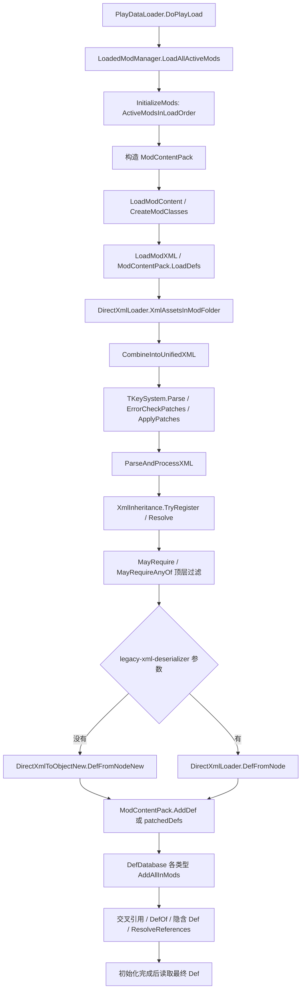

# 原版 DLC 发现、遍历与解析链路

本页根据本机程序集的 Mono.Cecil 元数据/IL，以及 ilspycmd 8.2.0.7535 反编译结果整理。反编译用于阅读，签名与调用顺序以 `snapshot/runtime-api-and-il.json` 为准。这里描述的是代码路径，尚未运行游戏验证。

## 1. 发现与激活是两个过程

`ModLister.RebuildModList()` 发现 Data 下官方目录、Mods 下本地 Mod、Steam 订阅项，构造 ModMetaData，并执行缺失项清理与已安装扩展缓存更新。具体 Steam 授权/下载环境不在离线扫描结果中推断。

`ModMetaData.Init()` 读取 About 元数据；`ModMetaData.PackageId` 是身份标识，显示名不可作为统一身份。`ModMetaData.Official` 判断 Core 或内容来源；运行时 `ModContentPack.IsOfficialMod` 从已保存的 official 字段读取。官方身份不要仅凭目录名或 `ludeon.*` 前缀猜测。

`ModsConfig` 从 ModsConfig.xml 读取 activeMods；`RecacheActiveMods()` 构建 HashSet，更新 Royalty/Ideology/Biotech/Anomaly/Odyssey 的缓存布尔值，并使加载顺序缓存失效。`IsActive(string)` 将参数转小写后查集合，**不会替调用方验证目录存在或 Def 加载完成**。

| 状态来源 | 入口 | 含义 |
|---|---|---|
| 磁盘扫描 | Data/*/About/About.xml | 本次可以读取文件，不能证明运行时可用 |
| 游戏安装目录 | ModLister.AllInstalledMods、各 DLC Installed 属性 | 游戏发现的已安装内容 |
| 游戏配置 | ModsConfig.ActiveModsInLoadOrder、IsActive、各 DLC Active 属性 | 选中的内容与次序 |
| 运行时加载集合 | LoadedModManager.RunningModsListForReading | 已构造的内容包；仍应等待 Def 初始化完成 |
| 扩展展示状态 | ExpansionDef.Status | Active / Installed / NotInstalled；不是 Def 初始化状态 |

`ExpansionDef.Status` 先查 `ModsConfig.IsActive(linkedMod)`，再查 `ModLister.AllInstalledMods`，否则 NotInstalled。扩展描述定义来自 Core 的 `Defs/Misc/ExpansionDefs/ExpansionDefs.xml`，不是每个 DLC 自己的独立代码程序集。

## 2. 内容与 XML 加载顺序

图把一个函数内的阶段展开，不能当作任意相邻节点均有直接 IL call。`snapshot/runtime-api-and-il.json` 的 calls 数组给出实际直接调用、委托引用和构造引用。

`LoadAllActiveMods()` 在开始/结束清理 XML 继承缓存；先加载内容与 Mod 类，再合并 XML、应用补丁、解析定义。`ParseAndProcessXML()` **先注册并解析继承，再遍历节点做顶层 MayRequire 过滤并实例化**。不要实现成“逐文件反序列化后再补丁”。

`PlayDataLoader.DoPlayLoad()` 随后把各包 Def 加入全局数据库，执行交叉引用、DefOf 绑定、语言注入、隐含 Def 生成和分类型 ResolveReferences 等阶段，末尾还有延迟初始化。未来接口应由已有生命周期调度，在数据就绪后建立快照；不要在 Mod 构造器中假定 DefDatabase 完整。

## 3. 文件遍历不能忽略加载目录

`ModContentPack.InitLoadFolders()` 解析版本目录/LoadFolders 设置。`ModLoadFolders.LoadDataFromXmlCustom()` 支持版本节点（可去掉 v 前缀）与 default；目录项条件是 `IfModActive`、`IfModActiveAll`、`IfModNotActive`。`LoadFolder.ShouldLoad` 组合“任意满足”“全部满足”“没有命中禁止项”。

`GetAllFilesForMod()` 按加载目录优先序遍历子目录，同一相对路径首次命中胜出；`GetAllFilesForModPreserveOrder()` 反向遍历目录、按文件名排序，再从末尾去重。不要仅用全盘 rglob 的顺序模拟最终覆盖。缺少 LoadFolders 时还有版本文件夹和 Common/根目录选择逻辑，完整分支可用 `decompile-local.ps1` 查看。

本工具的 XML 索引只扫描本次官方包的 `Defs`、`Patches` 以及存在时的 `LoadFolders.xml`，并明确保留 raw 标记；**没有实现版本目录选择、文件覆盖或游戏加载器**。未来通用 Mod 支持应另外接入原版选中的目录，不复用 raw 索引冒充最终数据。

## 4. 条件、继承与反序列化

| 机制 | 已核对入口 | 用途 |
|---|---|---|
| MayRequire | ParseAndProcessXML、DirectXmlToObjectNew.ValidateMayRequires、旧解析器 | 逗号分隔需求全部满足才处理相应节点 |
| MayRequireAnyOf | 同上 | 需求中任意一个满足才处理 |
| Name / ParentName | XmlInheritance.TryRegister、Resolve、GetResolvedNodeFor | 命名模板与父子合并，不等同 defName |
| Abstract="true" | 新/旧 DefFromNode | 不实例化为 Def，仍可能是继承模板 |
| Class | 新/旧 DefFromNode、ResolveTypeForNode | 选择实际类型，需要存在且满足原版类型约束 |
| Def 引用 | DirectXmlCrossRefLoader.Register*WantsCrossRef、ResolveAllWantedCrossReferences | 先登记名字，再在数据库阶段解析 |
| Mod 条件补丁 | PatchOperationFindMod.ApplyWorker | 此原版类按 **Mod 显示名** 查找；不是 packageId |

顶层和字段/列表项都可能有 MayRequire；仅检查顶层不充分。新解析器通过 DynamicMethod/IL Emit 生成并缓存按类型解析委托，字段解析、列表解析、对象构造、PostLoad 以及交叉引用登记涉及生成的代码。Cecil 静态 call 索引会显示 Emit/GetMethod，不会完整展开生成后的执行边。

不要发明 `MayRequireAllOf` 或把 `IfModActiveAll` 直接用在普通 Def 节点上；本次核对到的是不同加载层的不同属性。

## 5. 最终 Def 与来源

`ModContentPack.AddDef()` 设置 `def.modContentPack`。`DefDatabase<T>.AddAllInMods()` 按 OverwritePriority 和加载次序装入，处理同包重复项与跨包同名替换，另加入 PatchedDefsForReading。原始 XML 的多个节点不保证各自留下一个运行时对象。

读取最终能力时用 `DefDatabase<T>.AllDefsListForReading` / `GetNamedSilentFail()`；身份使用**类型 + defName**，保留大小写，不以翻译后的 label 匹配。本次原始索引就发现了 `BackStoryDef` 与 `BackstoryDef` 两种标签，不能把字典键不加区别地折叠。

`def.modContentPack` 可以说明当前对象登记的内容来源，但不能证明它没有被其他 Mod 补丁修改，也不是“所有修改贡献者”的列表。筛选“DLC OriginOnly”与查询“最终有效能力”是不同需求；不明确记录修改历史时返回 Unknown/Unsupported，不凭空补齐。

数据注入、缓存清空、热重载和静态初始化是另一个边界。本次接口建议只读取初始化完成的对象，不调用加载器、SetActive、Add/Remove 或补丁执行函数。
