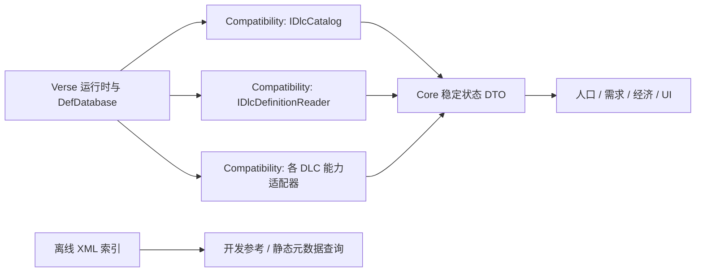

# 未来接口方案（尚未实现）

建议预留三个小接口，使用同一份初始化完成后的会话快照。不要把 DLC XML 解析、业务适配与游戏配置修改合成一个服务。

## 1. IDlcCatalog：发现与状态

返回 packageId、名称、官方身份、Core 标记、安装/启用/加载三种独立状态、加载顺序和 SnapshotId。状态使用 Yes/No/Unknown，不能用缺省 false 代替无法读取。默认查询 DLC 可以排除 Core，但显式保留 Core 行，避免错误地把本体当 DLC。

packageId 转小写、去调用方输入首尾空白；Steam 后缀处理委托给原版身份查询的能力，不使用任意字符串替换。以实际元数据 Official 和 Core 标记筛选；未来新官方包可增加目录行，无需更改枚举。

启动时数据未就绪：返回 NotReady。游戏初始化完成且主线程上：读取 RunningMods 和配置状态，复制到自有 DTO。重新载入/配置变化：建立新 SnapshotId，使依赖缓存失效。只读查询不调用 SetActive/LoadAllActiveMods，UI 显示状态不创建任何业务账户。

## 2. IDlcDefinitionReader：查询最终定义

查询输入包括 DefTypeKey、可选 OriginPackageId、offset/limit 和 ExpectedSnapshotId；返回 QueryStatus、定义数组、Total、HasMore、SnapshotId 及原因。

DefTypeKey 由受控类型注册表映射到已核实的 Def 子类，禁止调用者传任意类型后反射执行。身份是 DefTypeKey + defName；不对 defName 或类型名转小写。稳定 DTO 只包含需要的字段（名称、来源包、标签、业务 capability key），不暴露 Verse.Def、Pawn 或可修改集合。

OriginPackageId 筛选当前运行时对象登记的来源，不声称筛掉全部第三方影响。ModificationTrace 未建立时为 Unsupported；补丁来源不能从 def.modContentPack 自动推导。

离线 raw 索引单独命名和存放，其结果不填 RuntimeLoaded=Yes，也不混入运行时查询。分页、最大返回条数与输入校验由实现保证；同快照中排序使用 Ordinal 的类型名与 defName，避免文化环境改变次序。

## 3. IDlcCapabilityRegistry：业务读取适配器的目录

这里只列出已注册的 capability key、所属 packageId、版本与状态，不返回通用执行 delegate。读取基因/需求/理念等具体能力继续使用各自窄协议，避免万能对象字典扩散 DLC 类型。

例如：`biotech.child-needs.v1`、`ideology.pawn-beliefs.v1`、`anomaly.population-classification.v1`。Royalty/Odyssey 在有实现与验证之前记 Unsupported；安装或启用不等于具备本 Mod 的适配能力。

## 状态契约

| 情况 | 建议结果 |
|---|---|
| 启动尚未完成 | NotReady，原因 Loading |
| 不认识的 capability/type key | Unsupported，原因 AdapterMissing/TypeNotRegistered |
| 指定 DLC 未安装 | NotInstalled |
| 已安装但未启用 | Inactive |
| 查询成功且没有匹配定义 | Ready + 空数组 + Total=0 |
| 扫描不完整、跟踪数据缺失 | Unknown/具体状态原因，不构造假数据 |
| 输入错误/快照不一致 | InvalidQuery / StaleSnapshot |
| 读取异常 | Error + 有界诊断；不把异常吞成“无 DLC” |

## 建议实现顺序与验收

1. 先落地 IDlcCatalog 的只读快照，验证未安装、未启用、启用、加载中状态以及 Core 排除规则。
2. 增加有限 Def 类型注册表与分页查询；验证抽象节点不当作运行时 Def、继承值来自最终对象、缺失引用有明确结果。
3. 接入现有 Ideology/Biotech/Anomaly 适配器；业务输出和原先调用保持一致；按需求再增加 Royalty/Odyssey。
4. 用同名覆盖、第三方补丁、快照失效和未适配 Need 类型测试错误边界，然后在游戏中验证相关场景。

接口草案见 `examples/DlcContracts.cs.txt`。它不引用 Verse，不注册 Harmony，不更改任何配置；只是后续实现的设计起点。业务生命周期、适配器线程调度、类型映射和具体实现留待后续任务。
