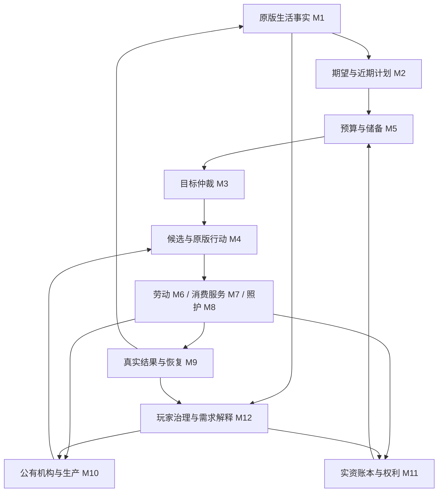

# Pawn 经济需求驱动 AI：全部十二模块方案合订本

整套设计 v1.0 · 2026-10-08。包含跨模块总册及 M1–M12 全文。此文件由分模块方案合并生成；更新请编辑各源文件后重新导出。

这是代码设计交付，尚未实现完整模型。原版接口证据、文档校验和假设演算不等于运行编译、经济仿真、性能或游戏验收。前端硬依赖 RUIF，机构公有，新增货币须有真实银币缴存。

<!-- source: 00-总纲与共享/02-代码设计总册/00-全部模块方案_总册.md -->
<a id="overall"></a>
## Pawn 经济需求驱动 AI：全部模块代码设计总册

2026-10-08，整套方案 v1.0。交付阶段：完整模块代码设计，包含已有 M1/M2 和本轮补齐的 M3–M12；不是完整运行实现或发布包。类型、方法、枚举、Def 和参数名称若未明确标为现有，均为拟议契约。本文是跨模块协调规则的当前入口；单模块修订不得违反本册不变量。

连续阅读全文：[十二模块合订本](00-全部模块方案_合订本.md)。开发时以各模块源文件为准；合订本由校验/导出工具重建。

### 1. 制度与玩法边界

1. 前端硬依赖 RUIF；Verse.Window 只作宿主，业务组件使用 RUIF，不另写同类通用控件。
2. 扩展原版 ThinkTree、Job、Need 和可观察结果，保留征召、玩家强制、精神状态、危险、工作许可、时间安排、区域和原版紧急处理权。一个 Pawn 同时只有一个经济前台意图。
3. 机构全部公有，由玩家治理预算、岗位、生产、报价、时段和保障；个人自主求职、履约、消费、储蓄与依法照护，不要求玩家逐人强制。
4. 自然野果、树木、野兽等未开发资源按原版合法规则免费参与候选；公有加工原料不是人人可取，加工成品与登记服务按明确报价/保障政策使用。
5. 只有真实银币缴存产生对应的新账本余额。外贸说明实际资金来源；内部拨款、工资、消费和退款是已有资金转移，不增加货币总量。
6. 医疗/托育/居住逐类通过原版访问、交付和结算原型后才收费。未适配能力继续原版公共机制，不因总开关开启就全部收费。
7. 不加入私营机构、无限福利、强制劳动、自动外贸、银行贷款、税制、保险或完整遗产法。缺岗位、供给、人员或资金时允许生活与经济受阻，并明确解释。

### 2. 十二模块与阅读顺序

| 编号 | 独立方案 | 职责与主要交付 |
|---|---|---|
| M1 | [状态与需求感知](#module-01) | 原版事实、覆盖/年龄/未知、当前缺口；修订 1.1 |
| M2 | [长期生活规划](#module-02) | 八维风格、期望与近期计划、时间窗口及有限储备政策 |
| M3 | [目标与多需求仲裁](#module-03) | 唯一目标池、前置 DAG、P0–P3、滞回及单一选择 |
| M4 | [方案比较与行动调度](#module-04) | 有界候选、合法性/时效比较、行动票据及原版执行 |
| M5 | [生活预算与储蓄](#module-05) | 同窗量价转换、覆盖去重、软预算、储备水位与有限筹资 |
| M6 | [就业与劳动合同](#module-06) | 有效岗位、资格、工资承诺、实际劳动、应付与退出 |
| M7 | [消费与服务](#module-07) | 报价、订单、产品/服务交付、使用效果、退款与分期结算 |
| M8 | [家庭与照护协作](#module-08) | 受益需求、监护/执行/付款分离、跨人时间与容量分配 |
| M9 | [经验反馈与失败恢复](#module-09) | 有界学习、失效分类、退避、生命周期恢复及解释 |
| M10 | [再生产与公有机构运行](#module-10) | 机构工具、生产/补货、岗位和服务容量、有限收缩 |
| M11 | [资金资源权利与制度协调](#module-11) | 真实储备、账本、权属/资源占用、事务、启停和迁移 |
| M12 | [需求可视化与治理反馈](#module-12) | RUIF 同口径总览/追溯、治理命令、政策情景和生活结果 |

模块数不是调度循环数：仍为**一个总体控制循环、四个个人业务循环**（即时满足、储蓄、劳动、消费服务）。家庭、机构与治理提供目标/约束及外围反馈，不另抢 Pawn 执行权。

### 3. 总闭环与分阶段调用



单次主线程协调按阶段运行，不在模块之间递归直到收敛：

1. 应用已批准的设置/政策命令与失效通知；M11 恢复/结算已确认事实，M9 协调过期清理。
2. M1 更新原始事实；M8 只在已有授权下协调责任，未确认的关系不生成付款义务。
3. M2 用原始事实产生目标；M4 的只读供给查询为 M5 提供合法方案量/报价；M5 生成预算估计；M2 最多接收一次兼容反馈。
4. M3 更新目标和风险，M4 对有限候选比较；未知输入保留等待，不形成虚假成交。
5. 进入跨 Pawn 的提交申请队列；M11 对资金/物资/容量作有界、去重、主线程的整体准备，产生短期行动票据。
6. 原版 ThinkTree 在允许的时点读取票据，JobDriver 成功取得原版预约和行动租约后执行。M6/M7/M8 不另行 StartJob 抢控制。
7. 实际完成/移交/使用产生类型化证据；M11 唯一入账，M6/M7 更新业务状态，M9 更新经验，M1 重新观察 Need/健康。
8. M10 在真实订单、库存和玩家生产授权下更新供给与岗位；M12 发布同一批次的解释。UI 关闭不影响上述步骤。

首轮预算未知时也能显示目标；原版紧急处理不等待计划、预算、事务队列或 UI。

### 4. 共同契约与唯一写入者

| 契约/状态 | 唯一负责者 | 跨模块约束 |
|---|---|---|
| PawnFactSnapshot/Fact<T> | M1 | Unknown=0，原版事实只读，按组年龄/范围查询 |
| LifeStyleState/NeedTargetProfile | M2 | 来源/版本明确；期望、执行档和实际状态分开 |
| GoalRecord/GoalGraph | M3 | 其他模块提交 Proposal，不直接改目标生命周期 |
| ActionTicket/ActionLease | M4 | 每 Pawn 至多一个执行租约；票据不等于已执行 |
| LifeBudget/ReserveAssessment | M5 | 软预算不扣钱、不独立发行余额；金额引用 M11 |
| WorkContract/WorkEvidence | M6 | 合同决定工资条款，M11 决定资金预留和付款 |
| Order/ServiceEvidence | M7 | 订单决定交付条款，使用结果与财务状态分开 |
| CareResponsibility/CareAssignment | M8 | 真实关系不是自动监护/扣款授权 |
| ExperienceSummary/RetryState | M9 | 不写钱/健康，不重新结算业务事实 |
| SupplyPlan/InstitutionPolicy | M10 | 经济计划不与既有车间工单运行器竞争写入 |
| Ledger/Claims/ResourceRegistration/Mode | M11 | 唯一账本、资源权利、硬占用和制度阶段写入者 |
| DashboardSnapshot/PolicyDraft | M12 | 查询只读；草稿不改变世界；命令交责任模块复核 |

所有 DTO 出游戏适配边界后只包含稳定 ID、标量、枚举、已冻结集合，不保存可写 Pawn/Thing/Need 引用。运行与持久化宿主复用现有经济 GameComponent，不为每模块新建一份经济状态。

知识/业务状态枚举默认零值必须安全地表示 Unknown/未准备，不能默认 Known、成交或执行中；制度默认 Off 可以显式作为安全零值。接口草图省略实现和辅助类型，不可直接当作已编译 API；未来新增持久枚举采用稳定显式编号及迁移，不重排旧存档值。

#### 标识、版本与单位

- `RequirementKey = beneficiaryId + canonicalNeedOrCondition + component`，不包含 Tick、付款人、余额或目标修订。
- `RequirementSliceKey = RequirementKey + [windowStart, windowEnd) + unit/benefitType` 表示同一规划窗内的覆盖分量；连续需要与一次事件须有各自稳定事件实例键。切换滚动窗口时按区间交叠裁剪，不能全当新需要。
- GoalId 表示目标生命周期，OrderId/ContractId 表示承诺，EvidenceId 表示一次真实结果；不可互相替代。DedupeKey 至少包含来源实例、执行阶段和完成序号，不只用 JobID。
- SessionEpoch 解决读档/切档缓存混用；SourceVersionSet 记录各源版本，不要求不同 Pawn 的版本数字相等。PublicationBatchId 只表示一次读模型发布，不证明同 Tick 原子真值。
- 钱为 long 整数最小单位，显示 1 银币=100 最小单位；交易运算 checked，比例用基点。营养、Tick、次数、件数等各有 UnitId，跨单位禁止相加。
- `CommandEnvelope` 至少含 CommandId、SessionEpoch、SubjectId、ExpectedRevisions、IssuedTick、ValidUntilTick、Payload；过期/重复分别返回明确状态，不能重复扣款。
- `EvidenceEnvelope` 至少含 EvidenceId、SourceInstanceId、Phase、Sequence、Actor/Beneficiary/Payer、发生 Tick、Quantity/Unit、物资谱系及引用。观察到 Job 结束不自动构成完整证据。

### 5. 跨 Pawn 稀缺资源与提交规则

同一笔钱、同一件物品、床位/医生/孩子/工人时段只有一个硬占用写入者 M11。逻辑占用与原版 ReservationManager 不相互替代。

跨 Pawn 准备申请在一个有界批次内按已验证保护等级、可产生帮助的时效、有限等待和稳定申请 ID 排序；经济金额/出价不是生存公平性的排序键。普通等待不能伪装成 P0。批次外新出现的原版紧急事件立即使不合法经济票据失效，不等下一批。

M11 按稳定资源键顺序检查并整体准备 ClaimBundle；失败不留下部分硬占用，不阻塞式等锁。准备票据有 TTL，原型上限 150 Tick，具体值需剖析；普通候选阶段无预留。原版接受 Job 前后再次检查控制权，TryMakePreToilReservations 失败则整体释放票据并退避。原版暂不选择经济 Job 时票据到期释放，不下发等待 Job 长占 Pawn。

已执行服务的资源租约仅在合法进度/实际当班下续期，续期不可跨过合同/服务上限；不能把整场医疗当长时间不可中断原子提交。程序重入保护与事务状态同步，避免事件回调再次提交同一票据。

### 6. 保存、恢复与失败

持久保存：稳定风格、活跃目标/责任、合同/订单/权益、账本/凭据/资源登记、有限重试/学习状态、制度迁移阶段。原版 Pawn/Thing 由原版或唯一 ThingOwner 保存，其余引用；事实快照、派生预算、候选、寻路和 UI 缓存重建。

保存允许出现在行走/服务阶段；跨界的实物和资金转移用短同步提交及持久阶段凭据。加载后按实际持有者、履约证据和事务阶段恢复，不能“所有 Prepared 一律重做”或“所有未完成一律退款”。不确定且无法自动对账的记录进入 ReconciliationRequired，隔离其相关资源/新增承诺并向玩家解释，不悄悄发币、删物或记患者债。

所有模块采用 Unknown/NotApplicable/Unsupported/Error 和明确原因；未知不等于零，受阻不等于已满足，已付费不等于已使用，工资应付不等于到账。

### 7. 原版接入与自研范围

当前代码已有五类机构、账本、衣物交付、岗位体检和有限生产工资作为参考；现有 `BasicPawn/SafeDecision`、固定 GetPriority、首次赠币、JobID 去重和手动 StockItem 不能整套沿用。新增正式入口应通过能力路由替换旧决策路径，避免两套 AI 同时申请/收费。

本册 M10 对 v0.7 的补货式增加“已授权未开工量”并明确出口总量口径，避免订单还未开工时每轮重复追加。M5 明确软预算/硬预留与储备目标的对称去重；较早设计中的笼统统计键在本册拆为需要身份与规划切片，以本册及对应模块细则为准。

ThinkNode_JobGiver、JobDriver、预约、Bill/GenRecipe、ThingOwner、TradeDeal 等提供执行/物理基础；现代账户、产权、合同、效用、储备与家庭授权均是本 Mod 自研。原版字段/方法存在不证明某条完成证据、堆叠谱系或交易到账挂点已验证。

公开依据限于扩展和保存机制：[Harmony Prefix](https://harmony.pardeike.net/v2/articles/patching-prefix.html)、[Harmony Postfix](https://harmony.pardeike.net/v2/articles/patching-postfix.html)、作者维护的 [Saving For Dummies](https://spdskatr.github.io/RWModdingResources/saving-guide)。各模块具体 API 以当前游戏 DLL 与本地源码核验为准；[全模块接口证据](../04-实装指导手册/evidence/全模块_接口证据.json)记录本轮补核。候选挂点必须原型验证，不虚构通用“劳动完成/治疗成功/净外贸收入”事件。

### 8. 实装顺序与整体准入

1. M1 + M12 只读范围：看见真实需要、年龄和未知；M2 只读目标。
2. M11 实资/权益/迁移基础 + M5/M3/M4 纯契约及影子决策：只记录将选择什么，不扣款/派工。
3. M10 有效生产/物流 + M6 + M7 食品衣物：贯通首次工资、提前补储、真实产品交付与使用。
4. M8 照护协调 + M7 床位/诊疗/托育逐类接入；未完成部分保留原版公共机制。
5. M9 有界学习/恢复和 M12 政策反馈按基础数据逐步启用。基础失败清理、幂等与生命周期从第一阶段就必须存在，不拖到最后。

整体验收至少覆盖：零现金、同时饥饿疲劳、孩子与成人竞争时间、无岗位、有货无钱、有钱无货、停贸欠薪、供给瘫痪、多人抢末件食品、存档中断、重复完成通知、堆叠/腐败/损毁、玩家强制/征召、经济启停、旧档迁移、未适配 DLC 和 RUIF 多分辨率。

设计全覆盖表示所有十二模块均有职责、数据、流程、接入与验收方案，不表示每项参数已平衡或游戏经济永远稳定。[完整设计校验](../04-实装指导手册/evidence/全模块_设计校验.json)只记录文档、接口与独立示例演算，运行编译、性能、原版时序及存档验收仍是实装阶段门槛。

---

<!-- source: M01-状态与需求感知/01-状态与需求感知_代码设计方案.md -->
<a id="module-01"></a>
## 模块一：状态与需求感知——代码设计方案

2026-10-08，修订 1.1。阶段：代码设计，尚未接入运行代码；文中新增类型、方法、目录和参数均为拟议契约。制度范围沿用 [v0.7](../01-方案主线/公有机构与外贸循环_优化方案_v0.7.md)，需求与玩家解释沿用 [v0.8](../01-方案主线/经济学优化与需求可视化_方案_v0.8.md)，模块划分见 [v0.9](../01-方案主线/当前方案复评与AI模块摘要_v0.9.md)。

本次落实[方案评审](../../M01-状态与需求感知/01-状态与需求感知_方案评审.md)的七项设计修正。后续生活目标契约见[模块二：长期生活规划](#module-02)。修正完成指文档契约已明确，不代表实现或游戏验收完成。

**模块目的：让 AI 和玩家得到同一份可追溯的生活事实，说明“谁现在处于什么状态、哪里存在缺口、哪些数据暂不可知”。** 模块一不决定去工作、买东西或分配医生；它为后续规划、仲裁和 RUIF 需求面板提供输入。

### 1. 职责边界

| 本模块负责 | 后续模块负责 |
|---|---|
| 读取原版 Need、健康、衣着、位置、关系及控制状态 | 生活标准、长期风格、风险预测与预算分配 |
| 用明确传入的目标配置计算当前连续需求缺口 | 生成持久生活目标、P0–P3 仲裁和行为选择 |
| 记录已有事件条件，例如已订婚、可见怀孕、孩子的需求 | 决定婚礼准备、监护分担、服务预约或求职 |
| 输出观察状态、来源、时间、版本与缺失原因 | 订单、工资、账户写入、产权交易与真实执行 |
| 发布事实变化及只读快照 | 供给搜索、完整寻路、岗位/价格比较与政策推荐 |

依赖方向：`原版对象 → Capture/Compatibility 适配 → Application 采集协调 → Domain 事实/缺口投影 → Application 读模型 → RUIF`。

Domain 的事实 DTO 和缺口计算器不引用 Verse、RimWorld、Unity 或 RUIF。游戏适配器在主线程读取对象，出边界后只传 ID、数值、枚举和只读集合；UI 不持有可写 Pawn、Need、Hediff 或账户对象。

### 2. 观察对象与行动资格分开

首批观察当前地图中玩家殖民者的生活事实，包含成人、儿童、婴儿，以及倒地、被征召、精神状态中或暂时失能的人。是否能工作、消费或照护，交给后续控制权/能力检查。

| 对象状态 | 感知处理 |
|---|---|
| 正常殖民者 | 正常读取存在且支持的事实 |
| 婴儿/儿童 | 正常读取本人的 Food/Rest/Play/Learning 等；不是缩小版劳动者 |
| 倒地、征召、精神状态 | 保留需求并记录限制事实，不从统计里删除 |
| 被抱起/在地图内容器中 | 身份仍属于该地图观察范围；可读部分继续，位置/环境另标来源和可用性 |
| 离图/商队/世界对象 | 首批不作完整跨图采集；发布离图标记，旧数据显示过期而非当作已满足 |
| 死亡 | 发布终止事实，停止活体需求采样；不删除其历史权益 |
| 囚犯、奴隶、访客、动物、机械体 | 当前不自动纳入完整个人经济；保留可扩展范围策略，不因出现于地图就授予制度资格 |

不得复用现有 `BasicPawn` 或 `SafeDecision` 作为观察过滤器：当前代码会排除孩子、倒地者、征召者，并以 Food/Rest 门槛限制行为；这些条件不能决定谁的需要值得被看见。

人口来源优先使用地图现有 Pawn 索引并增量维护。`FreeColonistsSpawned` 只覆盖 spawned；需要低频协调 `FreeColonists/AllPawns` 才覆盖抱持/容器对象。后两者可能递归扫描和复用内部临时列表，必须在主线程即时复制所需 ID，不能保留游戏返回 List 或每个 Pawn 每次采样都调用一次。

### 3. 四组输入事实

| 事实组 | 首批字段 | 边界 |
|---|---|---|
| 身份与控制 | pawnId、地图/位置状态、发展阶段、存活、倒地、征召、精神状态、当前 Job/是否玩家强制、当前时间安排 | 是当前观察，不等于最终行动许可；提交动作时仍需重查 |
| 原版连续需求 | NeedDef、实际值、最大值、比例、原版类别、可用性 | 只读；不新增经济 Need，不额外衰减原版数值 |
| 身体与生活条件 | 可见健康事实、实际穿戴及耐久、当前环境温度、原版舒适温区、已分配/当前床位 | 不由衣物价格推断保暖，不把已分配床位等同可达可用服务 |
| 关系与事件 | 真实关系边、已有婚约、可见怀孕/生育准备事实、孩子身份与发展阶段 | 不因单身建缺口，不强制育儿归某一性别，不暴露隐藏病症 |

账户、现有合同、公共覆盖、监护授权属于其他业务的真值。模块一可以关联其只读版本/引用，不能计算一份独立钱包或建立监护责任。当前 `EconomyService.Account/Person` 在记录不存在时会创建记录，**不能拿来作感知只读查询**；后续应提供 `TryReadAccount/TryReadPerson` 类查询门面，无记录返回 Unknown/NotEnrolled。

### 4. 数据契约

以下是接口形状，省略构造器和实现体，不能整段直接当作可编译类文件。

```csharp
// 拟议：PersonalChronicle.Domain.PawnEconomy.Perception
enum FactState { Unknown = 0, Known = 1, NotApplicable = 2, Unsupported = 3, Error = 4 }
enum SubjectLocation { Unknown = 0, SpawnedMap = 1, HeldOnMap = 2, OffMap = 3, Dead = 4 }
enum TargetState { Unknown = 0, Enabled = 1, Disabled = 2, NotApplicable = 3 }

readonly struct Fact<T>
{
    public FactState State { get; }
    public string ReasonCode { get; } // 默认结构安全回退为 Uninitialized
    public bool TryGetValue(out T value); // 非 Known 不允许当有效值使用
    // 私有构造；Known/Unknown 等工厂；数值合法性另由数值工厂/投影校验
}

sealed class PawnFactSnapshot
{
    public string PawnId { get; }
    public long SessionEpoch { get; }
    public long ObservationRevision { get; }
    public int CapturedTick { get; }
    public PawnContextFact Context { get; }
    public IReadOnlyList<NumericNeedFact> Needs { get; }
    public NeedCoverage Coverage { get; }
    public Fact<float> MoodRatio { get; } // 只读结果事实；不转购买目标
    public HealthFactSet Health { get; }
    public ApparelFactSet Apparel { get; }
    public EnvironmentFactSet Environment { get; }
    public RelationshipFactSet Relationships { get; }
    public CaptureCompleteness Completeness { get; }
}

sealed class NumericNeedFact
{
    public string NeedDefName { get; }
    public string AdapterId { get; }
    public Fact<float> CurrentLevel { get; }
    public Fact<float> MaximumLevel { get; }
    public Fact<float> Ratio { get; }
    public Fact<float> CurrentConditionRatio { get; } // 已适配 Seeker 才支持，独立来源/采样年龄
    public Fact<string> VanillaCategory { get; }
    public Fact<bool> IsFrozen { get; }
}

sealed class CurrentNeedGap
{
    public string RequirementKey { get; }
    public string BeneficiaryId { get; }
    public string DomainId { get; }
    public TargetState TargetState { get; }
    public Fact<float> TargetRatio { get; }
    public Fact<float> RelativeTargetGap { get; }
    public Fact<float> AbsoluteRatioGap { get; }
    public Fact<float> RawLevelShortfall { get; }
    public string RawUnitId { get; } // Food 为营养值；其余按适配器声明的 NeedLevel，不冒充实物量
    public long FactRevision { get; }
    public long TargetRevision { get; }
    public IReadOnlyList<string> EvidenceKeys { get; }
}
```

`FactState` 描述知识状态；新鲜度、范围和采集完整度分别记录，不能把 Known 自动理解为“仍能用于现在行动”。复合事实允许部分成功，例如 Food 数值已知、冻结状态未知、某个第三方类别读取失败，不能将整个人改成全未知。

`default(Fact<T>)` 必须为 Unknown，TryGetValue=false；已知零值只能显式创建为 Known(0)。默认空集合不等于已确认没有需求：集合的已采集/完整/不适用状态必须由对应分组元数据说明。工厂禁止 Known(null) 代表对象已知；数值 NaN/Infinity 不得成为有效投影输入。

| 结构 | 必须进一步包含的字段 |
|---|---|
| `PawnContextFact` | location、mapId/cell、developmentStage、dead/downed/drafted/mentalState、jobDefName/playerForced、timeAssignmentDefName；可缺项均使用 Fact |
| `HealthFactSet` | 可见 Hediff 的稳定标识/Def/部位/严重度/可治疗事实；倒地等原版标志；未知/截断说明 |
| `ApparelFactSet` | 实际 worn item ID、Def、耐久比例、已读取的原版防护数据及来源；不直接表示“应购买某件衣物” |
| `EnvironmentFactSet` | 当前温度、原版舒适温区、床位 ID/所属地图/当前使用事实；离图或容器环境不明时标 Unknown |
| `RelationshipFactSet` | 关系 Def、对方 pawnId、真实事件条件与可见性；关系边不等于照护/付款授权 |
| `CaptureCompleteness` | 分组 Known/Partial/Error、截断数量、原因、各组 CapturedTick/sourceRevision；不能将漏项当作不存在 |
| `NeedCoverage` | 实际存在、已支持、未支持、无法确认的 Need 标识；覆盖状态 Full/Partial/Unknown。Full 仅指当前实际 Need 集合已适配，不代表生活无风险或全部服务已实现 |

快照通过构造器一次建成，只读包装不能暴露原始可变数组/List；发布后禁止原地修改。显示姓名、中文标签由 UI 投影关联缓存，不作为主键，也不在核心采样里翻译。

`RequirementKey` 由受益人稳定 ID、需求/条件标识及必要的子项标识构成；同一孩子的 Food 缺口被多个照护目标引用时沿用同一键。Tick、目标比例、付款人、余额与照护者不得进入需要的身份键；统计时间窗与订单编号另行管理，避免一次刷新或换人付款就生成重复需求。

### 5. 十种 Need 与十二个生活域的映射

| 域 | 感知输入 | 模块一输出 |
|---|---|---|
| D01 营养 | Food 实际值/MaxLevel、HungerCategory | 当前满足比例、原版饥饿类别、可配置目标下的缺口；不换算每日餐数 |
| D02 睡眠 | Rest 实际值、RestCategory、Resting | 当前疲劳事实与缺口；不换算必需睡眠小时 |
| D03 衣着/温度 | 实际 apparel、耐久、温度及舒适温区 | 衣着与暴露条件；具体防护目标由生活策略提供 |
| D04 舒适 | Comfort | 当前值与配置目标缺口 |
| D05 娱乐 | Joy；已核验的原版活动/耐受摘要 | 当前值与配置目标缺口；活动搜索留给候选模块 |
| D06 美观 | Beauty、有限局部环境事实 | 当前美观体验；不直接下清洁/装饰订单 |
| D07 居住空间 | RoomSize、OwnedBed/当前床位、房间事实 | 当前空间与占用条件；不是住房产权或可用容量证明 |
| D08 室内外活动 | Outdoors、Indoors 中实际存在者 | 分项读取，不相加；不适用的 Need 不画为零 |
| D09 健康/生育准备 | 可见健康、原版可治疗事实、可见怀孕 | 具名状态条件；不制造“健康需求条”或保证恢复时限 |
| D10 关系/婚礼 | Lover/Fiance/Spouse 等真实关系 | 已有关系/事件条件；单身不自动生成婚姻不足 |
| D11 婴幼儿照护 | 孩子自己的 Food/Rest/Play、发展阶段、已有关系/责任引用 | 子目标指向孩子的唯一需要；不复制孩子饥饿给每个成人 |
| D12 儿童学习 | 实际 Learning、原版学习状态 | 当前学习事实；不保证成长结果 |

十种连续 Need：Food、Rest、Joy、Comfort、Beauty、RoomSize、Outdoors、Indoors、Play、Learning。Mood 作为只读结果事实输出实际比例及可用性，风险解释交给后续模块，不生成可购买的“心情需要”。其他 Need 保留 Unsupported 清单与显式部分覆盖提示；未经适配不自动驱动经济行动，不得将“已支持域无缺口”标成“该 Pawn 没有其他生活风险”。原版特殊需求的满足及紧急路径保持有效，经济行为的提交模块必须重新核验控制权。

Beauty、Comfort、RoomSize 的 `CurLevel` 是经历变化后的体验值，已验证的 Seeker 适配可以另读 `CurInstantLevel` 表示当前条件。两者分别显示、分别采样；瞬时条件不能替代真实体验。基类 CurInstantLevel 的占位语义不适用于所有 Need，未适配项输出 NotApplicable/Unsupported。进入合格环境后允许“当前条件已改善，体验恢复中”；是否重试改善由后续目标/反馈模块结合实际条件决定。RoomSize 瞬时检查含空间扫描，放入慢组或共享环境缓存。

NumericNeedFact 的瞬时条件另带 CurrentConditionCapturedTick/SourceRevision/Reason；即使快 Needs 组已更新，也不能把慢条件的采样时间刷新。读取该字段的查询年龄策略必须包含对应慢组，缺失字段时不以快组时间替代。

注册表以本机 NeedDef 为入口，初始化时核对 Def、适配类型和能力。采样对 `AllNeeds` 单次遍历，再映射已注册项；不要逐项反复遍历。原版泛型 `TryGetNeed<T>` 的本地实现按精确类型比较，第三方子类需显式兼容验证，不能假设泛型查找自然支持所有继承类型。

### 6. 当前缺口计算与关键限制

对支持标准比例语义的 Need，读取 `x = CurrentLevel / MaximumLevel`；目标 `t` 来自有修订号的 `NeedTargetProfile`，可由静态默认策略或模块二的生活计划提供。

`RelativeTargetGap = clamp01((t - x) / t)`；`AbsoluteRatioGap = max(0, t - x)`；`RawLevelShortfall = max(0, t × MaximumLevel - CurrentLevel)`。条件为目标 Enabled、实际值/最大值/目标均有限、MaximumLevel>0、0<t≤1，且适配器确认比例及原始量语义有效。

相对缺口表示距离目标的比例；绝对差和原始量用于同类需要的后续换算。三者都不是餐数、货币、死亡风险或跨域优先级，不能直接按最大 RelativeTargetGap 抢占行动。原始单位不明时只让该字段 Unsupported，不能阻止可靠的比例事实展示。

- 不能把 Food 的实际营养值直接当 0–1；其 MaxLevel 可随身体/原版属性变化。
- NaN、Infinity、最大值非正、异常数值范围分别标出原因，不进入排序和聚合。保留可靠原始值；不可靠数值不强行写 0。
- 轻微浮点偏差按明确 epsilon 处理；明显超范围的第三方 Need 保留原始诊断并标 UnsupportedNumericSemantics，需专用适配，而非悄悄钳制后驱动行为。
- 没有目标时仍显示实际值/原版类别，`gap=Unknown(TargetMissing)`；不得统一假定所有目标为 80%。例子 t=0.8、x=0.4→gap=0.5 只用于校验公式。
- Disabled 是主动关闭该可选改善目标，缺口字段为 NotApplicable(TargetDisabled)；Unknown 是未配置/未准备，NotApplicable 是该主体实际无该目标。禁用改善目标不禁用原版生存安全保障，也不把实际状态写成已满足。
- 目标变化使投影重算，但不伪装成原版需求实际变化；FactRevision 和 TargetRevision 分开。

状态/事件条件输出具名事实或布尔条件，不统一做一条百分比。是否需要新衣服、婚礼物资或托育，必须结合目标与合法条件由后续模块决定。

**冻结和变化率：** 当前 DLL 的 `Need.IsFrozen` 为 protected virtual；Food 等还有自己的 override。首批不直接调用该属性，按 Unknown 输出。可记录 Suspended、睡眠、Resting 等公开事实作为提示，但不能据此完整复制所有冻结逻辑。未来若确需准确冻结状态，单独设计能力检查和已验证访问器。

`FoodFallPerTick/RestFallPerTick` 即便可读，也不等于实际净变化：进食、睡眠、冻结和状态变化会影响结果。首批不以它们生成确定的死亡/风险倒计时，预测留给模块二；相邻快照之差也只能称观察变化，不能保证未来线性延续。

### 7. 采集流程和接口

拟议接口：

```csharp
// 游戏适配器实现；不得从后台线程或 OnGUI 调用 Capture。
interface IPawnFactCapture
{
    PawnFactSnapshot Capture(PawnCaptureRequest request);
}

// 纯函数投影，不读取游戏对象、不写目标。
interface ICurrentNeedProjector
{
    PawnNeedObservation Project(PawnFactSnapshot facts, NeedTargetProfile targets);
}

// UI 与后续模块只查询已发布数据。
interface IPawnPerceptionQuery
{
    FactQueryResult QueryFacts(PerceptionReadRequest request);
    ObservationQueryResult QueryObservation(PerceptionReadRequest request);
}
```

`PerceptionReadRequest` 包含 pawnId、SessionEpoch、mapScope、purpose(Display/Planning)、requiredGroups 和 maxAgeTicksByGroup。两个结果都返回明确的 Readiness（Unknown=0、Loading、Ready、Partial、Stale、OutOfScope、Error）、分组状态、年龄与原因，不用 bool 查询成功代替行动许可。M2 首先 QueryFacts 获取原始事实，输出目标后才由 Project 形成缺口，避免规划依赖自己尚未生成的缺口。

必需组齐备、来源有效、在范围内且满足该用途年龄要求才能 Ready；非必需组失败可为 Partial，调用者不得因此把必需字段视作可用。Display 可保留陈旧值并显式标注；Planning 默认不接受过期必需组，允许使用已知子集时必须携带限制。来源 Tick 晚于当前 Tick、会话不匹配或时间回退视为失效，不当作零年龄。

`PawnCaptureRequest` 包含 pawnId、SessionEpoch、所需分组和采样原因，由主线程目录解析为当前真实 Pawn；不要把旧 Pawn 引用长期塞进请求队列。请求中的版本只用来拒绝过期上下文，不能拿它覆盖新真值。

采集顺序：

1. 验证当前游戏已完成加载、会话、对象与范围；区分正在加载、离图、死亡和实际无该 Need。
2. 读取身份/控制事实，单次获取当前需求集合，按注册表采集数值和原版类别。
3. 按分组更新健康、衣物、环境、关系。单项适配异常只标该项 Error；记录限频诊断，不静默吞掉整个 Pawn。
4. 构建不可变 PawnFactSnapshot，关联同一来源分组版本；若分组未刷新，保留其原 CapturedTick，不能全部标成刚更新。
5. 对相同事实版本与目标版本作纯缺口投影，发布 PawnNeedObservation；通知有语义变化的订阅者。
6. Application 生成 RUIF 读模型；决策模块订阅变更/按预算重评。模块一不直接安排下一份 Job。

变更通知采用“数值显著变化、原版类别变化、可用性变化、控制/位置变化”分类。细小变化可以合并通知，但快照保留最新真实采样；旧 UI 值与旧预测必须显示其年龄。

### 8. 更新机制、时序和缓存

采用主线程“事件标脏 + 分散周期采样 + 按需一致性复核”。以下是可配置原型起点，不是原版阈值或性能保证：

| 分组 | 更新来源 | 周期/预算起点 |
|---|---|---|
| 存活/倒地/控制与高风险变化 | 已有伤害/死亡/生命周期信号，只标脏 | 主线程下次协调；执行许可由提交点重新读取，不等待面板 |
| Food/Rest 等快速事实 | 轮转采样；可选原版 Needs 更新后的观察通知 | 每 Pawn 目标 150 游戏 Tick，按稳定 ID 分散 |
| 健康/穿戴/环境 | 事件标脏 + 兜底 | 初始目标 250 Tick，复杂局部信息可延后 |
| 关系/事件/地图内抱持人口 | 事件 + 低频人口协调 | 初始目标 600 Tick，每地图共享一次目录扫描 |

每 Tick 初始最多处理 8 个常规 Pawn 请求仅是原型批量起点，不能限制单个 getter 的成本。按 Pawn+分组合并待处理状态，事件与周期进入同一脏队列；快组、慢组、人口扫描与紧急队列分别有工作量/耗时软预算，在不可分割工作单元之间检查，不能承诺中断第三方长 getter。常规队列保留最低服务额度，紧急项去重且有界，原版紧急保护不等待观察队列。

记录各组耗时、分配、积压、最旧年龄及超预算次数；预算不足时显示退化状态，按有界等待调整顺序并降低慢组频率。未变化的不可变慢组允许结构共享，旧发布版本有界释放，避免每次复制全部关系/穿戴集合。具体预算通过目标人数剖析调整，本设计不预设零分配或固定毫秒性能保证。

150 Tick 取自当前原版需求更新节奏的参考，不保证同相位或所有第三方需求节奏一致。GameComponentTick 与 Pawn Need 更新先后需原型核验；不依赖“同一 Tick 一定先更新 Need”假设。若加 NeedsTracker 的 Postfix，仅标志对应主体需要刷新，不跳过原方法、不全图采集，且核验其方法可能被更频繁调用。

同一主体的分组可以在不同 Tick 采样；快照不声称全局原子瞬间。后续模块按 requiredGroups/maxAgeTicksByGroup 读取，原子行动提交仍重查真值。跨 Pawn 发布记录 PublicationBatchId、人口/责任关系修订和每个主体的事实版本及年龄，允许满足年龄政策的异步样本，不要求不同 Pawn 的修订数字相等，也不以同 Tick 证明原子一致。

按 RequirementKey 去重；人口或责任关系在聚合期间变化时有界重试，无法完成则标 Updating/Partial 并说明缺项，不能无限等待所有主体同相位。部分结果不得被当成完整家庭需求总量，列表和详情共享一次页面发布批次。

缓存键至少包括 SessionEpoch、pawnId、factRevision、targetRevision、registryRevision。CapturedTick 不能作唯一业务 ID；观测新鲜度用当前 Tick 与采样 Tick 的安全差值。读档/新游戏/时间回退使会话过期并重建，不复用上一存档中同名 Pawn 的数据。

### 9. 生命周期和保存

- 模块一的原版事实、当前缺口和地图索引是可重建缓存，首批不再 Scribe_Deep 保存一份 Need/Pawn/Hediff。
- 稳定策略配置、适配器版本或未来的有界历史摘要按其负责模块保存；目标、合同与权益仍由现有/后续业务保存，不在本模块再保存副本。
- PostLoadInit 之前不给出“无需要”的最终判断；FinalizeInit 后重建人口和采样队列，页面先 Loading/Updating。
- 新游戏、返回菜单、切档清理静态订阅和缓存；离图/销毁移除游戏强引用并发送失效信号。历史详情可保留标量与稳定 ID，但不能阻止对象释放。
- 死亡/离图信号由目标、合同、照护模块处理自己的责任/承诺，感知模块只报告事实，不在观察中退钱或重新分配照护者。

现有 GameComponent_PawnEconomy 的 Tick 在 `State.Enabled=false` 时直接返回。感知协调必须置于这个收费开关判断之前或采用明确的独立观察服务；不能关闭制度后顺便停止需求面板。优先复用现有 GameComponent 宿主，不新增第二个保存同一经济状态的组件。

### 10. 拟议文件与接入点

| 落点 | 职责 |
|---|---|
| `Domain/PawnEconomy/Perception/Fact.cs` | 知识状态、原因和安全取值 |
| `Domain/PawnEconomy/Perception/PawnFactSnapshot.cs` | 身份和分组事实 DTO，纯标量/ID |
| `Domain/PawnEconomy/Perception/NeedObservation.cs` | Need 读数、具名条件、当前缺口及证据关联 |
| `Domain/PawnEconomy/Perception/CurrentNeedProjector.cs` | 有限值校验、已知目标下的纯缺口投影 |
| `Application/PawnEconomy/Perception/PerceptionCoordinator.cs` | 人口目录、脏队列、采样预算、版本与发布 |
| `Application/PawnEconomy/Perception/PerceptionQuery.cs` | 后续模块与 UI 的只读门面 |
| `Economy/PawnEconomy/Perception/VanillaPawnFactCapture.cs` | 原版 Needs、控制、身体/位置事实读取 |
| `Compatibility/Dlc/PawnLifeBiotechAdapter.cs` | 拟新增的 Play/Learning、怀孕/发展阶段适配；遵循现有 DLC 隔离约束 |
| `Capture/` 的现有信号桥 | 只添加感知失效通知；不改原有伤害/履历业务语义 |
| `Application/ReadModels/` 与拟新增 RUIF 只读需求视图 | 状态、来源、数值、缺口和不适用/未知文案；不声称完整驾驶舱已存在 |

`PawnLifeBiotechAdapter` 当前不存在，本表是拟议新文件。现有项目是 net48/C#9 且按目录显式 glob 编译；实施时放进已有受编译目录，避免示例/测试误入正式程序集。纯 Domain 文件不用游戏类型包装 DLL，方便独立测试。

#### 首批 RUIF 读模型与页面范围

拟议 `PerceptionPageSnapshot` 包含 PublicationBatchId、scope、populationCoverage、readiness、builtAtTick、domainRows、selectedPawnDetail；行/详情包含原版类别、实际值、目标状态、三种缺口及单位、组年龄和原因。实际 Need 比例只在个人详情显示；群体只统计同域适用/有已知缺口/未知人数，不把不同 Need 的百分比相加求殖民地总缺口。

沿用手册 [07 的组件映射](../04-实装指导手册/07-需求驾驶舱与政策反馈.md)：StatRow 展示读数，StatTable 展示分页行，AlertBanner/EmptyState 表示陈旧、部分覆盖及错误，独立按钮选择详情。组件签名以当前安装 DLL 核验，不自行重写通用控件。

M1 只验收 Loading/Ready/Partial/Stale/Empty/Unavailable/Error、范围和人口覆盖、事实/目标/缺口/年龄、未知说明及窄屏中文可读性。预算、报价、供给、订单、责任和期间结果未接入时明确“尚未接入”，不填零或生成受阻结论。Readiness 与 Empty/Unavailable 等页面表现分开映射；关闭窗口不停止采集，OnGUI 不触发采样或修改政策。

### 11. 原版接口依据和局限

| 调用点 | 已核对事实 | 使用约束 |
|---|---|---|
| `Pawn_NeedsTracker.AllNeeds` | public List，原版拥有其生命周期 | 即时读取，不保存原集合引用 |
| `Need.CurLevel/MaxLevel/CurLevelPercentage` | public getter；MaxLevel/CurLevel 可虚分派 | 检查有限值；虚方法/第三方 override 可改变语义 |
| `Need_Food.CurCategory`、`Need_Rest.CurCategory/Resting` | public getter | 记录原版类别，不复制固定阈值 |
| `Need.IsFrozen` | protected virtual，派生类可 override | 首批 Unknown，不伪造公开接口 |
| `MapPawns.FreeColonists/FreeColonistsSpawned/AllPawns` | public getter，覆盖范围不同 | 非 spawned 目录的成本、临时集合和线程约束单独处理 |
| `Hediff.Visible/TendableNow` | public virtual | 只暴露可见事实；原版可治疗不等于医生/药物/预约已存在 |
| `Pawn_RelationsTracker.DirectRelations` | public，含关系与对方 Pawn | 转成 ID/关系边；不代表监护授权 |
| `Pawn_Ownership.OwnedBed`、`RestUtility.CurrentBed` | public 读取入口 | 占用不等于产权或可达供给 |
| `GenTemperature.ComfortableTemperatureRange` | public 原版方法 | 与当前温度结合；精确消费/防护方案留后续 |

本机游戏 1.6.4871 rev590，25 个类型/20 份文件指纹和冻结可见性见[模块一接口证据](../04-实装指导手册/evidence/模块一_状态需求感知_接口证据.json)。元数据证明签名/可见性；本地反编译文本解释语义，未声称与当前 DLL 每行完全相同。getter 可能有原版缓存更新，读接口不等于性能零成本；本模块不得主动写 Needs、关系、钱或 Job。

公开资料：[Harmony Postfix](https://harmony.pardeike.net/v2/articles/patching-postfix.html)用于观察出口的扩展方式；[Saving For Dummies](https://spdskatr.github.io/RWModdingResources/saving-guide)用于分辨 Scribe 值、拥有对象和引用。缓存、版本、事实状态和需求算法是本项目自研契约。

### 12. 实施步骤与验收矩阵

顺序固定：**纯 DTO/校验 → 原版连续 Need 捕获 → 非行动人群与状态事实 → 事件/采样协调 → RUIF 只读显示 → 后续模块订阅**。本模块结束后应能看见缺口，但不以“已经自动求职/消费”验收。

| 用例 | 预期 |
|---|---|
| Food 实际 0.8、MaxLevel 2、目标比例 0.8 | 比例 0.4、gap 0.5；不把 0.8 直接当 80% |
| 实际值 0 与无该 Need | 前者是 Known(0)，后者按确认事实 NotApplicable；加载未完成则 Unknown |
| NaN/Infinity/MaxLevel≤0/目标无效 | 不除零、不进入排序；说明对应字段/目标错误，其他事实继续可见 |
| 原版类别变化而数值变化很小 | 必须通知，不被普通数值 epsilon 吞掉 |
| 目标 0.8→0.9，原版事实不变 | 只改变目标/投影版本，不报告一次虚假进食或需求恶化事件 |
| 婴儿、倒地、被征召 | 保留需要和限制事实；没有新劳动/消费命令 |
| 孩子被两个成人照护 | 食物需要仍以孩子唯一来源记录，不复制成人需要/预算 |
| 休眠/睡眠/特殊冻结 | 不把不完整冻结提示当完整状态；不输出未经验证的风险倒计时 |
| 无 Biotech/Need 被特质移除/第三方新增 | 不报空引用；区分不适用和不支持，实际已有未知 Need 可诊断 |
| 隐藏疾病/无诊断信息 | 不以全知健康信息驱动经济策略 |
| 无衣物但有公共替代/未分配床但有公床 | 记录事实，不直接得出“必须购买”或“没有睡觉方案” |
| 抱持、离图、死亡、切档、时间回退 | 范围和数据年龄明确；旧缓存失效，无跨存档强引用泄漏 |
| 关闭收费/关闭页面/暂停游戏 | 需求观察不依赖收费和窗口；暂停不伪造时间变化；UI 重绘不触发采样 |
| 第三方一个 getter 抛异常/采样超预算 | 分项 Error/Partial 与积压可见，不把整个人缺口归零 |
| 多次只读查询 | 不增加账户/人物记录、目标、订单，不改变 Need、Job、工资或关系 |
| 默认 Fact/默认位置/集合未采集 | Unknown，不生成 Known(0)、SpawnedMap 或已确认空列表 |
| 必需组过期、未来 Tick 或会话变更 | 查询 Stale/失效并带原因；禁止将查询成功当行动许可 |
| 多人各有不同修订数字 | 在同一发布批次及年龄政策下可有界完成聚合，不要求数字相等 |
| Seeker 体验低但当前条件合格 | 体验和条件分别显示，后续能判断等待生效；瞬时扫描不进快采样 |
| 相对缺口相同、最大值/目标不同 | 绝对差和原始量正确分开，不推导相同实物或紧迫性 |
| Target Disabled 与 Missing | 原因和状态不同；原版紧急生存不受禁用影响 |
| 特殊 Need 未适配、预算/供给未接入 | Partial 覆盖/尚未接入，不显示全生活已满足或预算零 |
| 同 Tick 周期与事件重复、紧急队列繁忙 | 分组去重、有界处理，常规队列不被永久饿死，记录测量指标 |

自动验证应覆盖数值异常、知识状态、版本/会话失效和只读不变量；游戏验收覆盖原版变化、DLC、抱持对象、时序、不同规模和 RUIF 可读性。当前交付为设计与接口证据，没有完整实现编译、性能测量或游戏验收。

修订 1.1 与模块二的文档、接口指纹、参数及演算结果见[本轮设计校验](../04-实装指导手册/evidence/模块一优化与模块二_设计校验.json)。校验文本中 Unknown=0 等标记不能替代未来 Fact/查询实现测试。

---

<!-- source: M02-长期生活规划/02-长期生活规划_代码设计方案.md -->
<a id="module-02"></a>
## 模块二：长期生活规划——代码设计方案

2026-10-08，修订 1.0。阶段：代码设计；所有新增类型、接口、参数和文件均为拟议，尚未接入运行代码。上游采用[模块一修订 1.1](#module-01)，制度以 [v0.7 公有机构与外贸循环](../01-方案主线/公有机构与外贸循环_优化方案_v0.7.md)为准，八维生活风格沿用 [v0.5](../01-方案主线/自主经济社会与玩家角色_总体设计_v0.5.md)，模块职责以 [v0.9](../01-方案主线/当前方案复评与AI模块摘要_v0.9.md)为准。

**目的：在有限规划期内表达 Pawn 想维持的生活、愿意付出的时间和风险，以及当前资源下可持续的安排；让劳动、消费、服务和储蓄有稳定方向。** 模块二不直接提交 Job、改时间表、转账、预留资金、抢占床位或分配监护人。

### 1. 三层输出与职责边界

| 层 | 表达内容 | 更新方式 |
|---|---|---|
| StableLifeStyle 稳定风格 | 生活标准、劳动倾向、储备意识、时间价值、家庭参与、职业发展、可靠性偏好、社交闲暇倾向 | 初始化规则 + 有界的慢速经验调整；不能一次饥饿就改变人格 |
| DesiredLifePolicy 期望生活 | 食品接受/溢价范围、各 Need 满足目标、休息娱乐偏好、有限储备保障期、可选生活项目 | 风格、原版限制、玩家政策边界与真实生活事件共同形成 |
| OperationalLifePlan 近期计划 | 未来 1–3 游戏日内可安排的时间、工作倾向、支出方案、未知和结构性缺口 | 按新事实和有版本的报价/责任/预算/合同摘要重评 |

期望生活不因当前余额为零就归零；近期计划可以暂时选择便宜但合法的食品、减少可选服务或延后改善，并保留未满足期望供玩家查看。原版紧急需求独立于这三层，不能因可选目标关闭、计划失败或储蓄不足而失去保障。

| 本模块负责 | 其他模块负责 |
|---|---|
| 形成可解释、有限的生活目标和软约束 | M3 持久目标、前置链、P0–P3 与单一前台意图 |
| 提供食品、劳动、休闲、服务和风险偏好 | M4 真实候选搜索、可达性与原版动作提交 |
| 提供储备期、上下水位比例、结余储蓄倾向 | M5 需要量/费用换算、共享预算、储备金额和实际资金占用 |
| 评估未来工时/收入/必要支出的可持续性 | M6 岗位申请、合同、结算和退出 |
| 引用已经授权的照护责任和协作提案 | M8 确定受益者/监护人/付款方、安排照护分担 |
| 消费有界的可靠性和耗时经验摘要 | M9 采集结果、去重、可靠性学习和失败恢复 |

M2 可发布 PlanProposal/FinancingNeedHint，但不建立第二个抢控制权的调度循环。四个个体循环仍为即时满足、储蓄、劳动、消费服务。

这些意向以主体、用途及来源 RequirementKey/稳定筹备项目键关联 M3 目标；PlanRevision、采样 Tick 和付款人不进入需要身份。同一计划重评只能更新或失效原意向，不能因为新版本就再创建一份储蓄/照护/消费目标。M3 拥有最终目标生命周期，M2 不自行标记执行完成。

### 2. 输入、知识边界与启动顺序

| 输入 | 真值与责任模块 | 未准备时的处理 |
|---|---|---|
| PawnFactSnapshot | M1 原始事实，不以自己生成的缺口作唯一输入 | 缺必需组时 Partial/WaitingFacts，保留可用部分但不推断已满足 |
| PlanningContextFacts | 主线程慢适配：原版有效 traits/degree、技能/热情、发展阶段、工作许可与 24 小时安排 | 字段 Unknown，不以缺失数据赋予劳动资格；不在 Domain 读 Pawn |
| PolicyBounds | 玩家已应用的制度/公有保障政策及版本 | 使用显式默认策略；不能悄悄更改玩家安排 |
| FamilyResponsibilityView | M8 已确认责任、受益需求键、时间分担和付款上限 | 关系只能生成待协调提示，不能据配偶/性别自动扣钱或派工 |
| KnownOpportunityView | 已公告/合法已知的报价、岗位、服务时段、有效期与来源 | Unknown；不全图全知，不按 MarketValue 生成可成交价格 |
| LifeBudgetProjection | M5 当前可用现金、承诺、同窗费用与覆盖估计；均只读 | WaitingBudget；允许输出风格和目标，不发布可负担保证 |
| CommitmentView | 已有有效合同、服务预约和已付款权益 | 缺失不等于没有承诺，不能重复安排或购买 |
| ExperienceSummary | M9 已观察耗时、欠薪、服务结果的有界摘要 | 使用注明 Unknown 的估计，不把新机构当可靠或欺诈 |

#### 避免 M1→M2→M1 和 M2↔M5 的循环等待

首次按 `M1 原始事实 → M2 初始风格/期望目标 → M1 缺口投影 → M5 费用/预算估计 → M2 近期计划 → M3 仲裁` 顺序建立。

M2 的早期目标可独立于预算生成；预算未知时计划为 Partial，不能假造精确金额或工作时数。后续 M5 根据目标版本给出新估计，M2 只接受与其输入兼容的摘要。采用有版本的有向阶段，不在一个 Tick 内无限互相调用求固定点。

每个重评批次最多一次接收预算反馈；尚未收敛则输出 WaitingBudget/Partial 和下一次重评条件，保持上一已发布计划作历史参考，不把旧计划标成新 Ready。M3 的紧急原版路径不等待长期计划准备。

### 3. 八维风格和可解释来源

所有维度取 0–1、独立表达，不相加凑成 100%；0.5 只是显式中性默认，不是已测量人格。维度影响有限的偏好和软约束，不覆盖原版能力、工作禁令、伦理限制、玩家控制与基本生存。

| 维度 | 主要派生字段 | 行为差异 |
|---|---|---|
| LifeStandard | 食品体验偏好、舒适/居住目标、可接受溢价上限 | 有能力时选择更好生活，缺钱时保留未满足愿望 |
| LaborInclination | 目标劳动时长、班次/稳定偏好 | 在可持续时间内愿意多工作或保留更多闲暇 |
| ReservePreference | 储备保障期、应急关注、补储意愿 | 在未来必要支出前提前求职，达到有限目标后停止补储 |
| TimeValue | 自做/购买服务的时间成本权重 | 在合法免费自救与付费服务间比较时间和效果 |
| FamilyParticipation | 在已授权责任内亲自照护的偏好 | 愿意保留照护时间或提出合法替代服务；不决定谁必须照护 |
| CareerOrientation | 对已有技能、热情、合法培训机会的偏好 | 优先可达到的工作路径；成人培训未适配则标不可用 |
| ReliabilityPreference | 对到账延误、排队、失败证据的敏感度 | 在不确定工资/服务与稳定方案之间作有限取舍 |
| SocialLeisure | 娱乐、社交与自主空闲的保留倾向 | 不把全部非睡眠时间安排为挣钱 |

#### 初始化规则

注册规则按原版 TraitDef + Degree 匹配，仅使用当前有效、未受抑制的特质。Def 缺失或第三方语义不明时跳过并说明，不硬编码中文标签。每项修正保存 RuleId、来源和参数版本。

首批映射是 Mod 的待试玩规则，原版资料只证明特质存在及其状态，不证明下列经济人格：

| 已核验原版标识 | 拟议映射 | 限制 |
|---|---|---|
| Industriousness，degree -2/-1/1/2 | LaborInclination 增量 `0.05×degree`，单条绝对上限 0.10 | 不能解除禁工或延长硬上限，不凭特质生成工资 |
| Ascetic | LifeStandard -0.10 | 只影响可选生活标准，不削减营养/医疗保障 |
| Gourmand | 食品体验偏好 +0.10 的局部修正 | 不把所有食品加 CompQuality；不放大营养消耗、不强制购买昂贵食物 |
| NightOwl | 对合法夜间候选窗口加偏好标签 | 不改原版时间表，不保证夜班存在，也不与所有候选混为单一工时增量 |
| QuickSleeper | 不直接减去固定睡眠小时 | 用原版实际恢复/已观察耗时改善睡眠估计，保持来源和不确定性 |
| Greedy | 首版无“储蓄更高”的自动映射 | 不把原版房间/思想机制误解释成金融人格 |

首版保存初始化后的向量和规则来源；读档、窗口打开、报价变化不得重复叠加特质修正。特质真实增删/抑制变化时按“默认基线 + 当前有效规则”重建基线，不在旧值上继续累加。

#### 慢速更新与即时情境分开

稳定向量可写为 `p = clamp01(base + learnedOffset)`。只有 M9 的可靠、有界、多次观察摘要更新 learnedOffset；原型每日最大绝对变化 0.03，单个摘要融合系数 0.10，均可配置。用未分配的每日变化额度限幅，同一摘要 ID 只处理一次；时间回退/读档不能重获同一日额度。未经校准的学习维度可先禁用。

怀孕、受伤、实际欠薪、照护变更会立即修改近期计划的约束/估计，不等待人格慢调；一次事故不永久改变风格。周期重评也不能不断平滑同一份旧证据产生额外人格漂移。

#### 首批可执行派生规则

为避免八维只是标签，以下规则作为纯 PolicyBuilder 的原型起点；`p` 为对应维度，基准值可在参数表中配置，结果在允许范围内限幅：

- `PreferredWorkHours = clamp(WorkBaseHours + 4×(LaborInclination−0.5), 0, 10)`，WorkBaseHours 默认 8。
- `ReserveCoverageDays = clamp(ReserveBaseDays + 2×(ReservePreference−0.5), 1, 3)`，基准 2 日。
- `SurplusSavingRatio = clamp(SavingBaseRatio + 0.4×(ReservePreference−0.5), 0, 0.4)`，基准 0.20。
- `MaxOptionalFoodPremium = clamp(PremiumBaseRatio + 0.5×(LifeStandard−0.5), 0, 0.5)`，基准 0.25；Gourmand 只修正食品体验权重，不自动突破此价格边界。
- `RetainedLeisureHours = clamp(LeisureBaseHours + 2×(SocialLeisure−0.5), 0, 4)`，基准 2h。
- `FoodDesiredRatio = clamp(0.85 + 0.10×(LifeStandard−0.5), 0.75, 0.95)`；`JoyDesiredRatio = clamp(0.70 + 0.20×(SocialLeisure−0.5), 0.50, 0.90)`。Rest 默认目标 0.90，不因劳动倾向提高而降低。

执行带上限随 DesiredRatio 更新，EnterBelow 必须再次通过严格小于 CompleteAt 的校验；这些阈值不替代原版紧急保护。TimeValue/FamilyParticipation/CareerOrientation/ReliabilityPreference 原样作为有来源的偏好传给候选或协作模块，M2 不用它们编造工价、家庭责任或成功率。

上述规则只能改变软计划，不直接代表真实消耗/恢复速度。年龄、失能和禁工先决定适用性：孩子/无许可主体的普通就业目标为 NotApplicable，不能先算出 8h 再把它显示为应该完成的义务。

### 4. 生活目标和原版需求的连接

`NeedTargetProfile` 保存用途、版本、适用主体、来源与各项目标。连续项包含 TargetState、DesiredRatio、可选 ExecutionBand（EnterBelow/CompleteAt），非连续项包含具名条件和有限上限。0 值不是启用/缺失的哨兵；Unknown/Disabled/NotApplicable 使用显式状态。

| 域 | M2 形成的目标/约束 | 保留边界 |
|---|---|---|
| 食物 | 实际 Need 的满意目标、允许食品集合约束、可选体验偏好及溢价上限 | 是否能吃、营养、禁忌、腐坏等走原版适配，不按价格自动赋予品质 |
| 睡眠 | Rest 满意目标、恢复时间估计、允许休息窗口 | 没床不等于不能休息，原版合法替代要参与候选 |
| 衣着/温度 | 原版舒适温区、防护和耐久的改善条件 | 不把衣价当保暖，不先造统一衣着百分比 |
| 舒适/美观/空间 | 有限改善目标和可接受等待生效 | 当前条件和经历值分开；不保证买设施立刻满条 |
| 娱乐/室内外活动 | 实际适用 Need 的目标与非劳动时间 | 不把不存在的 Need 当 0；不把所有原版娱乐改收费 |
| 健康/生育 | 有可见事实时准备合法服务/物资；原版急救独立保护 | 不生成健康满值条、预测必然怀孕/治愈或自动购买保险 |
| 婚约/共同生活 | 原版已有关系/事件支持的有限筹备项目 | 单身不自动缺婚姻；金钱不生成关系 |
| 照护/学习 | 引用孩子唯一需要和 M8 已授权分担，保留时间/费用边界 | 孩子不进入成人劳动；父母关系不自动产生共用钱包 |

展示期望目标使用 DesiredRatio；近期执行可选择达到基本缓解、暂缓可选改善或使用便宜方案。降低执行档不能重写期望缺口为已满足，完成订单也不能视为原版需要已恢复。

原型例：Food DesiredRatio=0.85、EnterBelow=0.55、CompleteAt=0.85；Rest 为 0.90/0.45/0.90；Joy 为 0.70/0.35/0.70。以上是 Mod 目标样例，不是原版类别/危险阈值，不按此设置原版 Needs，不保证连续到满。M3 保存滞回状态；过程中的紧急风险、价格/可达性变化和合理部分缓解仍可改变行动。

所有启用的执行带满足 `0≤EnterBelow<CompleteAt≤1`，且 CompleteAt≤DesiredRatio；可选执行带未知不妨碍显示已知期望。触发门槛不低于安全门槛的保证由后续安全/仲裁规则实现，不能把上述例子当生命安全保证。

食品品质以原版可食用性、营养、FoodPreferability、成分及已验证的进食思想事实分别表达；其中偏好枚举不是线性效用分数。普通餐食不能被假定具有 CompQuality。已有 Quality 的衣物/家具可读真实 Quality；昂贵也不自动更好。

### 5. 计划数据契约

以下是接口形状，省略实现/构造器，不是直接可编译文件。Domain 不引用 Verse、RimWorld、Unity、RUIF。

```csharp
enum LifePlanReadiness { Unknown = 0, WaitingFacts = 1, WaitingBudget = 2,
    Partial = 3, Ready = 4, Constrained = 5, OutOfScope = 6, Error = 7 }

sealed class LifePlanningInput
{
    public string PawnId { get; }
    public long SessionEpoch { get; }
    public PawnFactSnapshot Facts { get; }
    public PlanningContextFacts Context { get; }
    public LifeStyleState Style { get; }
    public PolicyBounds Policies { get; }
    public PlanningWindow Window { get; } // [StartTick, EndTick)，有限范围
    public VersionedOptionalInputs OptionalInputs { get; } // 各源状态/修订/有效期
}

sealed class PawnLifePlan
{
    public string PawnId { get; }
    public long SessionEpoch { get; }
    public long PlanRevision { get; }
    public LifePlanReadiness Readiness { get; }
    public SourceVersionSet Sources { get; }
    public DesiredLifePolicy Desired { get; }
    public OperationalLifePlan Operational { get; }
    public ReservePolicy ReservePolicy { get; }
    public IReadOnlyList<PlanConstraint> Constraints { get; }
    public IReadOnlyList<PlanExplanation> Explanations { get; }
    public int NextReviewTick { get; }
}

interface ILifePolicyBuilder
{
    DesiredLifePolicy Build(LifePolicyInput input);
}
interface IOperationalLifePlanner
{
    PawnLifePlan Build(LifePlanningInput input, DesiredLifePolicy desired);
}
interface IPawnLifePlanQuery
{
    LifePlanQueryResult Query(LifePlanReadRequest request);
}
```

| 对象 | 必须进一步包含 |
|---|---|
| LifeStyleState | 八维基线、局部偏好、learnedOffset、规则版本/来源、初始化标志、有界学习水位、变化额度与版本；不包含钱包 |
| DesiredLifePolicy | NeedTargetProfile、食品接受策略、服务偏好、生活项目边界、时间偏好；目标标明 Desired/Operational 用途 |
| OperationalLifePlan | 时间窗口/候选分配、已有承诺引用、可能执行的生活方案类、预算摘要引用、预测区间/未知和未覆盖期望 |
| ReservePolicy | 保障期、有限应急范围、补储上下水位比例、结余储蓄比例上限、目标有效期；金额交 M5 |
| PlanConstraint | 稳定 Code、域/主体、Hard/Soft、已知/未知、数量/单位、来源、允许的退化/重评条件 |
| SourceVersionSet | M1 各组版本/年龄、policy/traits/skills/timetable、责任、合同、报价、budget 的修订及适用目标版本 |
| PlanExplanation | 来源规则、原始事实/约束、方案选择理由、被延后期望、下一重评条件；不只输出人格标签或总分 |

时间、费用与收入预测用独立 `PlanningEstimate<T>` 表达 Lower/Upper、单位、来源、适用窗口、有效期和 Kind（Unknown=0、ObservedSummary、Modeled、Heuristic）；ObservedSummary 也只是历史摘要，不是未来确定结果。不能把默认睡眠 8h 的启发式写成原版测量事实。缺少上界时显式 OpenUpper/Unknown，不用零代替；预测参与计划时一并暴露所采用的保守/基准假设。

窗口 Tick 使用有界 long 计算后经验证进入游戏 int 接口；金额为整数最小单位并 checked 计算，不能用 float 保存钱。已知零余额、未登记账户、未来欠薪、暂不可读分别表达，不能用 nullable/default 掩盖知识状态。

储蓄/水位等涉及金额的比例在业务契约中使用整数基点（10000=100%，默认低水位 7000、结余倾向 2000）；金额由 M5 按明确舍入规则换算。表中小数仅用于展示和原型演算，不能通过 float 乘钱后截断。时间由有界日/小时参数转换为 Tick，并说明舍入，不将预测区间假定为精确区间。

Query 要求当前会话、主体范围、用途、必需源和允许年龄；返回 Ready 等状态与过期原因。计划曾经 Ready 不等于现在还能接单，行动提交点由 M4/M6/M7 重新验证。

### 6. 时间规划：有限可行窗口而非强制时间表

目标游戏 `GenDate` 为 24 小时/日、2500 Tick/小时、60000 Tick/日；内部用 Tick，显示才转换小时。读取 Pawn 本地 24 小时安排，不将现实秒或玩家游戏速度当劳动工时。

时间分类：

1. 原版/玩家硬约束：征召、失能、禁止工作、已指定安排、不可达、有效强制任务等。
2. 已有承诺：合法合同/预约/照护所占的候选时间；紧急中断规则仍有效。
3. 必要生活与移动：实际/估计进食、睡眠、恢复、通勤和必要照护；估计记录区间及来源。
4. 软偏好：希望劳动、娱乐、社交、家庭参与和自主空闲；可调但不能挤掉原版安全保护。

对半开区间使用合并后的并集，不能将重叠睡眠/承诺/照护简单相加再扣两遍。若两份必须履行的承诺发生重叠，必须额外输出 CommitmentConflict；并集扣除本身不说明冲突已解决。

`FreeWindows = PlanningWindow \ union(HardUnavailable, ExistingCommitments, NecessaryLifeBlocks, RetainedPersonalBlocks)`。

已有劳动承诺已在 ExistingCommitments 中扣除；新增劳动上限为 `min(空闲且合法窗口, max(0, 期望劳动量 − 已有劳动承诺量))`，再受岗位可用时段/资格和政策上限约束。不能扣除已承诺工作后又要求完整额外工时。

首版只把已验证的 Anything/Work 原版安排作为普通经济工作候选窗口；Sleep/Joy/Meditate 及未知安排不自动重写为劳动许可，精确规则通过适配器白名单与原版调度核验。原版紧急生存不受此普通工作白名单限制。

时间估计不能由单个低 Rest 值反推出精确睡眠时长；已有可靠样本/原版恢复条件不充分时给区间或 WaitingEstimate。没有有效岗位时只能显示愿意工作，不能把所有自由时间写成确定就业。

例（单日假设、各块不重叠）：睡眠 8h、进食 1h、移动 1h、照护 2h、娱乐 2h、自主余量 2h，剩余至多 8h 劳动；照护改为 6h 后剩余至多 4h。若 4h 工作已经承诺，剩余新增劳动分别最多 4h/0h。例子不是所有 Pawn 固定每日时间表，也不保证任何时段都有岗位。

### 7. 储蓄与劳动的连接：提前筹资但不侵占必要生活

M2 输出 ReservePolicy；M5 用真实费用、覆盖、承诺和现金计算金额、水位和补储状态。不能在 M2 再保存一份可用余额或冻结资金。

| 字段 | 原型默认/范围 | 含义 |
|---|---|---|
| PlanningHorizonDays | 2，允许 1–3 | 近期生活窗口，不承诺能预测精确远期风险 |
| ReserveCoverageDays | 2，允许 1–3 | 有限未覆盖必要费用的保障期；若长于计划窗，费用预测必须单独具备对应证据 |
| RefillLowRatio | 0.70，允许 0.60–0.80 | 储备低于下水位进入补储状态 |
| RefillHighRatio | 1.00，固定原型上水位 | 达到目标退出补储，不无限提高目标 |
| SurplusSavingRatio | 0.20，允许 0–0.40 | 对必要承诺和眼前生活之后的可分配结余表达储蓄倾向 |
| MaxOptionalFoodPremium | 0.25，允许 0–0.50 | 相对可比基本食品方案的可选溢价上限，仍需预算和效用支持 |
| PreferredWorkHours | 8，允许 0–10 | 普通成人初始软偏好，上限不是强制工作义务；原版能力/许可优先 |
| RetainedLeisureHours | 2，允许 0–4 | 娱乐/社交时间偏好；原版 Need 安全独立保护 |
| UnallocatedSlackHours | 2，允许 0–4 | 规划留白，避免全部窗口被理论计划占满 |

这些是待试玩 Mod 参数，不是经济学定律或原版默认。个体映射须限幅，任何变更带参数版本，已确认订单和合同不追改。

#### 费用与储备不能重复覆盖

M5 应按受益需求键/覆盖区间区分：已付款权益、已预留未付款承诺、确定公共覆盖、尚未覆盖的必要生活、有限未来事件。公共覆盖只有在物资/人员/预算/授权真实有效时抵扣，不能因为机构公有就当免费且无限。

对未来储备窗口，目标包含该窗口未被现有覆盖/承诺保护的必要费用及明确的有限应急项目；预留款保护的费用不能既从可用现金扣减，又作为未覆盖储备需要再加一次。窗口外的婚礼/生育项目单列有界目标，不无限计入日常储备，具体金额/身份去重由 M5 封口。

储蓄比例不从工资或食品预算强制扣款，不另创建钱；只有实际剩余现金才有“储蓄”意义。0.20 是软倾向，若储备已充足、眼前生活不足或真实承诺冲突，可以为 0。原型不借债、不发利息，不将未到账工资当现有购买力。

比例例：新到账 10，需覆盖真实承诺 7 和未重复计入的眼前必要生活 2，结余为 1；20% 倾向对应 0.2，而不是从工资直接扣 2。若必要生活升到 3，结余为 0，此次不追加储蓄。M5 还需按现有现金、目标缺口和有效承诺裁剪；这个示例不是独立转账规则。

#### 提前找工作的触发条件

M5 以稳定储备目标、水位滞回和同窗费用返回补储缺口；M2 在已知合法工时内提出 FinancingNeedHint。M3 决定是否激活求职，M6 比较岗位并提交申请。

只有“存在未来合理费用 + 补储/收入缺口 + 有可及时到账的合法候选工作”才可能形成具体收入前置链。没有岗位、工资晚于必要支出、缺料或长期欠薪时显示 NoFeasibleIncome/CashflowTimingGap；不能反复寻找同一不可行合同，也不能延长工时直到理论收入为正。

风险、时间和价格共同影响选择：免费采集可以合法参与，但实际耗时/风险可能高于服务；已存在的加工食品也不会因为收费就被自动排除。没有合适付费方案时不能先得出“钱不够”。

### 8. 可持续性检查与退化顺序

对规划窗口内每个费用到期节点，分别列出：当前可用现金、已付款/预留保护、可用公共覆盖、预计到账区间与尚未覆盖的必要支出。先确认扣除口径，再作时序对比；未来工资仅进入预测列，不进入当前可花现金。

可持续性状态：

- Ready：必需来源有效、窗口/已确认承诺不冲突、近期基础方案已具备足够的可执行证据；仍不是未来结果保证。
- Constrained：有已知时间/钱/供给/资格缺口，保留未满足期望并给出具体原因。
- Partial/WaitingBudget：关键来源未知，不伪装成已发现实际短缺。

退化优先级：释放未承诺的可选升级 → 寻找较便宜且可接受的食品/服务及真实公共替代 → 暂缓补储/可选项目 → 在合法窗口内调整工作或提出照护协作 → 仍不可持续则报告结构性缺口。

不得取消已履约工资、单方抹掉有效订单、扣走家人钱包、擅自改变照护责任、减少基本生存到危险水平或增加公有机构预算。家庭协作需要 M8 确认，公费支持需要真实授权。

长期计划不能预测随机疾病/商人到访等必然事件。已知即将到期权益可安排；未知风险以有限应急范围表达。M3 对当前风险及首次有效帮助时间独立判断，不只看总窗口预计收支平衡。

### 9. 完整示例：同样风格，在不同条件下形成不同计划

以下全为假设演算，显示单位 1 对应 100 最小货币单位，不是游戏实际价格。

前提：普通成人、基本食品净必要费用 6/日、确定免费床位、其他基础费用已覆盖；储备期 2 日，无重复承诺或其他项目，因此 M5 给出目标 12、下水位 8.4。当前可用现金 5、无预留，孩子责任已确认照护 2h。期望工时 8h，时间例采用上一节分配。

1. 当前未必饥饿，但现金 5 低于下水位 8.4，M5 提供有限补储缺口，长期计划提出收入关注。
2. 有资格合法的岗位 A 最多 8h，假设实际净工资 2/h 且本日工作完成后能到账；用满窗口的预测收入最多 16，不能直接记入钱包。
3. 若当天 6 的必要食品支出发生在工资之后，预测日末现金 `5+16−6=15`，可跨越储备上水位；M6 按合同最小工作单元比较有限工作量，不要求为这个估计固定工作满 8h。
4. 若食品必须在首笔工资前取得，即使日末预测为 15，眼前仍有 1 的现金时序缺口；需真实公共餐、雇主有效包餐或其他可及时缓解的合法方案，不能让求职顶替吃饭。
5. 照护变为 6h 后最多劳动 4h，预测收入最多 8，日末至多 `5+8−6=7`，仍低于下水位；计划报告照护/收入约束，保留生活期望，不能强行安排 8h。
6. 库存断供时，现金再多也不能保证买到食品；未提供供给证据则 Partial/Constrained，不把预测金额当供给。
7. 之后储备达到 12 时，补储目标退出；已承诺工作按合法退出/续约规则处理，下一轮不为无需求无限挣钱，也不为机构回款强迫消费。

另一个 Pawn 可以更重视闲暇或有更长有限保障期，但一样遵守原版需要、照护责任、工资到账、工时和现金守恒。风格改变取舍，不改事实。

### 10. 更新、发布、滞回与持久化

| 变化 | 处理 |
|---|---|
| 快速 Food/Rest 波动 | M1/M3 处理即时需要；不每次完整重建长期人格/计划 |
| 日常计划周期 | 原型每 2500 Tick 目标重评一次、按 Pawn 分散；不同队列有界，超预算显示年龄；周期是待剖析参数 |
| 伤病/出生/责任/机构关闭/实际欠薪/控制权变化 | 标脏相应约束，下次主线程有界重评；紧急保护即时交原版/M3，不等待此周期 |
| 报价微调 | 失效未来可选估计，不追改订单，不立即重建人格；候选切换门槛和冷却由 M3/M4/M6 处理 |
| 玩家改时间表/禁工/政策 | 失效受影响窗口/目标，读取当前版本；M2 不写回替玩家决定 |
| 目标改变 | 新 TargetRevision 与 PlanRevision，事实不伪造变化；原因标 TargetChanged |
| 切档/回退/离图/死亡 | 失效计划缓存和订阅，保留合法持久风格/历史引用，不能跨会话复用计划 |

有语义变化才增 PlanRevision 并通知；验证过但语义未变的结果更新独立 ValidatedAt/source metadata，不能靠不增版本掩盖旧源。读模型将期望、实际、近期安排和未覆盖原因分列。

持久保存 LifeStyleState 的基线/局部偏好、已接受学习状态、规则/参数版本、稳定主体键和必要的有界学习去重水位；不保存原版 Pawn/Need 快照、DerivedPlan、候选列表或另一个账户。目标如需持久 Goal，由 M3 保存；M2 的可重建目标配置保留必要版本来源即可。

生命周期宿主复用既有经济 GameComponent，风格存入游戏存档而非全局 ModSettings；原版对象仍由原版保存，只用稳定标识/合法引用。读档前无派生计划，FinalizeInit 后按阶段重建。参数升级按明确迁移版本处理，不因规则更新每次洗掉已形成风格。

收费制度关闭时，M1 原始需要仍观察，M2 可输出生活目标/时间倾向；付费预算、就业与服务前置链标 NotEnabled，不生成收费承诺。重新开启不重复初始化风格、不赠币、不改旧权益。

### 11. 拟议文件落点与游戏/公开资料依据

| 文件落点 | 职责 |
|---|---|
| `Domain/PawnEconomy/LifePlanning/LifeStyleState.cs` | 八维风格、来源、有界修正和默认未知安全 |
| `Domain/PawnEconomy/LifePlanning/DesiredLifePolicy.cs` | 目标配置、执行带、食品/服务/储备偏好 |
| `Domain/PawnEconomy/LifePlanning/PawnLifePlan.cs` | 近期计划、窗口、源版本、约束、解释 |
| `Domain/PawnEconomy/LifePlanning/LifePolicyBuilder.cs` | 基线/规则到生活目标的纯投影 |
| `Domain/PawnEconomy/LifePlanning/OperationalLifePlanner.cs` | 时间并集、约束检查、有界退化，不提交动作 |
| `Application/PawnEconomy/LifePlanning/LifePlanningCoordinator.cs` | 阶段化输入、标脏、发布和重评预算 |
| `Application/PawnEconomy/LifePlanning/LifePlanQuery.cs` | 按用途/年龄的只读查询 |
| `Economy/PawnEconomy/LifePlanning/VanillaPlanningContextCapture.cs` | traits/技能/许可/本地时间安排的慢采集；不改原版对象 |
| `Compatibility/Dlc/` | 特殊需要、发展阶段、冥想/基因等已适配条件；不散布 DLC 类型到纯 Domain |
| `Application/ReadModels/` 与 RUIF 个人页 | 三层计划解释、来源年龄与未知，不在绘制时运行规划 |

目录仍遵循当前 net48/C#9 编译 glob，新增类型均不存在于当前运行程序集；不新建竞争保存同一经济状态的 GameComponent。

| 已核对原版入口 | 支持的事实 | 不能据此宣称 |
|---|---|---|
| `Pawn_TimetableTracker.GetAssignment/CurrentAssignment` | 每小时安排与当前本地安排 | 游戏提供现代劳动合同排班器或 M2 可以改时间表 |
| `GenDate.TicksPerDay/TicksPerHour/HoursPerDay` | 60000/2500/24 的游戏时间单位 | 现实秒与劳动产出线性对应 |
| `Pawn_StoryTracker.traits`、`TraitSet.allTraits`、`Trait.Degree/Suppressed` | 原版特质、程度与当前有效性 | 原版自带储蓄人格或这些经济权重有理论定值 |
| `Pawn_WorkSettings.GetPriority/WorkIsActive` | 玩家启用的工作类型/优先级 | 每个可劳动者都必须就业、优先级等于工资 |
| `Pawn_SkillTracker.GetSkill`、SkillRecord 的 Level/热情/禁用状态 | 实际职业能力输入 | 名义技能保证岗位存在、立即升职或收入到账 |
| `FoodUtility.NutritionForEater`、已验证食品条件 | 具体食品/食用者的营养信息 | 每天固定三餐、MarketValue 等于柜台价格 |
| `CompQuality.Quality` | 真实存在该 Comp 的物品品质 | 所有食品都有通用品质等级 |

本次[模块二接口证据](../04-实装指导手册/evidence/模块二_长期生活规划_接口证据.json)保存当前 DLL、源文件和 RUIF 指纹。源码解释与元数据可见性分开核验，第三方 override/实际调用成本仍需原型测试。

本轮核对 12 个游戏类型、22 份文件指纹、6 个 RUIF 方法重载及 6 个特质输入。原型参数集中列在[参数设计样例](../04-实装指导手册/evidence/模块二_参数设计样例.json)，仅供文档/演算，不是运行 Mod 已加载的配置。

公开资料：[Saving For Dummies](https://spdskatr.github.io/RWModdingResources/saving-guide)支持区分值、拥有对象与引用的持久化方式；[Harmony Postfix](https://harmony.pardeike.net/v2/articles/patching-postfix.html)支持观察原版调用出口。它们不提供本方案的人格、生活目标或经济算法。本模块首版可复用既有信号与周期，新增补丁只在缺少失效通知时专项核验，不为规划每 Tick 反射。

### 12. RUIF 展示与玩家治理

个人详情分列：**希望维持 → 近期能安排 → 当前未覆盖 → 为什么/何时重评**。显示实际 Need/期望、目标劳动量/实际合法窗口/已有承诺、休闲与照护时间、有限储备政策及 M5 尚未准备的状态。

组件沿用 StatRow、StatTable、AlertBanner/EmptyState 与独立详情按钮；对时间或储备 CapacityBar 必须提供同单位分母与正确语义色，零/未知分母显示文本而不绘制伪覆盖比例。数字不是可执行工作订单，不显示“计划收入”成“钱包余额”。

玩家仍治理公有机构、薪资、报价、授权岗位、保障和预算；个人风格由规则形成，不要求逐 Pawn 手动填写计划。政策草稿用现有 RUIF 输入组件，确认前不改目标/时间表/合同；命令由既有制度层复核执行，不在 OnGUI 规划或扣款。

前期只显示有证据的解释：`因照护占用6h，可安排普通劳动最多4h`、`储备低于下水位，关注可及时到账岗位`、`工资在食品取得后才能到账，当前仍缺启动保障`。预算/责任模块未接入时写尚未接入，不能补假数字。

### 13. 实施顺序与验收矩阵

先纯风格/目标契约 → 游戏慢事实适配 → 时间窗口/承诺一致性 → M5/M8 版本化可选输入 → 有界近期规划 → RUIF 解释 → 原版 Job 仲裁模块订阅。M2 单独交付不以自主工作/购买已完成验收。

| 场景 | 预期 |
|---|---|
| 原始事实已有、预算尚无 | 可形成目标，计划 WaitingBudget/Partial，不阻塞 M1、不伪造现金 |
| 重复窗口打开/读档/报价重评 | 特质修正不叠加，未消费旧经验不漂移 |
| Trait 被抑制/第三方 Def 未知 | 只用有效规则，覆盖/原因可见，不把 Unknown 当中性测量事实 |
| 同时缺 Food/Rest/Mood 低 | 长期偏好不抢原版紧急路径，M3 独立仲裁，不为补储延迟进食 |
| 日内生活块重叠、两合同重叠 | 并集不双扣，承诺冲突仍报告，不能宣称排班可行 |
| 照护 2h→6h / 已承诺 4h 工作 | 时间例劳动上限 8h→4h，新增上限 4h→0h，不强制家人接班 |
| 无工作许可/儿童/失能 | 不赋予就业资格；需要和已有责任/服务关注继续可见 |
| 预期工资尚未到账/先吃饭后发薪 | 不入钱包，不把日末盈余当眼前可支付；报告时序缺口 |
| 已付款权益/预留/公费覆盖 | 需要量和储备费用同一来源只抵扣/计入一次 |
| 已支持域正常但特殊 Need 未适配 | Partial 覆盖，原版特殊需求保护不被长期工作覆盖 |
| 高标准暂不可负担 | 可选执行档退化，期望和未满足原因保留，不把贫穷当无需要 |
| 储备达到上水位/无岗位/无食品 | 停补储/报告无收入机会/报告无供给，不无限劳动或强迫消费 |
| 价格小变/机构关闭/真实欠薪 | 前者有界重评不频繁换岗，后者及时失效近期假设，风格仍慢调 |
| 有婚约/单身/孩子有两个照护者 | 真实事件才支持筹备，单身无强制婚姻目标，孩子需要只计一次 |
| 经济制度关闭后重新开启 | 原始需要仍可见，无新付费链；不开第二钱包、不赠币、不重置风格 |
| 计划过期、离图、切档或时间回退 | 缓存失效，查询给出原因，不能因旧 Plan.Ready 提交动作 |
| 同一经验摘要重复或跨日读档 | 水位/日额度避免重复学习，基线不会越读越偏 |
| 窗口内预算反馈未对齐 | 有界 WaitingBudget，不同 Tick 无限互调，不用旧摘要冒充本次估计 |

本次只做契约、元数据、文档和演算校验。完整设计现已接入[全模块总册](#overall)：实际费用换算见 [M5](#module-05)，跨 Pawn 协作见 [M8](#module-08)，短期控制见 [M3](#module-03)。运行接口未接入时仍以 Unknown/NotIntegrated 明确表示，不代表这些设计已实装。

[本轮设计校验](../04-实装指导手册/evidence/模块一优化与模块二_设计校验.json)记录 5 份文档、两组当前接口指纹、参数范围和 38 项假设算术演算；只检查文档契约与示例，不实例化拟议的运行类型，不代表单位测试、经济仿真、性能或游戏验收已通过。

---

<!-- source: M03-目标与多需求仲裁/03-目标与多需求仲裁_代码设计方案.md -->
<a id="module-03"></a>
## 模块三：目标与多需求仲裁

2026-10-08，设计 1.0，未实装。共同标识、事务、执行权、制度和验证边界服从[全模块总册](#overall)。本模块拥有目标池及生命周期，接续 M1 事实/M2 计划，向 M4 输出一次前台选择。

### 1. 输入输出与边界

输入：M1 当前状态/覆盖/年龄，M2 期望和执行带，M5 预算与收入缺口，M6/M7 合同/订单状态，M8 已授权责任及子需求，M9 失败/等待摘要，M4 少量只读候选摘要。

输出：去重 GoalGraph、等级/风险/前置链、ArbitrationChoice 或 NativeYield/Blocked、解释及重评条件。不写钱、分配家庭义务、调用 StartJob 或凭空延长身体能力。原版控制权优先于经济分数。

### 2. 数据契约

| 契约 | 最小字段 |
|---|---|
| GoalRecord | GoalId、RequirementKey/Slice、BeneficiaryId、Domain/Type、目标/事实修订、完成谓词、状态、等级、风险证据、已获得权益引用、创建/有效等待时间、下一复核 |
| GoalEdge | ParentGoalId、PrerequisiteGoalId、资金/交付/资格等依赖类型、有效窗口、共享收益键 |
| RiskAssessment | Known/Unknown、保护等级、原版类别、后果类型、可选时限区间、来源、证据年龄；无可靠时限不填 0 |
| ArbitrationChoice | DecisionId/Revision、PawnId、GoalId、CandidateId、选取理由、有效期、期望源版本、可中断阶段；不等于已执行 |
| GoalProposal | 稳定来源键、目标类型/受益者、必要前置、目标上限、失效条件、来源模块 |

目标状态：Unknown=0 → Proposed → Active / WaitingDependency / Blocked / Paused → Satisfied / Cancelled / Invalidated。终态历史只存有界解释；订单履约义务另由 M6/M7 保存，不因目标取消而消失。

### 3. 目标生成与滞回

1. 根据原始需求与执行带创建/更新目标，先按 RequirementKey/Slice 合并，不按每次 Tick 或 PlanRevision 新建。
2. 低于 EnterBelow 激活；达到 CompleteAt 且事实新鲜才满足。介于两者时保留既有状态；目标更新不能伪造吃饭/休息事实。
3. 已购食品未食用、已有床位权益未使用时，目标转使用阶段，不再次创建采购。
4. 孩子的唯一需要由 M8 引用；每个照护成人获得执行任务，不能各自多算一个孩子 Food 目标。
5. 当前目标可以只完成一次有效缓解后暂停，未达完整满足仍保留，不强行一次做到满。
6. 真实事件创建有限筹备目标，单身不生成结婚不足；死亡/离图使目标范围失效但不抹掉账本。

前置链必须为 DAG。必要餐费 → 筹资 → 岗位 → 资格 → 资格费 若回到同一筹资节点，标 DependencyCycle/StartupBlocked；改走真实公费/雇主代付或无此前置岗位，不能递归无限建目标。

### 4. 控制权与 P0–P3

| 等级 | 含义 | 典型处理 |
|---|---|---|
| P0 | 原版保护条件支持的即时安全问题 | 经济动作让路；走已验证原版保护/合法协作路径，不凭分数覆盖征召/强制任务 |
| P1 | 即将错过基础保障或必要责任 | 在真实有效帮助时限内安排进食、休息、照护、防护等；远期工资不能冒充及时救助 |
| P2 | 可持续日常 | 合法劳动、普通娱乐、学习、服务与有限补储竞争可行时间 |
| P3 | 可延期改善 | 非必要升级、婚礼改善、额外舒适准备使用剩余资源 |

同一需求不固定等级：普通娱乐通常 P2，严重不足结合原版风险可提高保障关注；普通婚礼不会因为临近就变 P0。等待只能改善同级公平，不制造生命风险。征召、强制 Job、精神状态、Lord/仪式、失能等按原版控制检查独立处理。

M3 在经济边界得不到控制权时返回 NativeYield 并提示风险，不另发覆盖 Job。既有 SafeDecision 的 Food/Rest 购物门不是紧急行动门。

### 5. 排序、短组合与公平

先筛合法与可产生有效帮助的候选，再作词典序比较：保护等级 → 严重且不可逆后果 → 可验证时限/首次有效帮助 → 对其他临近需求影响 → 同级净收益/有上限等待 → 稳定 ID。未知时限显式用原版类别和保守限制，不能与准确截止时间混成伪精确总分。

`firstHelp = now + 路程 + 前置 + 排队 + 首次生效前服务时间`；`slack = 有依据的时限 − firstHelp`。负 slack 不意味着放弃全部救助，应比较最快可稳定/减轻损失方案；不保证所有 P0 都能获救。

原型每 Pawn 最多比较 4 个关键目标、每目标 4 个候选、深度不超过 2 的短组合；参数只限制搜索，不宣称全局最优。例如快速进食再睡眠，或成人进食同时另一合法成人喂孩子。候选成本共享预算/时间，一份行动收益不能在两个目标重复计入。

仅 Ready 且可执行的同级目标累计有限等待；Blocked/OutOfScope/冻结无法推进项暂停积累，结构性短缺另记受阻时长。不补偿成无限休闲/照护债。连续多个周期基本保障挤占全部时间，向 M2/M12 报 PlanUnsustainable。

### 6. 中断与恢复

准备/行走阶段：普通切换需收益门槛与冷却；更高风险按原版许可让路。原型同级收益改进须超过 10% 且过 600 Tick 冷却，单位和归一化有效才比较，未知收益不强造百分比；危险/对象消失可越过普通冷却。

同步交易提交：只允许完整提交或事务补偿，不能扩展为整段服务不可中断。已交付：保留物品/权益，暂停使用不自动退款。已完工待薪：后台结算，不令 Pawn 站着等钱。

M9 通知失效后，M3 重查目标、价格、权益、责任与期限再选下一步，不能重放旧 Job。只有 M4 取得执行租约才把选中意图标为执行中；旧选择过期不等于目标失败。

### 7. 拟议接口与文件

```csharp
// 契约草图，非现有 API。
interface IGoalService { GoalUpdateResult Apply(GoalProposalBatch proposals); }
interface IGoalArbiter { ArbitrationResult Choose(ArbitrationInput input); }
interface IGoalQuery { GoalSnapshot Query(GoalReadRequest request); }
```

落点：`Domain/PawnEconomy/Goals/{GoalRecord,GoalGraph,GoalArbiter}.cs`，`Application/PawnEconomy/Goals/GoalCoordinator.cs`。保存活跃目标、DAG、滞回与有界有效等待；风险、候选与排序缓存重建。原版 ThinkNode_JobGiver 是衔接点，TryGiveJob 为 protected abstract；不直接从 Domain 调用，GetPriority 的固定数字不证明与整棵树兼容。

RUIF 显示目标状态、等级依据、前置阻塞、已获得待使用、暂停/失效原因及下次重评；普通玩家不需逐目标批准。

### 8. 验收

| 场景 | 要求 |
|---|---|
| 饥饿+疲劳+补储 | 有效及时缓解优先，远期收入不顶替眼前生存 |
| 默认/未知时限 | 不归零、不按无限安全处理，不伪造 deadline |
| 征召/玩家强制/精神状态 | NativeYield，经济分数不覆盖控制权 |
| 执行带反复小波动 | 不抖动建目标/取消采购 |
| 同一孩子多个执行者 | 唯一需要，执行任务可协作但不重复计量 |
| 已买未吃/资格筹资成环 | 转使用/明确启动闭锁，不再次购买或无限递归 |
| 长期挤占/资源不足 | 有界公平及不可持续解释，不伪造 P0 |
| 提交/读档中断 | 不重放交易、目标和已履约义务分离 |

本模块接口、风险/效用参数为设计，完整原版调度顺序、短组合性能及游戏中断行为须原型验收。

---

<!-- source: M04-方案比较与行动调度/04-方案比较与行动调度_代码设计方案.md -->
<a id="module-04"></a>
## 模块四：方案比较与行动调度

2026-10-08，设计 1.0，未实装。遵循[全模块总册](#overall)。M3 决定推进哪个目标，M4 比较有限合法方案并将已准备票据接入原版执行；它是经济前台行动租约的唯一拥有者。

### 1. 输入输出与边界

输入：M1 新鲜事实、M2 偏好/时间窗口、M3 目标选择、M5 不重复预算，M6/M7/M8/M10 提供的已知合法机会，M11 权利/占用和 M9 可靠性摘要。

输出：ActionCandidateBatch、拒绝理由、PrepareRequest、ActionTicket/ActionLease、原版 Job 适配和结果通知。不改 Need、伪造产品/工资、自动外贸或用 TryTakeOrderedJob 假装自主行为。

候选查询必须只读，不调用当前会创建账户/订单或改变报告的命令入口；未知、缺货、买不起和无资格分别表达。

### 2. 数据契约

| 对象 | 必须字段 |
|---|---|
| ActionCandidate | CandidateId、Goal/Requirement 引用、类型、Actor/Beneficiary/Payer、目标物/机构/时段、来源报价/合同修订、前置、资源需求、预计首次帮助/持续时间、收益域及单位、风险、成本、有效期、可中断阶段 |
| CandidateRejection | 原因码、证据、未知字段、可能复核事件；不能只返回低总分 |
| ActionTicket | TicketId、DecisionId、目标/候选引用、ClaimBundleId、来源版本、有效期、准备状态、原版目标参数；不携带可写 Pawn/Thing |
| ActionLease | LeaseId、PawnId、TicketId、开始/最后进度、允许续期上限、阶段、终止原因 |
| ActionResult | 成功/部分/中断/失效、真实 Evidence 引用、可观测使用结果、后续检查；Job 完成不自动代表需求满足 |

候选类型：ConsumeOwned、UseExistingRight、FreeSelfHelp、PurchaseGoods、BookService、SeekEmployment、PerformContract、AuthorizedCare。服务者与受益者可不同，但一个执行者只有一个前台租约。

### 3. 有界搜索与比较

1. 优先发现已有合法个人物品/权益，避免重复购买。
2. 查有限可见公告/机构与原版合法免费替代；不为每 Pawn 全图扫价/寻路。
3. 核验实际可食/可穿、禁用/区域、能力、工作许可、发展阶段、时间安排、危险及权利；不合法直接拒绝，不靠高效用抵销。
4. 先用粗距离、有效窗口和资格裁剪，再对少量候选做原版可达/预约验证；寻路结果有年龄/地图修订，提交重查。
5. 关联 M5 量价/预算，不按 FoodNeed 百分比直接生成固定餐数；未来工资不是支付许可。
6. 先比较保护/帮助时效，再比较同级效果、时间、价格、可靠性和偏好。免费不是自动最优，收费不是自动高品质。

同域已归一化软评分可为 `效果收益 − 金钱负担 − 时间占用 − 风险/不可靠惩罚 + 偏好匹配`，所有分量有尺度/来源，未知项为区间或限制，不强填 0。跨域的生存顺序由 M3 决定，不靠一个总效用压掉紧急目标。

原型每目标最多 4 个主要候选、每 Pawn 每次最多 2 次完整路径核验；无可行项返回原因并订阅相关变化，不每 Tick 重扫。具体数量为待测 Mod 参数。

### 4. 两阶段准备与原版执行

候选/评分阶段无硬预留。M3 选中后，M4 提交带去重键的 PrepareRequest，由主线程批次队列交 M11 整体准备资金、物资及服务/人员时段，返回短期票据。

原版 ThinkTree 允许自主行为时，TryGiveJob 读取有效票据并构造 Job；此时不扣款、不发工资、不标执行完成。若同票据被多次评估构造 Job，租约获取仍只允许一个，未采用的 Job 不触发业务完成。

JobDriver 的 TryMakePreToilReservations 验证票据与原版预约，取得行动租约；任何一步失败整体释放准备状态，原版可继续选其他 Job。未被原版采用的票据 TTL 到期释放，不强制 StartJob，也不以永久 Wait Job 等钱/岗位。

执行期间通过原版 Toils、FailOn 和 AddFinishAction 桥接取消/失效。提交前重查 Actor/Payer 授权、控制权、目标实体、数量、报价版本、资源登记和时间。短同步物钱提交由 M11/M7 协调；长服务允许原版中断并按已交付片段结算。

### 5. 动作适配范围

| 动作 | 首批路径 | 禁止的捷径 |
|---|---|---|
| 吃已有/已购食物 | 原版合法进食 Job 和实际食用证据 | 付款后直接加 Food |
| 睡眠 | 原版合法寻床/休息，登记服务权局部过滤 | 买床位后直接加 Rest 或隐藏全部公共床 |
| 求职 | 机构申请/资格/签约 Job，M6 状态后台推进 | 站在岗位旁自动领工资 |
| 劳动 | 原版 WorkGiver/Bill/物流及工种完成适配 | 给每个 DoBill 或拿起物品都付钱 |
| 消费/穿戴 | 扩展现有真实衣物交付/穿戴 | 用 MarketValue 自动买入/无中生有 |
| 医疗/照护 | 原版合法治疗、喂养等逐适配 | 合同覆盖征召/逃生或直接写 Hediff |

食品、床、医疗搜索过滤只作用于已登记收费资源；非登记资源保留原版规则。产权访问缺少必要挂点时相关收费能力保持 Preparing/Disabled，不先收费后声称保护完成。

### 6. 恢复、保存与性能

行走/准备中断释放本动作准备；已交付保留资产/权益；已发生服务保存阶段证据；已完工未付只后台处理。释放只能释放本 Lease/Bundle 的资源，不清空其他原版预约。

保存原版 Job 的必要稳定票据/阶段引用，业务履约由 M6/M7/M11 保存；不保存路径缓存或旧 Pawn 强引用。读档先对账票据、实际物品和履约阶段，再决定恢复/释放，不能无条件再执行一次付款。

分组失效、有限路径查询与短票据抑制开销；全图搜索与 OnGUI 不运行规划。无进度超时区分合法服务等待、受阻与对象失效，不能把正常睡眠简单按无位移取消。

### 7. 拟议接口与落点

```csharp
// 契约草图。
interface IActionCandidateProvider { CandidateBatch Query(CandidateRequest request); }
interface IActionCoordinator { PrepareResult Prepare(SelectedAction request); }
interface IActionLeaseService { LeaseResult TryBegin(ActionTicket ticket); }
```

`Domain/PawnEconomy/Actions/{ActionCandidate,ActionTicket,ActionLease}.cs`；`Application/PawnEconomy/Actions/{CandidateCoordinator,ActionCoordinator}.cs`；`Economy/PawnEconomy/Actions/` 放原版 JobGiver/JobDriver 适配。现有 EconomyWorld 为参考，正式新路由与旧 PlanTradeOrEmployment 不同时处理同一能力。

依据：当前 ThinkNode_JobGiver.TryGiveJob 为 protected abstract，Pawn_JobTracker 有公开 StartJob/TryTakeOrderedJob 但本方案不将其用作普通自主派工捷径；JobDriver 的预预约/Toils/清理提供阶段挂点，ReservationManager 提供原版物理预约。详细重载见全模块接口证据；本设计不保证只加一个固定 GetPriority 就能正确衔接。

RUIF 展示免费/付费/已拥有候选、主要拒绝原因、首次帮助估计、当前阶段及已交付待使用；不要求玩家逐候选确认。

### 8. 验收

| 场景 | 要求 |
|---|---|
| 已有食品/权益 | 先合法使用，不重复购买 |
| 免费远路与近处付费 | 同等效果下考虑真实时间/风险/预算，允许选择任一种 |
| 反复 TryGiveJob/未采用票据 | 至多一个租约，无扣款/工资，TTL 释放 |
| 两人抢末件/预约冲突 | M11 与原版双层检查，失败释放且不丢钱物 |
| 玩家强制/征召插入 | 不覆盖命令，失效准备并按阶段处理 |
| 物品交付后中断 | 不再买，保留权益，结果未满足仍可见 |
| 隐藏资源或能力未接入 | 不偷偷收费/全局禁用原版资源 |
| 读档/销毁/长期等待 | 重查与有界恢复，不能重放交易或挂死 Pawn |

运行签名存在不等于动作时序、路径成本和真实游戏恢复已通过，需原型单独验证。

---

<!-- source: M05-生活预算与储蓄/05-生活预算与储蓄_代码设计方案.md -->
<a id="module-05"></a>
## 模块五：生活预算与储蓄

2026-10-08，设计 1.0，未实装。服从[全模块总册](#overall)。本模块把真实需要转换为同窗、同单位的费用与有限保障目标；拥有预算投影和补储滞回，不拥有第二份钱包。

### 1. 输入输出与边界

输入：M1 原始值/缺口/年龄，M2 目标、保障期、储蓄基点，M4 合法免费/付费方案与已知报价，M7 已付权益/订单，M8 付款授权，M11 当前账本/硬预留/保障，M9 有界消费与到账估计。

输出：RequirementCostSlices、LifeBudget、ReserveAssessment、FinancingNeedProposal、可负担/缺价/缺供给原因。不转账、不生成实物、不读取创建型 Account/Person 作为查询，不把欠薪、预测工资或待清算历史权益当现金。

### 2. 数据契约

| 对象 | 最小字段 |
|---|---|
| RequirementCostSlice | 唯一需要切片、受益者、付款授权、窗口、数量/单位、证据/估计类型、方案与报价修订、必要/可选、到期/首次帮助条件 |
| CoverageAllocation | 切片/交叠区间、来源物品/权益/公共预算、覆盖量、实物/时间有效性、费用是否已付款/预留、唯一使用份额 |
| BudgetAllocation | BudgetId/Revision、AccountId、Goal/Slice 引用、优先级、软金额上限、有效期/来源；不等于硬预留 |
| ReserveAssessment | 窗口、目标及费用范围、当前可用现金、低/高水位、RefillActive、缺口、未知/被覆盖项与原因 |
| FinancingNeedProposal | 收入目标唯一键、受益切片明细、净所需上限、最迟有效到账、合法工时、可行岗位状态、失效条件 |
| BudgetReadiness | Unknown=0/Ready/Partial/WaitingQuote/WaitingCoverage/Inconsistent/OutOfScope，不以预算未知冒充钱不够 |

所有金额为 long 最小单位；比例为基点，乘除/合计 checked，溢出返回 InvalidAmount 并停止该交易准备，不截断成负数。原型费用向上取最小单位、可分配额向下取，退款/结算以原始精确金额为准。

### 3. 需求量换算

#### 食物

当前营养差来自 `max(0, t×MaxLevel−CurLevel)`；候选物品营养必须针对实际食用者。未来窗口的营养需要可估计为 `max(0, 期末目标营养 + 窗口消耗估计 − 当前体内营养 − 有效已有食品/保障覆盖)`。

该公式仅在身体/MaxLevel、消耗区间与覆盖假设明确时使用。FoodFallPerTick 不等于实际净消耗；冻结未知、进食混入、身体变化或样本不足时采用注明假设的区间/Unknown，不直接预测死亡，也不写死每天三餐。配给按实际可食用的整数份量向上取，记录过量/浪费，不能用小数半份承诺原版不支持的拆分。

#### 其他域

| 域 | 单位/换算 | 限制 |
|---|---|---|
| 睡眠/住房 | 合法床位时段、休息机会 Tick | Rest 缺口不是固定租床小时；免费床/合法地面临时休息也须比较 |
| 衣物/温度 | 有条件的具体件数/可用耐久与防护 | 不把多种衣服价格相加当温度需求量 |
| 娱乐/学习/照护 | 有对象的可用活动/服务时段 | 未适配原版免费活动保持可用，不为全部娱乐收费 |
| 医疗 | 合格诊疗/治疗片段、药物量、费用上限 | 每条 Hediff 不独立算一名患者，不承诺治愈时间 |
| 婚礼/生育准备 | 有真实事件实例的有限物资/服务项目 | 不给单身生成固定婚礼支出，不无限滚动加总 |

未知方案量/价格保持 Unknown/WaitingQuote；无报价不能认定买不起，无可达供给不能用补钱解释一切。

### 4. 覆盖去重与时间窗口

按 RequirementSliceKey 维护份额。已有个人物品、有效已付款权益、预留保护的订单、已授权且真实可供的公共支持分别关联切片；同一件食品/一段服务/同一公共额度不能覆盖两份互斥需要。

先抵扣可实际使用的生活覆盖，再计算未覆盖付费候选。硬预留的未交付订单只表示费用受保护，不能冒充已经吃过/已治疗；生活覆盖与现金保护两列分开。滚动窗口按交叠区间裁剪旧覆盖，不因 intervalId 改变重新采购已获得的物资。

家庭受益需要只计一次，按明确付款授权拆分金额，分担比例不能使合计超过费用，也不能把未确认家人余额加入支付能力。

### 5. 当前预算与储备：一份现金只计算一次

令 B 为 M11 账面余额、R 为真实硬预留，`L=B−R` 是当前未占用现金；若 R>B，返回 Inconsistent，不 clamp 后假装正常。

确定储备目标 S：在有限保障窗口内，合计仍需现金保护的必要费用和有依据的有限应急项目；已付款/实物保障、公费保护和硬预留已保护的费用排除。重叠事件与日常费用通过切片去重。S 不包括所有可选高标准愿望，也不含无限未来风险。

**S 是对当前 L 的保障目标，不是另一笔扣款。** 当前必要生活的软预算仍包含在 L 内；不能先从 L 扣必要软预算，再拿剩余额与包含该项的完整 S 比较。硬预留 R 与其保护费用则必须从现金和目标两侧对称处理。

软预算顺序：近期必要生活/责任 → 有依据的保障准备 → 已允许的可选改善。每项分配明细共享同一 L，`sum(软分配)≤L`；M11 在真正准备订单时将对应分配转换成硬预留并使旧预算版本失效，不能软硬两头占用。

储蓄比例只影响未承诺结余的保留倾向：已满足眼前必要项后的可分配结余 Z，原型 `软保留倾向=min(Z, 尚待保障的有限量, floor(Z×储蓄基点/10000))`。这是本次预算的用途标签，不往账户加钱、不冻结急救款，也不能反复重算当作新增存款。过去已保存的现金仍是 L 的一部分。

低于储备目标并不自动禁止一切可选消费；M2/M3 还需检查消费后基础保障、补储时效和真实机会。默认不允许可选消费侵占眼前必需生活；应急情形可释放低优先级软保留，不能擅自退款已成交订单。

### 6. 补储滞回与有限筹资

S 已知且大于 0 时，下水位为 `ceil(S×LowBP/10000)`，上水位为 S。L 低于下水位进入 RefillActive；介于上下水位保留原状态；达到上水位退出。S=0 时退出，不无限积累财富；S 未知时状态为 WaitingEstimate，不用零重置历史滞回。

新增收入缺口上限 `max(0,S−L)`，同一个窗口里多个需要合并为一份有明细的筹资意向，不各派一份重叠工作。已有订单/合同的现金保护和预计工资分别列明；工资未到账只能减少某一明确情景的预计缺口，不能减少当前付款检查所用的缺口。

候选工作必须在必要支出前可有效到账，并兼顾生活/照护时间、工作许可、通勤和欠薪证据。无岗位/不及时/资格启动闭锁交 M3/M6/M10 解释，不循环申请。储备达标后停止新补储意向，合同按合法退出/续约规则结束，不抹掉已承诺劳动。

### 7. 演算与验收

例一：B=1000、R=300（最小单位），窗口总必要费用 800，其中 300 已由该硬预留保护；故 L=700、S=500，不能再把全部 800 当未覆盖目标。当前一项必要软预算 200 已在 S 内，不再从 L 扣 200 后重复计算。

例二：无预留，必要净费用 600/日、保障期 2 日，S=1200、LowBP=7000，下水位 840；L=500，筹资缺口 700。不是 1200+当天600−500=1300，也不是每个餐食各求职700。

例三：到账1000、真实承诺700、其他未重复必要生活200，结余100；20%倾向20。必要生活变300则保留0，不能按工资直接扣200。

| 场景 | 要求 |
|---|---|
| 同钱多目标/软转硬 | 总额不超 L，不双占用、不重复付款 |
| 冻结未知/儿童食品/营养变动 | 适用与估计明确，不固定三餐或用成人食品覆盖婴儿 |
| 已付/已预留/公费/窗口移动 | 生活量与现金保护分列，份额去重 |
| 无报价/有钱无货 | WaitingQuote/供给受阻，不标成统一 MoneyShortfall |
| 欠薪/历史权益/预算未接入 | 不可花、不填假零、不阻止原版紧急路径 |
| 水位附近波动/达标/零成本 | 滞回有限、达标停止、S=0 不无穷储蓄 |
| 时间错配/多家庭付款方 | 不能用日末盈余支付眼前订单，未授权不合并钱包 |
| 金额溢出/储备遭损毁 | 明确错误/风险，不能生成资金补平 |

### 8. 接口、落点、保存与依据

```csharp
// 拟议纯投影/应用契约。
interface IRequirementCostProjector { CostProjection Project(CostInput input); }
interface ILifeBudgetPlanner { BudgetResult Build(BudgetInput input); }
interface IReservePolicyEvaluator { ReserveAssessment Evaluate(ReserveInput input); }
```

`Domain/PawnEconomy/Budget/{RequirementCostSlice,LifeBudget,ReserveAssessment}.cs` 与纯计算器；`Application/PawnEconomy/Budget/BudgetCoordinator.cs` 协调版本。派生量价/软预算重建；只保存必要的补储滞回、已处理收入分配事件水位及原因，账本/硬预留由 M11 保存。

原版 Need/食品营养支持生活事实，合同/报价/账户不是原版能力。公开来源和当前 DLL 依据见总册；公式是自研待试玩规则。RUIF 显示余额、硬预留、可用、未到账、切片覆盖、目标/水位和缺价/缺货原因，不能显示一条虚构“储蓄账户余额”。

---

<!-- source: M06-就业与劳动合同/06-就业与劳动合同_代码设计方案.md -->
<a id="module-06"></a>
## 模块六：就业与劳动合同

2026-10-08，设计 1.0，未实装。服从[全模块总册](#overall)。让 Pawn 根据生活/补储缺口主动申请真实岗位，以可验证劳动获得工资，不把机构存在或站岗本身当无限收入。

### 1. 输入输出与职责

输入：M3/M5 有限收入需求与到账期限，M2 合法时间/职业偏好，M1 能力状态，M10 可执行岗位，M11 机构资金/承诺，M9 欠薪/通勤摘要。

输出：岗位候选、申请/资格流程、有限 WorkContract、劳动任务引用、WorkEvidence、Payable/已付状态和合理退出。不创建公有预算，不强迫工作，不接管前台行动；Job 请求统一交 M3/M4。

### 2. 数据与状态

| 契约 | 最小字段 |
|---|---|
| PositionOffer | Institution/PositionId、角色/WorkType、实际工作来源、地点/时段、人数与任务量上限、资格、工资单位/单价、结算点/付款时效、有效期、版本、预算准备状态 |
| WorkApplication | ApplicationId、PawnId、候选修订、时间/资格证据、状态、雇主代付资格来源、有效期 |
| WorkContract | ContractId、双方/角色、授权任务范围、班次/最大承诺量、固定条款修订、工资上限/ClaimBundle、资格与暂停/退出规则、开始结束窗口 |
| WorkEvidence | EvidenceId、ContractId、来源任务实例、阶段/完成序号、实际执行者、有效量/单位、输入输出谱系、地点/Tick、去重键 |
| WageObligation | ObligationId、EvidenceId、应付额、已付额、付款方/收款方、到期/欠薪原因、唯一 TxId |

申请：Unknown=0 → Submitted → WaitingQualification / Accepted / Rejected / Expired。合同：Prepared → Active → Suspended / ExitRequested → Completed / Terminated；已发生应付款独立存在。账本/凭据状态与合同不共用一个简单 Active 布尔。

### 3. 有效岗位与零现金入职

岗位必须同时具备授权、可执行工作/真实服务需求、合法人员时段、必要输入/设施与有限支付承诺。岗位发布可以告知准备中，但只有 Ready 报价可签约；玩家授权模板由 M10 自动维护空缺，不要求逐人 PublishOffer。

候选先查原版禁工/能力/年龄/时间/区域，再比较：首次工资到账是否及时、净收益（扣个人必须承担的通勤/合规费用）、稳定性、职业匹配及闲暇/照护影响。工价由机构条款确定，个人偏好不能生成更高工资。

无个人现金仍可申请。必要岗位体检由真实雇主资格预算/授权公费承担；必须验证资金、人员和交付，不凭空免费完成。没有有效代付/资格替代时标 QualificationStartupBlocked，不形成工资→付费资格→工资无限循环。

首笔工资前若需要吃饭，比较真实雇主餐/公共保障/免费自救，不能预支虚拟工资或默认患者/工人债务。

### 4. 签约、排班与劳动执行

选中岗位经 M11 整体准备工资上限/名额/必要资格费用；签约主线程再次核验岗位修订、许可与时间。条款快照固定，未来调薪只影响新报价/合法续约。

已签约不等于独占 Pawn：原版急救、进食、休息、征召/强制和合法照护仍可中断。M2/M8 的时间冲突必须在接受新承诺前核验；两个不同角色不能占同一不可并行窗口。

工作实际通过原版 WorkGiver/Bill/搬运/服务适配执行；合同只约束授权任务和报酬，不伪造无限任务。找不到工单或材料时暂停任务、释放未使用承诺并通知 M10，不让工人站着刷工资。

待命合同可单独存在，但必须有真实排班/资格/在场/可响应条件、有限人数/时长和预算；不得把所有闲置者都算待命工资。

### 5. 各工种工资证据

| 工种 | 结算证据 | 去重与风险 |
|---|---|---|
| 播种/收割 | 授权地块的实际完成阶段，收割产物关联 | 播种独立结算，不等一季成熟；同格多次操作分真实任务实例 |
| 狩猎/屠宰 | 授权猎杀与实际尸体/产物交付，各阶段分开 | 不因发现尸体再发猎杀工资，不重复给原料收入 |
| Bill 加工 | 原版迭代完成、执行者、输入消耗/产物登记 | 一个 Job 可多次配方迭代，JobID 不能作唯一结算键 |
| 搬运/补货 | 指定来源→目标的真实移交净量 | 拿起/放下/中途掉落不是额外交付，往返刷同批不给重复工资 |
| 清洁/维修 | 授权对象实际改善量/有效片段 | 任务上限、对象版本与造脏/重复维修限制 |
| 诊疗/托育/教学 | 合格人员对真实对象的有效片段/材料 | 交付与最终治愈/成长分开，同一片段只付一次 |

所有原版完成挂点都需专项原型，不能将 GenRecipe 的产物枚举创建直接等同实际完成、入库或付款。现有 CompleteProduction 按 LastProductionJobId 的简单逻辑仅为参考，应替换为类型化来源实例+迭代序号证据。

### 6. 付款、欠薪与退出

`wage = 按条款单位核验的有效量 × 固定单价`，checked 且不超过合法承诺；超额工作不静默白干，记录超授权事实/异常并停止新增派单，具体争议进入治理对账。

计件/片段用整数次数、数量或 Tick；清洁/维修等游戏浮点变化由专用适配器转成条款声明的有限整数刻度并保存原始证据/舍入规则，不能用浮点金额累计工资。原料/环境被第三方改变而无法确认真实贡献时标 Unknown，不按差值猜工钱。

M6 建立唯一 WageObligation，M11 按预留转账；重复 Evidence 返回同一结果。预留异常、储备缺口或付款失败时应付款继续存在，不能当已收现金。M9 记录真实欠薪，M10 停止无支付能力的新招。

到期/储备达标后可以不续约；主动退出按条款释放未来任务/工资承诺，已完成劳动仍应付。紧急离岗不收任意罚款；死亡/离图保留已履约权益进入 M11 保管状态。机构关闭重派/取消未来任务，不抹掉欠薪。

### 7. 接口、文件与保存

```csharp
// 拟议契约。
interface IEmploymentQuery { OfferBatch Query(EmploymentRequest request); }
interface IContractService { ContractResult Apply(ContractCommand command); }
interface IWorkEvidenceSink { WageResult Accept(WorkEvidence evidence); }
```

`Domain/PawnEconomy/Employment/{PositionOffer,WorkContract,WorkEvidence,WageObligation}.cs`；`Application/PawnEconomy/Employment/{EmploymentService,PayrollCoordinator}.cs`；`Economy/PawnEconomy/WorkEvidence/` 放工种适配。保存合同、条款、未清义务、证据结算水位；原始详单可有界归档，但已结算/未结算判断不能随历史裁剪丢失。

依据：现有 EconomyService.Sign/CompleteProduction 与原版 WorkGiver_DoBill、Bill_Production.Notify_IterationCompleted、GenRecipe 提供参考；反编译/元数据不证明精确产物转移/Hook 时序已通过。RUIF 显示有效岗位、资格、首次到账、任务/支付承诺、实际已付/欠薪和退出原因。

### 8. 验收

| 场景 | 要求 |
|---|---|
| 零现金申请/体检必要 | 允许申请，资格代付有真实来源，无无限债/赠币 |
| 无工单/材料/预算 | 不发布可签虚假岗位、不站着刷薪 |
| 同 Job 多迭代/重复通知 | 真实每次迭代可结算，同次只一次 |
| 搬运往返/清洁反复造脏 | 仅授权净完成量，在任务预算上限内 |
| 先发薪时限/照护冲突 | 不用迟到工资支持眼前消费，不重叠承诺 |
| 工资预留不足/机构关闭 | 保留应付，停止新承诺，不能转嫁凭空债务 |
| 工价改变/读档/退出死亡 | 旧条款不追改、证据不重付、已履约权益保留 |
| 储蓄已足够 | 可停止新补储工作，合理履约/退出，不强制消费回款 |

---

<!-- source: M07-消费与服务/07-消费与服务_代码设计方案.md -->
<a id="module-07"></a>
## 模块七：消费与服务

2026-10-08，设计 1.0，未实装。服从[全模块总册](#overall)。负责从真实需求到合法报价、订单、交付/使用和部分服务结算，区分付款、交付与生活满足。

### 1. 输入输出与边界

输入：M3 目标，M4 已选方案，M5 可用软预算，M8 受益/付款授权，M10 实际库存/容量/报价，M11 资金/权益，M1/M9 使用结果。

输出：Quote、Order、Delivery/ServiceEvidence、UseRight、分阶段结算/退款/失效结果。不生成产品、直接修改 Need/Hediff、承诺治愈、收取未适配的原版公共服务费；所有动作走 M4，所有钱/权属变更走 M11。

### 2. 数据与多轴状态

| 契约 | 字段 |
|---|---|
| Quote | QuoteId/Revision、机构、适用服务/物品、单位/单价、材料/服务费分列、最高价、受益适用性、时段/有效期、取消条款 |
| Order | OrderId、Goal/Slice、执行者/受益者/付款方/收款方、固定报价快照、数量/窗口、最大承诺、ClaimBundle、交付条款 |
| DeliveryEvidence | 原物/谱系、来源目标、真实移交量/时间、最终持有者、质量/可食条件、是否已结算 |
| ServiceEvidence | 对象、执行者、场所、有效 Tick/片段序号、材料实耗、合格条件、已交付量、异常/中断 |
| UseRight | 权利持有人/受益者、资源/时段、数量、已使用、失效/转移规则；不是机构所有权 |
| OrderOutcome | DeliveryState、FinancialState、UseState 各自状态及来源；不共用一个 Completed 掩盖未使用 |

流程状态：Unknown=0 → Draft → Prepared → Confirmed → InProgress → Fulfilled / PartiallyFulfilled / Cancelled / Expired / Disputed。财务可为 Held/PartiallySettled/Settled/Released/RefundDue，使用可为 AwaitingUse/PartiallyUsed/Used/Unavailable；交付完成不保证实际生活目标完成。

### 3. 商品购买流程

1. 查询只读 Quote，先确认个人已有物品/权益和免费合法替代，避免重复购买。
2. M5/M8 确认预算和付款许可，M11 整体准备现金/实物/物流窗口；未采用票据到期释放。
3. 原版 Job 到达并取得预约，重查实际对象/数量、价格条款、可食/可穿、腐坏和资源登记。
4. 短同步提交：从真实持有者移交物品、登记个人权属并结算；任一步失败按持久阶段补偿。不能只扣款然后下一 Tick 再试着找物。
5. 交付后使用原版进食/穿戴。M1/M9 捕获真实使用，M3 更新目标；未使用只保留权益，不重新购买或自动退款。

拆分/堆叠沿 M11 谱系传播权属。成交时不符合质量/适用性按条款取消/争议；交付后因暂停、后来腐坏或没有立刻吃完不一概算销售失败。原版个人持有可能在搬运/掉落后继续存在，不能只靠当前背包判定丢失。

### 4. 各类服务的具体收费与交付

| 服务 | 可验证交付与费用 | 中断/不足 |
|---|---|---|
| 公有床位 | 真实合法使用的时间片段，报价/费用上限明确，房间设备公有 | 未用片段释放；原版寻床/逃生不被付费权锁死 |
| 普通诊疗/治疗 | 合格检查/治疗行为、实际耗药，服务与材料分列 | 已发生按证据结算，未发生释放；疾病未愈不等于未服务 |
| 急救 | 有限授权公费先承担，收费不能成为原版紧急路径前置 | 仍需人/药/床；不足解释并走合法原版救助，不造患者债 |
| 岗位体检 | 真实双人/合格检查片段及具有效期报告，通常雇主付 | 不合格结果也可能是已交付检查；报告不代替治疗 |
| 托育/教学 | 合格服务者对具体孩子的有效片段/喂养/互动/教学事实 | 同孩子同片段不重复付；成长/学习结果另观察 |
| 娱乐活动 | 明确登记的新服务才收费，按真实参与/时段 | 未适配原版娱乐继续公共，不全局收门票 |

床位、治疗、托育的具体原版事件与材料消耗必须各自原型；不能用“每 Tick 双方在旁边”证明全部服务完成。现有体检 Pulse 只证明首版资格流程，不能直接换名字当治疗/托育。

### 5. 部分服务与幂等结算

固定总上限 Q、实际已交付累计 q、固定单位价 p：`累计应结=min(Q, q×p+已授权材料实耗)`，并以原始条款拆分保证不超服务/材料各自上限；本次新增结算=`累计应结−已结`。零进度不收钱，同一个片段通知不会增加 q。

人数/对象/能力、时段和材料必须合法。治疗分段须尊重真实临床/原版阶段，不能为退款把已耗药虚构回仓。退款仅针对可退的实际已收款，未用预留叫释放而非新增收入。部分交付后取消保留证据，后续只退未交付且符合条款的部分。

服务价格变化不追改确认单。过期续约产生新条款和有限上限，不把所有未来服务永久预留。

例：服务上限1000，合法已交付40%价值400，已结250，则只再结150；取消释放剩余600预留，不退全部1000。若已交付但未收款，记真实应收/应付，不从患者账户造负数或重复收费。

### 6. 公费、雇主和自费

付款方与受益者分离，授权必须具体到资金/范围/上限/有效期。公共保障可为实物给付、已付款服务权或合法代付，不同时算私人购买力和公共销售。

急救公费不足时，优先比较原版合法未收费资源和已授权有限应急物资。若政策允许从登记库存作有限公共实物救助，M11 记实际出库/成本与资源授权，不凭空造消费收入或向患者记债；医生劳动是否有工资需明确真实预算/合同。没有物资或可用人员仍可能无法救助，不能承诺自动解决。

自费并非服务合格的唯一条件；有钱者不能用付款覆盖失能、禁忌、危险或无医生。婴儿/失能者由 M8 协调合法执行者，不能被要求自己去柜台。

### 7. 启用门槛、恢复与存档

每种服务能力维护 PublicVanilla/Preparing/ReadyPaid/Suspended。ReadyPaid 必须核验：原版搜索/访问过滤、真实交付证据、材料/工资/容量、取消/存档恢复与 UI 解释；否则保留原版公共能力，不能仅加报价牌收费。

保存确认订单、固定条款、权利、交付累计及结算凭据；草稿/查询重建。读档按实际物品持有者/片段证据/M11 事务恢复，不把所有未终结订单统一重买或全退。离图/死亡/机构销毁释放未来占位，已履约事实保留对账。

### 8. 接口与接入依据

```csharp
// 拟议契约。
interface IQuoteQuery { QuoteBatch Query(QuoteRequest request); }
interface IOrderService { OrderResult Apply(OrderCommand command); }
interface IDeliveryService { SettlementResult Accept(DeliveryOrServiceEvidence evidence); }
```

落点：`Domain/PawnEconomy/Consumption/{Quote,Order,UseRight,ServiceEvidence}.cs`；`Application/PawnEconomy/Consumption/`；`Economy/PawnEconomy/Services/`。真实商品复用现有 ThingOwner/衣物交付基础；治疗、喂养等借原版 JobDriver 阶段逐项挂接，类型存在不等于通用完成事件已经找到。

RUIF 显示固定报价、付款/受益者、预留/已收、已交付/未交付、已使用/待使用、材料实耗、退款理由及未知，禁止一个绿色 Completed 代表全部结束。

### 9. 验收

| 场景 | 要求 |
|---|---|
| 买到未吃/无睡眠恢复 | 不重复购买、不直接改 Need，使用状态独立 |
| 无药/无医生/婴儿不能到柜台 | 供给/执行约束真实，不收未发生服务 |
| 双重片段/部分取消/药已耗 | 只结增量，不退不存在的药，不重复付 |
| 报价调整/窗口到期 | 已确认条款固定，未用预留释放 |
| 公费/雇主代付/急救不足 | 来源有限，不算私人资金、不生患者债 |
| 提交中断/读档/堆叠掉落 | 钱物对账，权益保留，不重复成交 |
| 服务能力尚未适配 | PublicVanilla/Preparing，不先收费后补机制 |

---

<!-- source: M08-家庭与照护协作/08-家庭与照护协作_代码设计方案.md -->
<a id="module-08"></a>
## 模块八：家庭与照护协作

2026-10-08，设计 1.0，未实装。服从[全模块总册](#overall)。将孩子/失能者的唯一需要连接到可执行、可付款、可分担的真实照护任务，不把每个成人复制成一份孩子需求。

### 1. 输入输出与边界

输入：M1 孩子/失能者事实、发展阶段和关系，M2 双方时间/参与偏好，M3 需要及风险，M5 有限预算，M6/M7 已有承诺/服务，M10 公共容量，M11 授权/资源，M9 失败与可用性。

输出：CareResponsibility、CareProposal/Assignment、家庭付款分担、有限时段协作及未覆盖原因。关系、监护、执行和付款不是同一个字段；不自动合并家人钱包，不以性别确定责任，不让婴儿/儿童承担成人就业。

### 2. 默认自主责任机制

制度启动时玩家治理的是通用责任/保障政策，不需要逐婴儿手动排喂养。M8 根据真实关系、制度范围、既有监护记录、能力/地点和已启用的政策自动提出责任；成人 AI 可在自己的授权范围内接受任务/费用上限，公共照护由真实公费授权。

生物学/配偶关系单独存在并不足以扣款。默认政策必须明确责任来源、个人自费上限、可拒绝/暂停条件和公共兜底范围；没有合法确认则输出 ResponsibilityUnresolved，并允许原版紧急照护继续，不等待经济手续。

原版生活机制继续决定可食用物、哺乳资格、发展阶段与医疗限制；M8 不能推定所有成人都能哺乳或所有儿童都具备自理能力。

### 3. 数据契约与状态

| 对象 | 最小字段 |
|---|---|
| CareResponsibility | ResponsibilityId、受益主体、允许任务范围、责任人/机构、来源政策/确认、地点/有效期、替代顺序、费用/时间上限 |
| CareNeedReference | 原始 RequirementKey/Slice、实际需要量/风险/年龄；只引用，不建重复 Need |
| CareAssignment | AssignmentId、责任引用、具体执行者、受益者、任务/服务、时段、前置/移动、ClaimBundle、状态及交接规则 |
| HouseholdPaymentAuthorization | PayerId、受益切片/服务范围、个人上限/比例、有效期/修订、已占用；不等于共用账户 |
| CareHandover | From/To、对象、双方确认/实际交接证据、时间、未完成需要及占用转移 |

任务状态：Unknown=0 → Proposed → Accepted/WaitingProvider → Prepared → Active → PartiallyDelivered/Delivered/Interrupted/Invalidated。Delivered 只表示本次照护片段交付，孩子需求/成长由 M1 另观察。

### 4. 分工与时段协调

1. 先发现受益者唯一需要，区分自主满足能力与必须他人执行的部分。
2. 在已授权照护者/公共机构中筛能力、原版许可、距离、原有任务、资金和窗口。
3. 比较少量合法组合：成人亲自照护、另一成人分担、有效托育服务、原版公共替代。不能只比较名义工资−托育费而忽略到账、路程和真实服务时段。
4. 生成待确认分担；照护方/付款方各自授权后交 M3/M4 和 M11 准备。既有承诺冲突必须报告，不因父母关系强制抢人。
5. 同一孩子同一不可并行片段只能有一个照护硬占用；喂养、学习和睡眠不合理叠加。孩子、服务者、床位/设备和付款方在同一窗口核验。
6. 实际交接后才能释放上一执行者对对象的必要责任，不能因预约成功就假定有人接手。无法交接时报告并保留安全处置。

多个孩子共享一个照护者时，能力/容量来自具体服务类型；不能用“机构容量=3”证明同 Tick 三次直接喂养。教学小组与一对一喂养容量分开，实际照护中断按 M7/M6 有效片段结算。

### 5. 家庭事件与筹备

已有恋人/婚约可支持共同生活/婚礼筹备，但不保证结婚发生；费用和所需物资有上限。可见怀孕/实际出生改变近期床位、营养、服务和时间约束，不能预知隐藏妊娠或随机分娩结果。

出生后先建立实际受益者身份和唯一需要，再引用原有责任规则；不能把怀孕准备目标和孩子出生后需要重复算同一次食品/床位。成长阶段变化使旧哺乳/托育适用性失效，重新核验合法活动。

原照护者死亡/离图/失能时自动在已授权替代集合中重新协调；无可用替代则标 UncoveredCare，并走合法原版紧急路径/治理提示，不悄悄把责任和账单转给任意同地图成人。

### 6. 付款分担与资源守恒

费用引用 M7 固定报价和 M5 同一需要切片。分担必须满足各人已授权上限，已预留与已付合计不超过本单应付；默认不自动从配偶账户补差。公共补贴与个人支付分别记来源，同一服务不同时收全额自费和全额公费。

例：服务成本1000，个人A授权最多400，B最多300，公共有效额度300，可拼接为1000；若公共真实额度只有100，尚差200，不能凭“家庭总资产足够”擅自扣款。可以改合法方案/自照护或明确受阻。

孩子无现金不等于无需要；原版合法喂养/公共照护继续可选。孩子的归属与个人财务不是所有权交易，不建立买卖儿童/监护权的合同。

### 7. 生命周期、接口与保存

```csharp
// 拟议契约。
interface ICareResponsibilityService { ResponsibilityResult Reconcile(CareContext input); }
interface ICarePlanner { CareProposalBatch Propose(CarePlanningInput input); }
interface ICareAssignmentService { CareResult Apply(CareCommand command); }
```

`Domain/PawnEconomy/Care/{CareResponsibility,CareAssignment,HouseholdPaymentAuthorization}.cs`；`Application/PawnEconomy/Care/CareCoordinator.cs`；DLC/喂养适配放 Compatibility/Economy 层。

保存责任来源/确认、已接受分担、费用授权、实际交接和未结义务；关系/Need/可达性缓存重建。读档对照真实抱持者、服务者、订单/Claim 和原版 Job，不能只恢复 Assignment.Active 旗标后认定孩子已被照护。

依据：原版 DirectRelations、发展阶段、FeedBaby/Breastfeed/TendPatient 等类型提供关系/执行基础；它们不提供现代监护与付款授权，具体可中断/喂养完成时点要逐项原型核验。

RUIF 显示受益需要、责任来源、执行/付款方、时间冲突、替代方案、已交接与未覆盖；常态由 AI 协调，不要求玩家手工选择每个执行者。

### 8. 验收

| 场景 | 要求 |
|---|---|
| 两个家长/三个孩子 | 需要去重，执行容量真实，不复制粮食缺口 |
| 同时工作/照护/睡眠 | 共享时间与行动租约，不重叠履约 |
| 仅关系存在/未授权支付 | 不擅扣账户，责任未解显式提示 |
| 孩子无钱/婴儿不能行动 | 需求保留，合法执行者/公费有限，不强制孩子购物 |
| 托育无人员/交接失败 | 不把预约当已接手，未交付不付全额 |
| 成长/出生/照护者死亡离图 | 适用性重查、替代有授权，不随机派责 |
| 分担额度不足/重复片段 | 明确差额、成本只计一次，不超付款上限 |
| 读档时被抱持/治疗中 | 真实对象和证据重建，不能把历史任务当当前安全 |

---

<!-- source: M09-经验反馈与失败恢复/09-经验反馈与失败恢复_代码设计方案.md -->
<a id="module-09"></a>
## 模块九：经验反馈与失败恢复

2026-10-08，设计 1.0，未实装。服从[全模块总册](#overall)。让 Pawn 根据实际欠薪、交付、排队和使用经验改善选择，并在失败后有界恢复；不以“更聪明”名义获得隐藏/未来全知。

### 1. 输入输出与边界

输入：M4 动作阶段，M6 工资/合同证据，M7 交付/使用/取消，M8 交接，M1 可观察变化，M10 机构状态和 M11 事务对账结果。

输出：ExperienceSummary、RetryDirective、InvalidationEvent、LifeStyleFeedbackProposal 与玩家解释。不重新付款、不改健康、不裁定原版隐性因果、不替业务模块取消合同/订单；恢复协调只发命令给唯一负责者。

### 2. 数据契约

| 对象 | 字段 |
|---|---|
| ObservedOutcome | OutcomeId、SourceEvidence/Order/Contract/Lease、事件类型、可观察结果、时间/成本、Known/Unknown、受益者、因果限制 |
| ExperienceBucket | Pawn/Provider/ActionClass、去重水位、有限样本、交付/到账及时次数、耗时区间、最后更新与证据来源 |
| RetryState | Goal/ActionClass/Reason、条件指纹、连续失败数、NextRetryTick、上限、等待事件、是否结构性受阻 |
| RecoveryCase | CaseId、关联事务/阶段、事实与预期差异、唯一业务负责者、恢复步骤状态、结果/待人工治理原因 |

财务证据去重由 M11 永久/压缩水位保存；经验样本裁剪不能使工资或订单重新可结算。经验不是账本。

### 3. 分类学习

| 指标 | 可学习内容 | 不可推断 |
|---|---|---|
| 工资 | 合同到期前是否实际到账、延误区间、真实欠薪 | 新机构默认欺诈、应付等于到账 |
| 商品 | 准确物品/数量/质量、交付延误、合法使用反馈 | 付钱等于吃饭、价格高必然营养好 |
| 服务 | 有效片段、材料/资格、排队/取消 | 未治愈全归医生无能、随机结果必有经济原因 |
| 自救/通勤 | 可观察路线耗时/危险/收益 | 全图资源即时可知、旧路径永远可达 |
| 家庭 | 实际交接、覆盖时段、服务可用性 | 某性别必须照护、关系等于付款授权 |

可用有界平滑摘要：新观测耗时与旧估计在已标明样本/场景内融合；原型 alpha=0.20。样本少显示 LowEvidence，不把平均值当准点保证。计时按游戏 Tick，暂停不增加等待样本；离图/已知不适用分开处理。

及时交付/到账可信度可用带显式先验的 Beta(1,1) 作为原型估计，显示先验/样本数：`mean=(1+onTime)/(2+knownOutcomes)`。只在结果和截止时间均已知时更新；未知不记失败。此分数不是实际成功概率证明，不能用于生命安全保证或压掉原版风险。遗忘使用有限窗口/权重，不能反复 Tick 衰减造成同一事件被重复学习。

M2 风格反馈另有限幅、去重和每日额度；M9 可输出多次稳定证据建议，不能每次购物直接改整个人格。

### 4. 失败分类与重试

| 类别 | 处理 |
|---|---|
| ProtectedAction/OutOfScope | 让路，控制/范围变化时复核，不计服务失败 |
| StaleVersion/ReservationLost | 释放本票据，读新版本，有界重新比较 |
| MoneyShortfall/StockShortage/NoStaff | 等工资/补货/排班等相关事件，慢速兜底；不每 Tick 扫相同条件 |
| Qualification/DependencyCycle | 明确前置或制度闭锁，寻找合法替代；没有就结构性受阻 |
| DeliveryMismatch/TransactionUnknown | 交 M7/M11 对账，隔离相关新增承诺，不重放付款 |
| ActualDefault/RepeatedCancellation | 更新相应可靠性并允许合法换岗/换服务，保留已履约应付 |
| GetterError/Unsupported | 部分未知/适配问题，不虚构需求为零，不处罚供应方 |

原型退避为 `min(6000,150×2^min(failureCount−1,6))` Tick，失败数至少1，增加稳定小抖动避免全体同相位。第5次同指纹失败后标 PersistentBlocked 并改成事件驱动+每6000Tick兜底；有真实相关变化可提前复核，不等玩家逐人操作。

条件指纹由有意义的报价/库存/预算/资格/地图修订组成，不含当前 Tick。原版紧急保护不受经济冷却限制；变化只解除相关原因，不把所有重试历史清零。

### 5. 中断和加载恢复协议

1. 查询原版控制/对象与业务阶段，不单凭 JobCondition 判交付成功。
2. M4 结束本行动租约并请求释放仅属于本票据的临时占用；实际已交付部分保留。
3. M6/M7 根据持久 Evidence 和 M11 Tx 判定未执行、部分已执行、已结算或对账未知；各自更新状态。
4. M3 保留/满足/失效目标，M1 重新观察；M2/M5 只消费新版本，不重复建前置链。
5. M9 记录一次实际失败原因/经验并安排复核。不能一个中断同时记“未买到、买到未吃、服务失败”三份相同失败。

恢复可自动完成的差异按持久阶段幂等执行；无法确定钱物归属的记录进入 ReconciliationRequired，只隔离受影响能力/资源，其他只读/原版生活继续。玩家看到具体差异和安全可执行治理入口，不能一键“修复”凭空补钱或删债。

### 6. 有界历史与保存

原型每 Pawn 最多64个最近动作结果、每已知供应方保留有限按类摘要、最多16个活跃重试；超出按终态/年龄裁剪，未清对账义务和账本去重信息不随经验裁剪。所有数量为待剖析参数。

保存摘要、重试状态、有界事件去重水位和恢复案例引用；不保存原版对象快照/全量路径。读档按会话重建订阅，Tick 回退不产生负等待或重获已消费学习额度。

### 7. 接口、落点与显示

```csharp
// 拟议契约。
interface IOutcomeLearningService { LearningResult Accept(ObservedOutcome outcome); }
interface IRetryPolicy { RetryDirective Evaluate(RetryInput input); }
interface IRecoveryCoordinator { RecoveryResult Reconcile(RecoveryContext context); }
```

`Domain/PawnEconomy/Feedback/{ExperienceSummary,RetryState,RecoveryCase}.cs`；`Application/PawnEconomy/Feedback/`；现有 Capture 只桥接真实事件，不把运行重试写进 UI。

原版 JobDriver 清理/序列化提供退出和恢复观察入口，不提供经济欠薪或对账裁定。RUIF 显示实际证据、样本数/未知、原因、下次复核和对账状态，不显示无法解释的“可信度100%”。

### 8. 验收

| 场景 | 要求 |
|---|---|
| 重复 Outcome/读档/历史裁剪 | 不重复学习或付款，财务去重另存 |
| 未治愈/医生实际交付 | 区分效果与过程，不自动记违约 |
| 供应方未知/截止未知 | 显示证据不足，不记失败或满信誉 |
| 无货无钱长期失败 | 有界退避/事件复核，相关变化可恢复 |
| 征召/紧急保护 | 不计供应方失败，不受经济冷却阻塞 |
| 同票据多阶段中断 | 一次有来源恢复，各模块唯一写入 |
| 事务不明/时间回退 | 隔离相关记录，不造钱/负等待/重复学习 |

---

<!-- source: M10-再生产与公有机构运行/10-再生产与公有机构运行_代码设计方案.md -->
<a id="module-10"></a>
## 模块十：再生产与公有机构运行

2026-10-08，设计 1.0，未实装。服从[全模块总册](#overall)。机构全部公有、玩家治理；本模块在授权预算/工单/岗位/报价范围内自动维护生产、物流、服务和招聘，不引入私营老板。

### 1. 输入输出与边界

输入：M12 已应用政策，M7 确认订单/取消，真实库存/在制和原版工单，M6 人员/工资承诺，M8 照护容量，M11 资金/权属，M9 销量和失败摘要。

输出：有限 SupplyPlan、WorkDemand/PositionOffer、物流任务、ServiceCapacity/Quote、公费供给能力和受阻原因。不按愿望直接发行订单/工资，不自动交易外部商人，不重复控制现有车间生产。

### 2. 十二类具体机构工具

| 机构 | 地图工具/岗位 | 业务及启用条件 |
|---|---|---|
| 劳务站 | 公告柜台、申请点/岗位信息，招聘服务 | 自动公开真实岗位，资格/合同、有限名额；无任务不虚招 |
| 结算所 | 唯一储备容器、缴存/拨款终端 | 实际银币/账本由 M11；终端不是生成货币建筑 |
| 生产管理处 | 厨房/制衣/制药等既有台、原版 Bill、工人 | 公有原料→实际加工品，工单/材料/工资预算齐备 |
| 零售站 | 真实库存/交付点、柜台/服务人员 | 加工食品衣物等报价与交付，合法补货和权属 |
| 体检中心 | 检查点、合格检查者、报告 | 就业资格流程，雇主有限代付；不当治疗中心 |
| 诊疗中心 | 原版床/药/医生及诊疗接入 | 医疗过程/耗材计费，急救保障，收费需独立验证 |
| 居住服务处 | 公有床/房间、时段登记 | 临时使用权/免费保障，不售出机构产权 |
| 托育中心 | 喂养/照护设备、合法照护者、对象时段 | 一对一/小组能力分开，实际交接与喂养 |
| 学习服务处 | 原版学习机会/教学人员与时段 | 儿童学习，成人培训另适配，非保证成长值 |
| 娱乐活动站 | 已登记设施/活动、组织人员 | 新服务可收费，未适配原版娱乐仍公共 |
| 物流站 | 来源/目标存储、搬运岗位 | 实际净交付、通路/仓容/工资有限，不按拿起发薪 |
| 维护站 | 清洁/维修工单、授权区域/设备 | 实际改善量，防无效往返/反复造脏刷薪 |

以上是机构功能模板，不要求每类都新建独立建筑。可由既有建筑+区域/组件组合承载；首批五类已存在只能算参考基础。厨房属于生产链，食堂销售/保障归零售/公共给付，不重复登记一批餐食。

### 3. 数据契约

| 对象 | 字段 |
|---|---|
| PublicInstitution | Id、Kind/Capabilities、真实锚点/地图、Open/Preparing/Ready/Suspended、政策/账户引用、容量来源 |
| InstitutionPolicy | 授权配方/区域、岗位/工资/时段、价格、库存/出口/预算上限、公费范围、版本 |
| SupplyPlan | PlanId、产品/服务、关联确认订单、自由库存目标、出口授权、库存/在制引用、净新增量、约束、唯一计划写入者 |
| WorkDemand | TaskId、实际来源、输入/输出、工种/有效完成单位、量/时间/预算上限、资格、来源计划 |
| ServiceCapacity | 场所、服务类型、实际人员/资格、可用时段、对象容量、材料/资金、占用修订；不是固定建筑 Capacity 数 |

生产计划状态：Proposed → Authorized → WaitingInput/WaitingStaff/WaitingBudget → Ready → InProgress → PartiallyDelivered/Completed/Cancelled。未知库存/在制不当0盲目补货。

### 4. 有限补货与生产

对同一种可比较产品：`新增计划=max(0,确认未交付量+目标自由库存+授权未交付出口量−可用库存−可完成在制量−已授权未开工量)`。

可用库存包含为上述确认订单/出口预留的真实物品，自由库存目标不包含这部分。授权未交付出口量是尚未履行的总量，包含已分配但未交付部分；不能先扣掉已分配出口，再从全局在制量重复扣除。确认订单与出口授权也不得指向同一交付算两次。

可完成在制与已授权未开工互斥，已授权计划与相同订单/出口键关联；开工从未开工移到在制，完工从在制移到库存，交付才减少对应未交付量。这样每轮只补净缺口，不重复发布尚未开工的同一计划。腐坏、毁损、不可交付、其他权属物品或被别处占用的批次不算该计划可用。

净计划再按原料、配方、设备、合法人员、班次、仓容/保质期、工资/服务预算及玩家工单上限裁剪。多产品共享原料/人/设备时交 M11 统一占用，不能各自假设可用全部材料。

原型按确认订单时效、玩家基础保障/出口授权、有限库存缺口排序；无购买力的生活缺口只作为治理/需求信息，不自动生成全额销售单。销售信号可平滑更新有限目标库存，不能销量高就无限扩产。

原料前置链有界 DAG，原型深度4；配方循环/不可得输入标 InputDependencyBlocked。自然资源采集同样要授权任务、实际安全/可达和工资预算，不能把所有公共自然物当即时仓库。

例：确认未交付12、自由库存目标6、授权未交付出口4、可用库存8、可完成在制5、已授权未开工0，净新增9。原料/工资最多支持7则授权7，留下2的明确限制，不生成9份产品或9份已付工资。下次重评这7进入已授权未开工量，净新增只剩2；不能再追加9。

### 5. 唯一计划写入与自动招聘

现有自动化车间/原版 Bill 是生产执行真值。按能力声明唯一计划写入者：M10 可形成库存需求并请求既有运行器按已授权配方生产；不得每轮新建同一 Bill 或同时让两套控制器扣料/开工。

只有 WorkDemand Ready 且工资支付上限可预留时，发布/维护 M6 有效岗位；任务暂停自动减少新招和未使用承诺，已履约工资保留。机构不能因没有工人就写玩家工作优先级或强制征召失能者。

关键岗位缺员可以在玩家工资模板/授权上限内提出调薪或替班建议；不自动透支预算，不强迫储蓄达标者继续工作。医生/照护者也有需要、休息和原版控制权，容量随真实排班/资格变化。

### 6. 物流、商品与资金回流

物资归公有生产链，按真实批次/用途进入库存。劳动者领取工资而不同时占有全部公共产物。搬运按来源→目标的真实净量，产物已在车间并不代表零售库存可供。

M7 消费转移到机构账户；M11 公共拨款/跨机构结算在公有合并报表抵销。机构收入支持下一轮工资/补货，但无需求时允许收缩，不让 Pawn 为回款强迫消费。

外贸由玩家实际交易，授权出口只是生产目标；商人未到、无银币或不收货时，不把库存估值当现金。停贸时先停扩张/可选新生产，保持已承诺义务与有限基础保障，向 M12 报可支付期/短缺。

### 7. 恢复、接口与落点

```csharp
// 拟议契约。
interface IPublicSupplyPlanner { SupplyPlanBatch Build(SupplyPlanningInput input); }
interface IInstitutionRuntime { InstitutionResult Reconcile(InstitutionContext input); }
interface IWorkDemandPublisher { PublicationResult Publish(AuthorizedWorkDemand request); }
```

`Domain/PawnEconomy/Institutions/{PublicInstitution,SupplyPlan,WorkDemand,ServiceCapacity}.cs`；`Application/PawnEconomy/Institutions/`；与现有 Automation/Workshop 通过明确能力门面衔接。保存机构政策、授权计划及承诺关联；库存/能力快照重建，物资由唯一持有者保存。

机构销毁/停业取消未来报价/占位，库存按真实掉落/销毁登记，已付权利/工资义务交 M7/M6/M11 处理。读档以实际 Bill/产物/订单对账，不把所有 InProgress 全再投料。

原版 Bill_Production/WorkGiver_DoBill/GenRecipe/ThingOwner 支持执行和物理基础，不提供现代供给计划。RUIF 显示需要/有效订单/库存/在制/净计划/裁剪原因、真实人员容量、工资预算和出口实际到账分离。

### 8. 验收

| 场景 | 要求 |
|---|---|
| 相同订单/出口每轮重评 | 不重复生成工单或计划 |
| 多产品抢同原料/工人 | 原子占用、总量不超，不能重复扣料 |
| 需求高但没钱/只有估值 | 不生成销售收入或工资预算 |
| 无材料/关键岗缺员 | 停虚招、报告真实瓶颈，不强制劳动 |
| 搬运未到零售/物品腐坏 | 不当可售供给，谱系/数量同步 |
| 停贸/全员达储备 | 可收缩，保留已履约义务，不强迫消费 |
| 已有车间控制器/读档 | 单一计划写入，不重复生产或再次投料 |

---

<!-- source: M11-资金资源权利与制度协调/11-资金资源权利与制度协调_代码设计方案.md -->
<a id="module-11"></a>
## 模块十一：资金、资源权利与制度协调

2026-10-08，设计 1.0，未实装。服从[全模块总册](#overall)。本模块是账本、硬占用、资源权属和制度阶段的唯一写入者，为所有个人/机构业务提供可恢复交易基础。

### 1. 输入输出与职责

输入：玩家已批准的设置/缴存/拨款/治理命令，实际银币/物资持有状态，M6/M7 已验证履约与固定条款，M4 准备申请，M10 有界机构授权，生命周期/损毁事实。

输出：只读账户/权益/可用资源、ClaimBundle、Deposit/Withdrawal/TransferReceipt、事务/对账状态、制度能力路由。不得在无真实银币转移时发行余额、允许双重权属、让 UI 查询创建账户，或把库存 MarketValue 当钱。

### 2. 共同数据与不变量

| 对象 | 必须字段 |
|---|---|
| Account | AccountId/Kind/Owner、BalanceMinor、HardReservedMinor、版本、状态；可用=余额−硬预留 |
| LedgerTransaction | TxId/CommandId、类型、借贷腿、总额、来源凭据、Prepared/Applied/Finalized/Compensated/ReconciliationRequired、阶段版本 |
| ReserveDeposit | DepositId、实际 Silver 谱系/数量、移交前后持有者、入账金额、唯一 TxId、阶段 |
| ClaimBundle | BundleId、所属票据/合同/订单、资金/物资/人员/设施时间片、唯一资源键、TTL、状态/续期边界 |
| ResourceRegistration | 真实 Thing/批次、Owner、Purpose、数量、谱系、持有者/地图、版本、授权与应急使用规则 |
| LegacyEntitlement | 旧身份/余额/欠薪、已清算/待清算、实资承接凭据；不当新现金 |
| InstitutionModeState | schemaVersion、Off/Preparing/Active/Draining/Faulted、期望设置版本、各能力准备状态、迁移进度 |

不变量：余额/预留非负且预留≤余额；内部转移借贷相抵；同一凭据只结算一次；同一实物/时段不可重复承诺；同一实物只有一个保存拥有者；无实物不交付、无缴存不新增总余额；未来工资与欠薪不可花；费用不追改已有合法条款。

新账本 `sum(Account.BalanceMinor)=累计实资缴存−累计实际提取`。足额储备目标为实际专用 Silver 数量×100≥对应余额；若储备被毁/盗，记明确缺口而不强改两式补平。旧未兑现权益独立于新可用余额。

### 3. 银币缴存、提取与外贸

缴存：验证玩家来源/数量与可转移 → 创建唯一命令/阶段凭据 → 实际将 Silver 转入唯一专用储备 ThingOwner → 核验实际数量 → 记等额 Treasury 余额 → Finalize。失败时按实际持有状态补偿或对账，重复命令返回原结果，不再次转币/入账。

1枚实际 Silver 对应100最小单位；内部消费可按最小单位结算。提取只释放实际整枚 Silver，金额必须为100的整数倍，验证公共未占用余额/储备及权限后等额销账和转移；不能从工人余额、已承诺工资或不足整枚的零头取走实物。

专用储备不能同时成为原版交易/工资实物来源；若无法核验原版交易选银过滤，不能宣称储备隔离已完成。储备被毁/盗后保留账户和已履约义务，冻结新增提取/无保障承诺并报告；内部既有义务是否能继续结算按明确风险/对账政策处理，不自动重发货币。

外贸是来源标签与真实到账观察，不是发币按钮。`TradeDeal.TryExecute(out actuallyTraded)` 可作上下文入口，但内部会限制/处理数量并 Reset；Prefix 初始报价不是最终转移，Postfix 成功不是实际到仓。

候选实现：同一交易上下文跟踪最终 Tradeable.ResolveTrade/实际 Silver 转移，记录净流入/持有者；迟到商队/空投实际到账后才可缴存。精确当前 IL 挂点仍为专项原型任务。以物易物、赠礼、非银币、净买入、未成交均不产生外贸净银币入账；已有银币可以明确 Opening/Additional 注入，不伪称贸易收入。

### 4. 账户与借贷腿

账户拓扑：Treasury、公有 Institution:<id>、Pawn:<stableId>；公费专项可以为账本标签/额度，不能在同一资金下另复制余额。

| 业务 | 真实资金路径 |
|---|---|
| 公共拨款 | Treasury−x，Institution+x |
| 工资 | Institution−x，Pawn+x；应付转已付，不再另增余额 |
| 消费 | 合法 Payer−x，SellerInstitution+x |
| 公费/雇主代付 | 相应真实公共/雇主账户支付，不给个人同时发等额可花现金 |
| 退款 | 已收款方退回实际可退额；未用预留释放不增加余额 |
| 跨公有机构投入/服务 | 两机构间转移，公有合并报表抵销，不当外贸收入 |

新 Pawn 账户由明确 EnrollPawn 命令建立，初始零余额；观察查询仅 TryRead，不创建。个人遗留资产、欠薪、离图/死亡账户按保管规则保存，当前不实现自动继承/随机分配。

### 5. 资源权利与谱系

未开发自然资源 PublicNatural；授权生产材料 PublicInput；待售加工品 PublicMerchandise；个人合法自采/已购物品 PersonalUse；公有床/设施始终公共所有，UseRight 只覆盖合法时段。

同 Def 不等于同收费状态。SplitOff 将登记数量/来源份额分给新实体；TryAbsorbStack 仅在权属/用途可兼容且谱系不丢失时合并，否则阻止相关登记物混堆。烹饪/加工消费输入并登记输出谱系，不能把输入原料继续记在库。损毁/腐坏/丢弃/掉落/入容器同步真实数量及位置。

普通原版搜索/拿取/使用对已登记商品局部做权利判断，未登记和合法公共资源保留原版规则。原版紧急原路径是否能使用登记物资须有明确的有限应急授权；实际实物给付记出库/成本，不生成销售收入或患者债。

未能核验拆分/混堆/加工/原版访问挂点时，相应收费/库存能力停在 Preparing，不靠每600Tick扫描才补救已盗用商品。

### 6. 原子准备与交易恢复

M11 收到 PrepareRequest，按稳定资源键顺序在主线程验证所有现金、份额、时段、授权、版本，再同步整体创建 ClaimBundle；失败不留下部分占用。纯候选阶段无硬预留；准备票据 TTL/续期服从总册，不用阻塞锁。

M4 的 JobDriver 再取原版 Reservation；失败释放本 Bundle，不能清空其他 Job 的预约。逻辑资源与原版预约任一失效，不能继续当可交付。

确认/交付转账携带 CommandId/EvidenceId/ExpectedRevision；短同步阶段内重新核验真实物品和条款。持久日志标实际完成阶段；读档能判断“物已转、钱未记”等情况并继续唯一入账或合法补偿。无法确定的隔离对账，不能简单以 Prepared 代表未执行。

结算去重不能仅留最近100条收据：采用来源任务实例+阶段+完成序号，终结来源可压缩为不可重用的结算水位/墓碑；序号有空洞时保留未清项，不能跳过未结证据。ID 耗尽/溢出明确拒绝，不循环复用。

### 7. 开关、迁移与能力路由

总开关仅在 ModSettings 的既有 RUIF 设置体系，默认 false；运行制度阶段存在存档。设置意图在主线程安全阶段应用，不在 Paint 中转账。

Off → Preparing：核验 schema、实际机构/资金/基础生活、注册资源和逐能力适配；准备能力可独立 Ready。

Active → Draining：停止新收费/申请/未开始生产承诺，已发生原子提交先完成/补偿；取消未交付未来部分并释放占用，保留已付工资/已购物品/已履约应付。清理结束 Off；M1/M12 观察和历史结算仍运行，不能放在旧 `State.Enabled` 早退之后而永久停止。

拟议 v1→v2 迁移：旧身份/机构/资产保留映射，旧赠币余额/欠薪转历史权益，停止新 OpeningBudget 发放。实资承接才进入新可用账本；未落实部分不归零，也不冒充现金。已购物品不收回。迁移逐阶段留凭据，可重入且失败不破坏旧档。

能力路由声明 OriginalVanilla/LegacyReference/NewPublicEngine，正式新版 Ready 后相同能力只由新版处理，旧 PlanTradeOrEmployment 不同时求职/购买。未适配医疗/托育走 OriginalVanilla；不能保留两套收费执行者以“兼容”掩盖重复扣款。

### 8. 接口、落点与原版依据

```csharp
// 拟议契约，唯一命令/查询门面。
interface IEconomyLedgerQuery { AccountReadResult TryRead(AccountReadRequest request); }
interface IEconomyTransactionService { TransactionResult Apply(EconomyTransaction command); }
interface IResourceClaimService { ClaimResult TryPrepare(ClaimRequest request); }
interface IInstitutionModeService { ModeResult Reconcile(ModeRequest request); }
```

`Domain/PawnEconomy/Finance/`、`Rights/`、`Transactions/`；`Application/PawnEconomy/Finance/`；`Economy/PawnEconomy/SettlementReserveAdapter.cs`、`TradeReceiptAdapter.cs`、资源谱系适配；既有保存宿主扩展一次 schema，不各模块重复保存 Thing。

原版 ThingOwner/Thing.SplitOff/TryAbsorbStack/TradeDeal/Scribe 支持容器、转移、堆叠与保存；账户/合同/复式转移/占用均自研。元数据能证明签名，当前 IL/实际访问过滤、迟到到账与保存切点仍需原型。

RUIF 展示实资、净缴存、账户/预留/应付、储备缺口、未清历史权益、能力阶段和对账差异；不提供凭空补平按钮。

### 9. 验收

| 场景 | 要求 |
|---|---|
| 重复缴存/双持有/交易用储备 | 一次实物一次入账，储备不重复消费 |
| 内部工资消费拨款退款 | 总余额守恒、预留不超余额 |
| 零头提取/非银交易/迟到空投 | 整枚守恒，无未到账发币 |
| 拆分混堆/加工/腐坏毁损 | 权属数量谱系不丢，不重复算库存 |
| 多 Pawn 同时抢钱/物/服务 | 整体准备，失败无残留，原版预约另重查 |
| 每阶段保存/证据重放/裁剪历史 | 唯一结算、可恢复、墓碑/水位不丢 |
| 关停/再开/旧档/赠币余额 | 不重复发币，不追收旧物，不抹掉已履约义务 |
| 储备损失/事务不明 | 显式缺口与隔离，不自动重发、删账或记患者债 |

---

<!-- source: M12-需求可视化与治理反馈/12-需求可视化与治理反馈_代码设计方案.md -->
<a id="module-12"></a>
## 模块十二：需求可视化与治理反馈

2026-10-08，设计 1.0，未实装。服从[全模块总册](#overall)，延续[需求驾驶舱规格](../04-实装指导手册/07-需求驾驶舱与政策反馈.md)。前端必须 RUIF；目的在于让玩家知道谁缺什么、为何受阻、什么治理动作实际有效。

### 1. 输入输出与边界

输入：M1–M11 的只读版本化事实、目标、预算、机会、订单/合同、责任、失败、生产/资源/财政和真实结果。

输出：DemandDashboardSnapshot、个人/家庭/机构追溯、PolicyDraft/Scenario、带 ExpectedRevision 的治理命令。UI 不采集游戏对象、不运行仲裁/寻路、不直接写钱/Job/责任/价格；命令由对应唯一责任模块主线程验证。

### 2. 页面与读模型

| 页面 | 主要内容 | 要回答的问题 |
|---|---|---|
| 需求总览 | 范围/人口/覆盖、紧急与各类受阻去重人数、12域同单位量 | 有多少真实需要未覆盖，数据是否完整？ |
| 需求详情 | 当前不足/预测量、免费覆盖/付费候选、预算意向/确认订单/供给、原因 | 缺钱、货、人员、时间，还是事实未知？ |
| 个人生活 | 期望/近期计划/实际、现金/预留/储备、目标/动作/体验与条件 | 为什么找工作、选便宜餐、等待或暂停补储？ |
| 家庭照护 | 唯一受益需要、责任来源、执行/付款、交接/时间冲突 | 谁在照护，哪里尚未覆盖，是否重复计量？ |
| 公有机构 | 库存/在制/订单/净计划、岗位/容量、预算/应付/收入来源 | 什么瓶颈阻止供给，哪些政策可执行？ |
| 财政与恢复 | 实资/净缴存/账户、储备缺口/历史权益/未清事务 | 钱从哪里来，哪些余额现在不能花？ |

`DemandViewRequest`：地图/人群范围、规划/历史窗、域筛选、选中主体、分页、语言与用途/年龄要求。

`DemandDashboardSnapshot`：PublicationBatchId、Readiness、各源版本/年龄、scope/populationCoverage、uniquePopulation、urgent/money/supply/timeBlocked、domainRows、详情、命令可用性与未知说明。

`DemandDomainRow`：DomainId、适用/已知缺口/未知人数、Quantity/Unit、公共覆盖、付费候选、预算意向、确认未交付量、可供区间、主要/次要原因、来源键。不同阶段是包含/相交关系，不能堆叠求“总需求”。

### 3. 五层需求口径与去重

**生活需要 → 合法方案需要 → 预算购买意向 → 确认订单 → 实际交付/使用。** 五层分别显示，无销售不代表无需要；已交付不代表已吃/休息/治好。

按总册 RequirementKey/Slice 与明确窗口归属聚合，公共覆盖和个人订单只能抵扣同一份需要一次。儿童与成人照护引用同一受益切片，家庭预算不复制孩子食品量。房间空间/温度等条件不造物资百分比。

钱/货/时间等原因人数可以重叠，摘要不能把分项人数相加当总人数；同单位同窗口才作量的比值。Need 相对缺口只在个人详情解释，不相加平均成殖民地总幸福/经济需求。

已知原始状态与估计区间分列。Unknown/Unsupported/NotIntegrated/NotApplicable/过期分别说明，未接入预算不是0，未知供给不是“没有货”。人口/责任修订不一致时有界重试，Partial 结果显示覆盖范围，列表/详情同批发布。

### 4. 原因码与治理入口

| 原因 | 可用治理方向 | 必需证据 |
|---|---|---|
| MoneyShortfall | 真实公共保障、岗位/工资、合法新报价 | 已有合适方案和真实价格，当前支付不足 |
| Stock/InputShortage | 原料、工单/补货、物流 | 真实库存/在制/授权缺口 |
| Staff/Qualification | 有限岗位/替班、雇主资格预算 | 合法人员/能力/工资来源 |
| Capacity/ScheduleConflict | 时段、设施、照护协调 | 双方时间/名额同窗核验 |
| CashflowTimingGap | 有效启动餐/及时支付岗位 | 真实工资到账时序与必要支出 |
| ProtectedAction | 等原版控制解除、查看风险 | 不提供覆盖玩家命令的假“修复” |
| AwaitingUse/ExperienceRecovering | 查看已得权益/当前环境 | 不重复购买/强行增加 Need |
| FactUnknown/NotIntegrated | 查看来源/能力状态 | 不推荐无证据补钱或扩招 |
| ReserveDeficit/ReconciliationRequired | 实资补充/事实对账/有限暂停 | 不生成凭空补平和患者债 |

多原因全部可追溯，摘要取当前可解释主因；建议只是打开政策草稿/相关机构，不点击即给 Pawn 强制 Job。

### 5. RUIF 组件和布局

| 用途 | RUIF 入口 | 规则 |
|---|---|---|
| 导航/范围 | NavAtomsB.LayerSwitch、InputAtoms.Segmented | 只改查询意图，用当前核验的重载 |
| 数值/个人进度 | PanelAtoms.StatRow | 清楚写实际/期望/缺口/年龄，不把零当未知 |
| 域/订单/岗位列表 | DataAtoms.StatTable | 数据先分页；行点击/排序未提供时用独立按钮 |
| 容量/预算 | ProgressAtoms.CapacityBar | 同单位且分母有效；覆盖与负载用正确语义色 |
| 部分/陈旧/错误 | FeedbackAtoms.AlertBanner、EmptyState | 同时有文字，不只靠颜色；处理返回的动作 |
| 选择/政策草稿 | ButtonAtoms/InputAtoms 已核验按钮、搜索、Stepper/Checkbox | 金额 long 不截断进 int；必要时专用业务输入适配已有组件 |
| 长列表 | RUIF.Layout.BeginScroll/EndScroll | 成对调用，窄屏列表→详情返回，避免缩小中文字体 |

组件签名以当前安装 DLL 为准。CapacityBar 默认满载警告语义不适合直接画“生活满足越高越坏”；capacity≤0 返回的空条不能表示无风险，必须旁边文本说明。

宽屏左列表右详情，窄屏分级导航。前期只用表格、读数和独立条形指标，不自研通用图表。既有高清 PNG 是假设数据布局稿，不能当游戏截图或直接贴成整页可交互 UI。

### 6. 政策草稿、预览与提交

玩家可治理：新岗位工资/人数/时段、机构预算、原版授权配方/库存/出口计划、新报价、公费保障及建设扩容。总开关仅 ModSettings，不在每机构另建全局开关。

PolicyDraft 引用基线版本、目标机构、允许字段和值；未提交不写世界、不预留资金、不改已确认订单/合同。PolicyScenario 在隔离副本上复用纯预算/供给规则，显示固定假设、区间、未知、实际成本/可执行限制和旧订单不变。

命令带 CommandId/ExpectedRevisions/有效期，主线程重验资金/权限/能力和金额。过期返回重新读取，重复命令返回原结果。提交后显示“已应用，等待实际行动”，不得立刻把需要归零。

例：12人窗口需36份，确定公共覆盖6，付费候选30；单价3时预算意向18、已确认12、供给24。下一相同假设窗口新价2可能意向19，但无钱者仍无钱，旧单不追改；额外公费购买6份成本18，对原付费候选覆盖为24，加原公共6总覆盖30/36，个人意向仍18。方案明细/需求变化后应重算，不将例数当实际游戏预测。

### 7. 结果历史与性能

保存有界分桶：需要/未知人数、实际交付/使用、受阻时长、现金流/净实资、合同/服务延误；不为趋势保存每 Tick 全体 Pawn 快照。财政事务详单由 M11，UI 不再建第二账本。

实际进食/睡眠/治疗/照护证据才计使用/结果；不从付款推断。政策前后可比较同口径变化，但人口、灾害、商人和偏好改变时注明，不能声称差异全由政策造成。

查询缓存键含 scope/window/sourceRevisions/policy/language/filter/selectedId。OnGUI 不扫描地图、寻路、算预算或重建家庭；关闭窗口仍采集/决策。暂停不造历史样本。

### 8. 接口、文件与保存

```csharp
// 拟议只读/草稿契约。
interface IDemandDashboardQuery { DashboardResult Query(DemandViewRequest request); }
interface IPolicyScenarioService { ScenarioResult Preview(PolicyDraft draft); }
interface IPublicPolicyCommandService { CommandResult Apply(PolicyCommand command); }
```

`Application/ReadModels/PawnEconomy/`；`Application/PawnEconomy/Governance/`；现有 MasterControl 经济入口和 Archive/RUIF 桥新增业务视图。派生页面快照重建，保存少量用户筛选/布局偏好和有界趋势；草稿不当已应用政策保存，正式政策归 M10/M11。

### 9. 验收

| 场景 | 要求 |
|---|---|
| 没钱无销售/已交付未吃 | 真实需要可见，五层不混淆 |
| 儿童/倒地/征召/部分适配 | 人口不消失，覆盖和未知明确 |
| 统计窗移动/人头原因重叠 | 同窗去重，不能把相交人数相加 |
| 零容量/未知预算/陈旧 | 不画假健康空条或假0，状态有文字 |
| 修改草稿/过期重复提交 | 预览无副作用，正式命令幂等/重验 |
| 调价/工资改变 | 只影响新承诺，实际行动前不归零需求 |
| 关窗口/暂停/中文窄屏 | 无采样副作用、无假历史、字号可读 |
| 财政不足/对账待处理 | 来源/差异可追溯，无凭空修复入口 |

---

