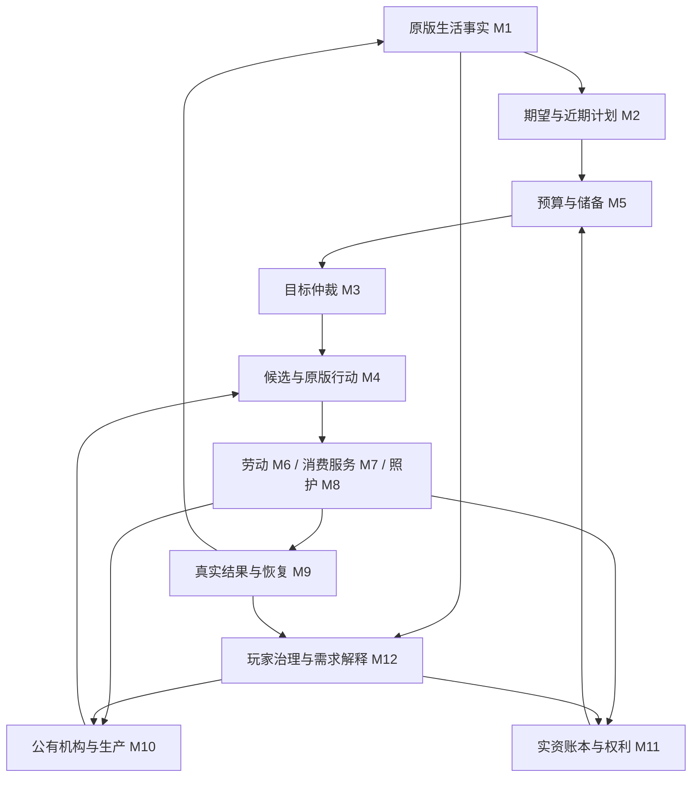

# Pawn 经济需求驱动 AI：全部模块代码设计总册

2026-10-08，整套方案 v1.0。交付阶段：完整模块代码设计，包含已有 M1/M2 和本轮补齐的 M3–M12；不是完整运行实现或发布包。类型、方法、枚举、Def 和参数名称若未明确标为现有，均为拟议契约。本文是跨模块协调规则的当前入口；单模块修订不得违反本册不变量。

连续阅读全文：[十二模块合订本](00-全部模块方案_合订本.md)。开发时以各模块源文件为准；合订本由校验/导出工具重建。

## 1. 制度与玩法边界

1. 前端硬依赖 RUIF；Verse.Window 只作宿主，业务组件使用 RUIF，不另写同类通用控件。
2. 扩展原版 ThinkTree、Job、Need 和可观察结果，保留征召、玩家强制、精神状态、危险、工作许可、时间安排、区域和原版紧急处理权。一个 Pawn 同时只有一个经济前台意图。
3. 机构全部公有，由玩家治理预算、岗位、生产、报价、时段和保障；个人自主求职、履约、消费、储蓄与依法照护，不要求玩家逐人强制。
4. 自然野果、树木、野兽等未开发资源按原版合法规则免费参与候选；公有加工原料不是人人可取，加工成品与登记服务按明确报价/保障政策使用。
5. 只有真实银币缴存产生对应的新账本余额。外贸说明实际资金来源；内部拨款、工资、消费和退款是已有资金转移，不增加货币总量。
6. 医疗/托育/居住逐类通过原版访问、交付和结算原型后才收费。未适配能力继续原版公共机制，不因总开关开启就全部收费。
7. 不加入私营机构、无限福利、强制劳动、自动外贸、银行贷款、税制、保险或完整遗产法。缺岗位、供给、人员或资金时允许生活与经济受阻，并明确解释。

## 2. 十二模块与阅读顺序

| 编号 | 独立方案 | 职责与主要交付 |
|---|---|---|
| M1 | [状态与需求感知](../../M01-状态与需求感知/01-状态与需求感知_代码设计方案.md) | 原版事实、覆盖/年龄/未知、当前缺口；修订 1.1 |
| M2 | [长期生活规划](../../M02-长期生活规划/02-长期生活规划_代码设计方案.md) | 八维风格、期望与近期计划、时间窗口及有限储备政策 |
| M3 | [目标与多需求仲裁](../../M03-目标与多需求仲裁/03-目标与多需求仲裁_代码设计方案.md) | 唯一目标池、前置 DAG、P0–P3、滞回及单一选择 |
| M4 | [方案比较与行动调度](../../M04-方案比较与行动调度/04-方案比较与行动调度_代码设计方案.md) | 有界候选、合法性/时效比较、行动票据及原版执行 |
| M5 | [生活预算与储蓄](../../M05-生活预算与储蓄/05-生活预算与储蓄_代码设计方案.md) | 同窗量价转换、覆盖去重、软预算、储备水位与有限筹资 |
| M6 | [就业与劳动合同](../../M06-就业与劳动合同/06-就业与劳动合同_代码设计方案.md) | 有效岗位、资格、工资承诺、实际劳动、应付与退出 |
| M7 | [消费与服务](../../M07-消费与服务/07-消费与服务_代码设计方案.md) | 报价、订单、产品/服务交付、使用效果、退款与分期结算 |
| M8 | [家庭与照护协作](../../M08-家庭与照护协作/08-家庭与照护协作_代码设计方案.md) | 受益需求、监护/执行/付款分离、跨人时间与容量分配 |
| M9 | [经验反馈与失败恢复](../../M09-经验反馈与失败恢复/09-经验反馈与失败恢复_代码设计方案.md) | 有界学习、失效分类、退避、生命周期恢复及解释 |
| M10 | [再生产与公有机构运行](../../M10-再生产与公有机构运行/10-再生产与公有机构运行_代码设计方案.md) | 机构工具、生产/补货、岗位和服务容量、有限收缩 |
| M11 | [资金资源权利与制度协调](../../M11-资金资源权利与制度协调/11-资金资源权利与制度协调_代码设计方案.md) | 真实储备、账本、权属/资源占用、事务、启停和迁移 |
| M12 | [需求可视化与治理反馈](../../M12-需求可视化与治理反馈/12-需求可视化与治理反馈_代码设计方案.md) | RUIF 同口径总览/追溯、治理命令、政策情景和生活结果 |

模块数不是调度循环数：仍为**一个总体控制循环、四个个人业务循环**（即时满足、储蓄、劳动、消费服务）。家庭、机构与治理提供目标/约束及外围反馈，不另抢 Pawn 执行权。

## 3. 总闭环与分阶段调用

单次主线程协调按阶段运行，不在模块之间递归直到收敛：

1. 应用已批准的设置/政策命令与失效通知；M11 恢复/结算已确认事实，M9 协调过期清理。
2. M1 更新原始事实；M8 只在已有授权下协调责任，未确认的关系不生成付款义务。
3. M2 用原始事实产生目标；M4 的只读供给查询为 M5 提供合法方案量/报价；M5 生成预算估计；M2 最多接收一次兼容反馈。
4. M3 更新目标和风险，M4 对有限候选比较；未知输入保留等待，不形成虚假成交。
5. 进入跨 Pawn 的提交申请队列；M11 对资金/物资/容量作有界、去重、主线程的整体准备，产生短期行动票据。
6. 原版 ThinkTree 在允许的时点读取票据，JobDriver 成功取得原版预约和行动租约后执行。M6/M7/M8 不另行 StartJob 抢控制。
7. 实际完成/移交/使用产生类型化证据；M11 唯一入账，M6/M7 更新业务状态，M9 更新经验，M1 重新观察 Need/健康。
8. M10 在真实订单、库存和玩家生产授权下更新供给与岗位；M12 发布同一批次的解释。UI 关闭不影响上述步骤。

首轮预算未知时也能显示目标；原版紧急处理不等待计划、预算、事务队列或 UI。

## 4. 共同契约与唯一写入者

| 契约/状态 | 唯一负责者 | 跨模块约束 |
|---|---|---|
| PawnFactSnapshot/Fact<T> | M1 | Unknown=0，原版事实只读，按组年龄/范围查询 |
| LifeStyleState/NeedTargetProfile | M2 | 来源/版本明确；期望、执行档和实际状态分开 |
| GoalRecord/GoalGraph | M3 | 其他模块提交 Proposal，不直接改目标生命周期 |
| ActionTicket/ActionLease | M4 | 每 Pawn 至多一个执行租约；票据不等于已执行 |
| LifeBudget/ReserveAssessment | M5 | 软预算不扣钱、不独立发行余额；金额引用 M11 |
| WorkContract/WorkEvidence | M6 | 合同决定工资条款，M11 决定资金预留和付款 |
| Order/ServiceEvidence | M7 | 订单决定交付条款，使用结果与财务状态分开 |
| CareResponsibility/CareAssignment | M8 | 真实关系不是自动监护/扣款授权 |
| ExperienceSummary/RetryState | M9 | 不写钱/健康，不重新结算业务事实 |
| SupplyPlan/InstitutionPolicy | M10 | 经济计划不与既有车间工单运行器竞争写入 |
| Ledger/Claims/ResourceRegistration/Mode | M11 | 唯一账本、资源权利、硬占用和制度阶段写入者 |
| DashboardSnapshot/PolicyDraft | M12 | 查询只读；草稿不改变世界；命令交责任模块复核 |

所有 DTO 出游戏适配边界后只包含稳定 ID、标量、枚举、已冻结集合，不保存可写 Pawn/Thing/Need 引用。运行与持久化宿主复用现有经济 GameComponent，不为每模块新建一份经济状态。

知识/业务状态枚举默认零值必须安全地表示 Unknown/未准备，不能默认 Known、成交或执行中；制度默认 Off 可以显式作为安全零值。接口草图省略实现和辅助类型，不可直接当作已编译 API；未来新增持久枚举采用稳定显式编号及迁移，不重排旧存档值。

### 标识、版本与单位

- `RequirementKey = beneficiaryId + canonicalNeedOrCondition + component`，不包含 Tick、付款人、余额或目标修订。
- `RequirementSliceKey = RequirementKey + [windowStart, windowEnd) + unit/benefitType` 表示同一规划窗内的覆盖分量；连续需要与一次事件须有各自稳定事件实例键。切换滚动窗口时按区间交叠裁剪，不能全当新需要。
- GoalId 表示目标生命周期，OrderId/ContractId 表示承诺，EvidenceId 表示一次真实结果；不可互相替代。DedupeKey 至少包含来源实例、执行阶段和完成序号，不只用 JobID。
- SessionEpoch 解决读档/切档缓存混用；SourceVersionSet 记录各源版本，不要求不同 Pawn 的版本数字相等。PublicationBatchId 只表示一次读模型发布，不证明同 Tick 原子真值。
- 钱为 long 整数最小单位，显示 1 银币=100 最小单位；交易运算 checked，比例用基点。营养、Tick、次数、件数等各有 UnitId，跨单位禁止相加。
- `CommandEnvelope` 至少含 CommandId、SessionEpoch、SubjectId、ExpectedRevisions、IssuedTick、ValidUntilTick、Payload；过期/重复分别返回明确状态，不能重复扣款。
- `EvidenceEnvelope` 至少含 EvidenceId、SourceInstanceId、Phase、Sequence、Actor/Beneficiary/Payer、发生 Tick、Quantity/Unit、物资谱系及引用。观察到 Job 结束不自动构成完整证据。

## 5. 跨 Pawn 稀缺资源与提交规则

同一笔钱、同一件物品、床位/医生/孩子/工人时段只有一个硬占用写入者 M11。逻辑占用与原版 ReservationManager 不相互替代。

跨 Pawn 准备申请在一个有界批次内按已验证保护等级、可产生帮助的时效、有限等待和稳定申请 ID 排序；经济金额/出价不是生存公平性的排序键。普通等待不能伪装成 P0。批次外新出现的原版紧急事件立即使不合法经济票据失效，不等下一批。

M11 按稳定资源键顺序检查并整体准备 ClaimBundle；失败不留下部分硬占用，不阻塞式等锁。准备票据有 TTL，原型上限 150 Tick，具体值需剖析；普通候选阶段无预留。原版接受 Job 前后再次检查控制权，TryMakePreToilReservations 失败则整体释放票据并退避。原版暂不选择经济 Job 时票据到期释放，不下发等待 Job 长占 Pawn。

已执行服务的资源租约仅在合法进度/实际当班下续期，续期不可跨过合同/服务上限；不能把整场医疗当长时间不可中断原子提交。程序重入保护与事务状态同步，避免事件回调再次提交同一票据。

## 6. 保存、恢复与失败

持久保存：稳定风格、活跃目标/责任、合同/订单/权益、账本/凭据/资源登记、有限重试/学习状态、制度迁移阶段。原版 Pawn/Thing 由原版或唯一 ThingOwner 保存，其余引用；事实快照、派生预算、候选、寻路和 UI 缓存重建。

保存允许出现在行走/服务阶段；跨界的实物和资金转移用短同步提交及持久阶段凭据。加载后按实际持有者、履约证据和事务阶段恢复，不能“所有 Prepared 一律重做”或“所有未完成一律退款”。不确定且无法自动对账的记录进入 ReconciliationRequired，隔离其相关资源/新增承诺并向玩家解释，不悄悄发币、删物或记患者债。

所有模块采用 Unknown/NotApplicable/Unsupported/Error 和明确原因；未知不等于零，受阻不等于已满足，已付费不等于已使用，工资应付不等于到账。

## 7. 原版接入与自研范围

当前代码已有五类机构、账本、衣物交付、岗位体检和有限生产工资作为参考；现有 `BasicPawn/SafeDecision`、固定 GetPriority、首次赠币、JobID 去重和手动 StockItem 不能整套沿用。新增正式入口应通过能力路由替换旧决策路径，避免两套 AI 同时申请/收费。

本册 M10 对 v0.7 的补货式增加“已授权未开工量”并明确出口总量口径，避免订单还未开工时每轮重复追加。M5 明确软预算/硬预留与储备目标的对称去重；较早设计中的笼统统计键在本册拆为需要身份与规划切片，以本册及对应模块细则为准。

ThinkNode_JobGiver、JobDriver、预约、Bill/GenRecipe、ThingOwner、TradeDeal 等提供执行/物理基础；现代账户、产权、合同、效用、储备与家庭授权均是本 Mod 自研。原版字段/方法存在不证明某条完成证据、堆叠谱系或交易到账挂点已验证。

公开依据限于扩展和保存机制：[Harmony Prefix](https://harmony.pardeike.net/v2/articles/patching-prefix.html)、[Harmony Postfix](https://harmony.pardeike.net/v2/articles/patching-postfix.html)、作者维护的 [Saving For Dummies](https://spdskatr.github.io/RWModdingResources/saving-guide)。各模块具体 API 以当前游戏 DLL 与本地源码核验为准；[全模块接口证据](../04-实装指导手册/evidence/全模块_接口证据.json)记录本轮补核。候选挂点必须原型验证，不虚构通用“劳动完成/治疗成功/净外贸收入”事件。

## 8. 实装顺序与整体准入

1. M1 + M12 只读范围：看见真实需要、年龄和未知；M2 只读目标。
2. M11 实资/权益/迁移基础 + M5/M3/M4 纯契约及影子决策：只记录将选择什么，不扣款/派工。
3. M10 有效生产/物流 + M6 + M7 食品衣物：贯通首次工资、提前补储、真实产品交付与使用。
4. M8 照护协调 + M7 床位/诊疗/托育逐类接入；未完成部分保留原版公共机制。
5. M9 有界学习/恢复和 M12 政策反馈按基础数据逐步启用。基础失败清理、幂等与生命周期从第一阶段就必须存在，不拖到最后。

整体验收至少覆盖：零现金、同时饥饿疲劳、孩子与成人竞争时间、无岗位、有货无钱、有钱无货、停贸欠薪、供给瘫痪、多人抢末件食品、存档中断、重复完成通知、堆叠/腐败/损毁、玩家强制/征召、经济启停、旧档迁移、未适配 DLC 和 RUIF 多分辨率。

设计全覆盖表示所有十二模块均有职责、数据、流程、接入与验收方案，不表示每项参数已平衡或游戏经济永远稳定。[完整设计校验](../04-实装指导手册/evidence/全模块_设计校验.json)只记录文档、接口与独立示例演算，运行编译、性能、原版时序及存档验收仍是实装阶段门槛。
