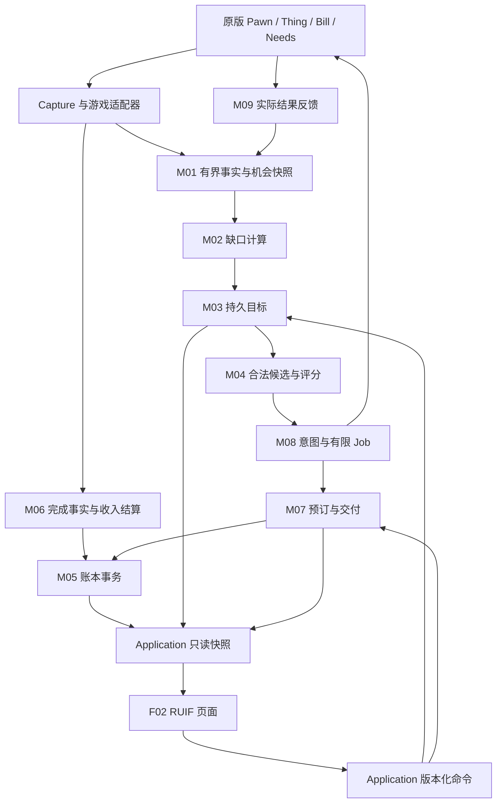

# 经济需求驱动殖民者 AI：模块化实装指导手册

版本：0.3 · 建立于 2026-10-07，2026-10-08 接入首版运行实现 · 状态：模块蓝图与首版实装并行维护。

五类机构、计件工资、真实衣物交易与体检已写入运行代码，实际交付范围见[首版操作与验收](../07-归档/经济机构首版_操作与验收.md)。本册其余模块和示例仍包含后续蓝图；不得把全部拟议契约当成已实现API。编译/离线验证与真实游戏验收分别记录。

2026-10-08 后续设计增补：[原版需求缺口驱动经济 AI v0.3](../01-方案主线/原版需求缺口驱动经济AI_设计方案_v0.3.md)。下一阶段以真实生活缺口先于商品和收入，覆盖吃饭、睡眠、关系事件与育儿；新增分类、等级、家庭责任和有限筹资设计。该增补是方案，不代表相关需求已实装。

## 1. 本手册回答什么

以用户提供的 [Pawn 经济 AI 核心方案（本仓库副本）](../00-调研与来源/Pawn经济AI核心方案-1.md) 为模型参考（原件位于 `D:/QQ/Pawn经济AI核心方案-1.md`，副本与其 SHA-256 一致），将“状态 → UtilityGap → 目标 → 方案评分 → 工作/储蓄/交易 → 使用 → 反馈”拆成可以逐项开发、单独验收的模块。参考方案是设计输入；运行改动以用户后续的实装授权为范围依据。

两个硬约束贯穿所有模块：

1. **前端以 RUIF 框架 Mod 为硬依赖。** 通用按钮、输入、导航、表格、进度和反馈使用 RUIF 组件。Verse.Window 只做游戏窗口宿主，不另外开发同类控件。
2. **数据从游戏真实对象读取，机制以公开 modding 资料和目标游戏程序集共同佐证。** 个人账户、完整产权、合同、效用评分和事务恢复由本 Mod 自研；不虚构原版接口。

## 2. 阅读与交付索引

| 文件 | 开发者用途 |
|---|---|
| [实装落地计划 v1.0](../03-实装批次与状态/00-实装落地计划_v1.0.md) | 用户批准后的 B0–B7 实施批次、迁移差异、能力准入和验收；首个代码子批为 B1.1 纯事实/缺口内核 |
| [实装批次状态](../03-实装批次与状态/实施批次状态.json)、[首批代码验证记录](../03-实装批次与状态/01-B1.1事实与缺口内核_实装记录.md) | 区分计划、离线代码验证、游戏验证与发布，避免把完整设计误认为完整运行实现 |
| [B1.2 人口采集与只读查询](../03-实装批次与状态/02-B1.2人口采集与查询_实装记录.md) | 真实人口/Need/身体生活条件/关系读取、分组调度、会话及新鲜度查询；代码验证完成，实机验收待执行 |
| [B1.3 RUIF 需求页](../03-实装批次与状态/03-B1.3_RUIF需求页_实装记录.md) | 当前实装：分页目录、个人事实/目标/缺口/来源/年龄，双语与未知/陈旧状态；只读页面已接入，未部署/未实机验收 |
| [B2.1 事务与旧账对账内核](../03-实装批次与状态/04-B2.1_事务内核与旧账对账_实装记录.md) | 整数货币、原子资金/资源预占、版本/期限/防重转账算法与九类旧记录快照；影子内核已验证，真实银币、存档迁移与制度开关仍待 B2.2–B2.4 |
| [B2.2 实物银币储备原型](../03-实装批次与状态/05-B2.2_实物银币储备原型_实装记录.md) | 独立 ThingOwner、实际单堆存取、两端数量/所属证据、异常隔离和独立 Scribe 往返已验证；原型没有接管游戏资金，整局恢复/旧权益映射与开关仍待 B2.3–B2.4 |
| [B2.3 持久事务与旧账保护](../03-实装批次与状态/06-B2.3_持久事务与旧账保护_实装记录.md) | 储备/新账同宿主保存、存取防重与阶段恢复、旧恢复前原始 payload 归档、实资国库约束的显式金额承接已离线验证；支付/设置/最终停旧及非货币权益转接仍待 B2.4，实机未验收 |
| [B2.4.1 制度设置与互斥门禁](../03-实装批次与状态/07-B2.4.1_制度设置与互斥门禁_实装记录.md) | 唯一默认关闭 RUIF 设置、五阶段保存、最新旧账冻结及旧付费/发薪/排班暂停已代码验证；读档不再取消旧订单。实际交付/权限/最终权益映射待 B2.4.2，开启仅准备中，B2.4 整批进行中，未部署/未实机验收 |
| [B2.4.2 真实交付与权益承接](../03-实装批次与状态/08-B2.4.2_真实交付与权益承接_实装记录.md) | 公有 Treasury 准备资金指令、Pawn 安全窗口自动搬运、预约/实物证明、预锁/取消/读档恢复、最终旧债权实资承接及九类记录逐项处理已代码验证；一般收费未接入，完整游戏验收仍阻塞 Active，未部署/未实机验收 |
| [全部十二模块方案总册](../02-代码设计总册/00-全部模块方案_总册.md) | 当前完整代码设计入口：M1–M12、共同契约、唯一写入者、执行/事务时序、恢复及整体实装门槛 |
| [全部十二模块合订本](../02-代码设计总册/00-全部模块方案_合订本.md) | 总册及十二模块完整正文连续阅读；由分模块源文件生成，阶段仍为设计 |
| [模块一：状态与需求感知代码设计，修订 1.1](../../M01-状态与需求感知/01-状态与需求感知_代码设计方案.md) | 原设计基线；B1.1–B1.3 代码与离线验证已完成，真实游戏验收待执行；生活目标等后续批次仍未接入 |
| [模块二：长期生活规划代码设计，修订 1.0](../../M02-长期生活规划/02-长期生活规划_代码设计方案.md) | 八维风格、期望与可执行计划、时间窗口、有限储备政策、预算/家庭接口、更新保存和 RUIF 解释；尚未实装 |
| [模块一方案评审与修订对应](../../M01-状态与需求感知/01-状态与需求感知_方案评审.md) | 原始七项发现和修订 1.1 的设计响应；历史证据不充当当前实现验证 |
| [当前方案复评与 AI 模块摘要 v0.9](../01-方案主线/当前方案复评与AI模块摘要_v0.9.md) | 12 个功能模块及用途、设计与现有代码的差距、四类剩余问题和实施优先级 |
| [经济学优化与需求可视化 v0.8](../01-方案主线/经济学优化与需求可视化_方案_v0.8.md) | 当前增补：生活需要、预算意向与订单分层，生活成本/储蓄/劳动联合约束，供给与政策解释；需求面板先行 |
| [07-需求驾驶舱与政策反馈](07-需求驾驶舱与政策反馈.md) | RUIF 总览/详情、原因码、数据口径、政策情景、版本与验收；附高清中文设计预览 |
| [公有机构与外贸优化基线 v0.7](../01-方案主线/公有机构与外贸循环_优化方案_v0.7.md) | 当前制度：Mod 设置总开关、公有再生产岗位、公共自然资源、加工品收费、外贸实资和服务契约；覆盖旧方案未定规则 |
| [第一批游戏代码设计](../02-代码设计总册/00-公有经济第一批代码设计.md) | 新增模块、设置接入、schema 迁移、事件顺序、实物/货币不变量和分批验证；尚未改动运行代码 |
| [玩法完整度与代码设计准入](../01-方案主线/玩法完整度评估与设计准入_v0.6.md) | 7 项玩法阻断、4 项深度问题、反例与进入代码设计的明确条件 |
| [自主经济社会总体设计](../01-方案主线/自主经济社会与玩家角色_总体设计_v0.5.md) | 玩家角色转变、制度逐步开启、Pawn 多维风格、机构自主运行与实施顺序 |
| [原版需求缺口驱动方案](../01-方案主线/原版需求缺口驱动经济AI_设计方案_v0.3.md) | 后续多需求决策：12 个生活观测域、优先级、有限筹资、家庭与照护闭环 |
| [多需求并发仲裁补充](../01-方案主线/多需求并发仲裁_设计补充_v0.4.md) | 同级需求顺序、时限、任务中断、资源争用、家庭协作、等待公平性与冲突矩阵 |
| [01-数据模型与源码依据](01-数据模型与源码依据.md) | 数据真值、字段、存档、事务、原版与自研边界 |
| [02-业务模块实装细则](02-业务模块实装细则.md) | 九个业务模块的输入输出、接口、步骤及完成标准 |
| [03-RUIF前端实装](03-RUIF前端实装.md) | 五个业务页、组件映射、读模型、命令、布局及文案 |
| [04-接入分期与验收](04-接入分期与验收.md) | 目录落点、车间接入、Job 仲裁、测试矩阵及发布门槛 |
| [05-证据索引与验证记录](05-证据索引与验证记录.md) | 公开资料、源码依据、已执行验证及未验证范围 |
| [06-微观机构与场所工具](06-微观机构与场所工具.md) | 十二类地图机构；劳务站、体检中心的设备、岗位、服务、资金与结果 |
| [首版操作与验收](../07-归档/经济机构首版_操作与验收.md) | 2026-10-08运行实现：五类柜台、劳动收入、真实衣物交易和体检；实际范围及待执行的游戏验收 |
| [本机接口证据](evidence/本机接口证据.json) | 游戏/RUIF DLL 指纹、方法签名及 IL 调用目标 |
| [保存接口示例](examples/EconomySaveExample.cs)、[RUIF 示例](examples/EconomyRuifExample.cs) | 已针对本机依赖编译的最小 API 用法；不能直接当成完整业务实现 |
| [真实库存示例](examples/EconomyStockExample.cs) | ThingOwner 保存单件物品的接口骨架；不含交易/交付实现 |
| [证据采集脚本](tools/Collect-Evidence.ps1) | 游戏更新后重新取证；只读程序集，不执行游戏代码 |

## 3. 当前核验基线

| 项目 | 本次确认的事实 | 使用规则 |
|---|---|---|
| 游戏 | 本机 `Version.txt` 为 `1.6.4871 rev590` | 只表示本机目标；不是对未来所有 1.6 小版本的兼容承诺 |
| 游戏程序集 | `RimWorldWin64_Data/Managed/Assembly-CSharp.dll`；SHA-256 见证据文件 | 签名以本次 DLL 元数据为准；方法语义结合本地反编译文本及当前 IL 核对 |
| RUIF | 安装版 `Mods/RUIF/Assemblies/RUIF.dll` 中 `Api.VersionString = 1.3.0` | 编译、部署、运行须指向同一依赖；不依据旧 README 推断版本 |
| RUIF packageId | `PersonalChronicle.RUIFramework` | 保留已有 About 硬依赖与加载顺序，引用 `Private=false` |
| 现有项目 | 已有车间执行、工单、履历采样、经济观察页 | 扩展服务契约；不恢复已删除的动态 MarketValue 系统 |
| 本手册 | 独立 net48 示例工程 | 不触发主工程 BuildStamp，不输出到 Mod 的正式 Assemblies |

RUIF 没有可供本任务使用的主题/换肤 API。当前统计表实现也存在内部数组分配；本手册不作“整个经济页零分配”承诺。

## 4. 模块划分

| 编号 | 模块 | 首版交付 | 后续扩展 |
|---|---|---|---|
| M01 | Pawn 状态与机会采集 | 生理、健康、衣物、账户、合法商品快照 | 更多服务、跨图机会 |
| M02 | 需求缺口与偏好 | 衣物缺口、有限储蓄偏好、硬保护标志 | 娱乐、住房、地位 |
| M03 | 持久目标管理 | 衣物目标、等待收入、暂停/完成/失败 | 目标替代、长期住房 |
| M04 | 候选与决策评分 | 买/继续排班工作/储蓄/放弃的合法比较 | 自制、出售、服务选择 |
| M05 | 钱包与事务账本 | 公共账户、个人账户、冻结、转账、退款、去重 | 多账户、合法继承等制度 |
| M06 | 劳动合同与收入 | 现有车间白名单配方的固定计件工资 | 精确时薪、换岗比较、绩效 |
| M07 | 产权、商品与固定价市场 | 公共售货点、单件衣物、挂牌、预订、交付 | 二手物、堆叠商品、租赁 |
| M08 | Job 执行与行为仲裁 | 有限购物 Job、原版穿戴、失败清理 | 消费服务与自主换岗 |
| M09 | 结果反馈与解释 | 收支/产权/使用分别记录，重算缺口 | 多维行为回顾与政策分析 |
| F01 | 生命周期与存档支撑 | 单一真值、Scribe、迁移、引用恢复、索引 | 跨版本迁移工具 |
| F02 | RUIF 管理前端 | 总览、个人、目标、市场、政策 | 企业、宏观经济页面 |
| F03 | 微观机构服务基础层 | 场所、岗位、容量、营业、预约、服务单；基础就业/商店机构 | 体检、培训、住房、配送等专业服务 |

F01/F02/F03 是所有业务模块共同遵守的基础契约。九个业务模块负责经济规则；F03 将它们落到具体机构。机构批次 A/B/C 与原 R0–R3 技术验收并行标记，详细流程见机构册。不得把后台字段或总控页签当作地图机构已经完成。

## 5. 架构和数据流

依赖方向：UI → Application 契约 → Domain 规则；Data 负责领域记录的持久化；Capture/Compatibility 将游戏或其他 Mod 的事实翻译成服务输入。Domain 不依赖 RUIF、Harmony、Window 或第三方类型。原版 Pawn/Thing 类型停留在适配和保存边界，纯评分使用标量和稳定业务 ID。

## 6. 首版具体闭环

首版对象限定为：单地图中正常自由成年玩家殖民者；囚犯、奴隶、访客、婴幼儿、机体及暂时离图者先禁用经济自主执行。这里的人群限制是设计范围，不是原版 API 自动保证的规则。

1. 玩家通过政策启用，并从一个有限的公共内部账户划出工资预算；默认关闭，旧存档不自动生效。
2. 现有车间继续按原有排班和工单生产。白名单配方完成一次，取得一次计件收入资格；不是每个产物各发一次工资。
3. 工资从公共账户转入个人钱包。无预算时生成应付记录并暂停新增有偿合同；不能凭空增加余额，也不能撤销已经完成的原版生产。
4. 个人发现合法、可穿戴衣物的缺口。若钱不足，目标进入等待收入，Pawn 继续原有生活与工作。
5. 公共售货点将一件公共衣物按固定内部价格挂牌。衣物原材料和生产产品不因 Pawn 制造就自动变成私产。
6. 在允许的自然决策点购物；到店交付时统一结算，随后请求原版穿戴逻辑。穿戴失败时保留已购买衣物，目标显示“已购，待使用”。
7. 钱包、所有权、穿戴及相关原版状态分别更新。只有实际使用产生的状态变化，才能作为缺口改善证据。

最小计算例：公共账户初始 1,000 内部单位，个人账户 0；每次合法完成工资 20，衣物售价 60。三次完成后个人有 60；购买后个人 0、公共账户 1,000。账户总额始终 1,000。**这只是确定性验收夹具，不是经济平衡建议。** 金额底层使用整数最小单位，内部货币不等同于地图银币。

本闭环证明“有劳动收入、预算决定购买、使用反馈影响目标”。首版不会自动证明“Pawn 能自主选择最赚钱岗位”；后者需要额外合同机会、排班变更权限和与工作管理 Mod 的仲裁。

0.2 具体化：上述核心闭环通过劳务服务站、工坊管理台、工资查询台和供销商店呈现；可共用一个公共服务大厅。体检中心列为紧随其后的优先机构，新增医生与客户双角色服务、能力报告、付款方和就业适配。机构设计不改变既有预留系统中心的运行状态。

## 7. 实施里程碑和退出条件

| 阶段 | 实装范围 | 进入下一阶段必须具备的证据 |
|---|---|---|
| R0 接口探针 | F01/F02 骨架、取证、工资完成事实、购物执行机会探针 | 真正繁忙殖民者能在许可窗口取得购物机会；不依赖 PostMain 永远可达的假设 |
| R1 账本与观察 | M01/M05、只读个人页、账户迁移与内部转账 | 精确守恒、重复命令不重复写账、读档稳定、未知字段/缺失引用有明确处理 |
| R2 收入与商品 | M06/M07、市场和政策页 | 一次完成对应一次结算；有合法卖方；取消、缺货、预算耗尽均可恢复 |
| R3 自主消费 | M02/M03/M04/M08/M09、目标与解释页 | 完整工作→收入→消费→使用→反馈录像和存档；抢占保护、预约、重载通过 |
| R4 扩展 | 娱乐服务、有限出售、租赁、自主换岗 | 每加一个玩法都附供应、权限、定价、实际使用与失败补偿说明 |

企业、税收、银行、贷款、动态价格、世界人口和 LLM 对话均不作为 R1–R3 前置。第三方经济 Mod 先作为对照样本，未有稳定公开 API 和兼容验证之前不接管它们的钱包。

## 8. 开发工作包写法

每个模块的开发单至少填写：模块 ID、采用的契约版本、输入真值与证据 ID、保存键、UI 页和 RUIF 组件、失败码、是否新增 Def/Harmony、变更文件、自动验证、游戏内场景、已知限制。阶段完成的含义是其验收证据齐全，而不是“文件已写好”。

具体字段、算法和测试按后续各册执行。所有建议阈值均标为可调初值，进入实机后再基于数据修改；源码只能证明扩展机制，不能替经济模型证明平衡性。
