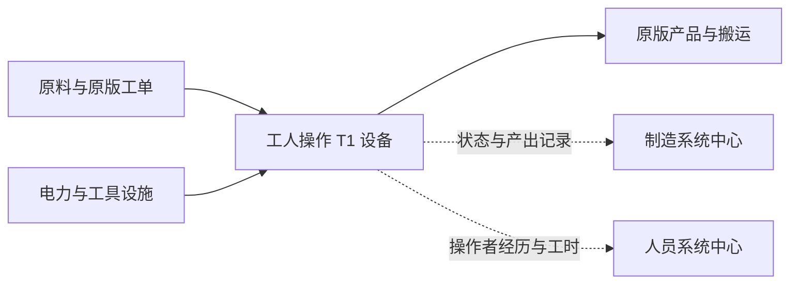

# T1 生产设备 · 人工操作与智能辅助设计方案

日期：2026-10-05。所属 Mod：殖民地综合管理系统 0.1。
状态：用户已批准实装。十类设备按本方案首轮数值接入“自动化”分类；用户制作的四十张四向贴图已导入，实机生产与平衡待验证。落地内容见 [T1 实装记录](T1生产设备_实装记录_2026-10-05.md)。
本方案参考现有初稿，并核对当前源码及本机 RimWorld 1.6.4871 rev590 的原版 XML；涉及反编译行为的结论来自开发区现存源码镜像，实装时仍需核对当前程序集及实机。

## 1. T1 的定位

T1 是殖民地从普通工作台走向工业化生产的第一档设备：工人持续操作，设备提供动力、速度辅助、工单展示和管理数据。

玩家获得三个可感知的收益：同一工人加工更快；生产任务与停工原因更清楚；设备、班组和产出可以在综合管理系统中统一查看。

- 操作、上下料和搬运沿用原版工作流程，技能要求、材料消耗和配方研究条件保持有效。
- T1 不增加设备自己的品质保底。工人技能、灵感与已经存在的车间品质加成继续按各自规则工作。
- 本轮聚焦单机生产。T2 的工序自动化与 T3 的无人生产只预留方向，不在本轮冻结速度、体积或断电倍率。
- 管理系统帮助安排人员；设备不能因为有班组名或“智能”标签就凭空生产。

## 2. 玩家使用流程

1. 完成“智能生产设备”研究，建造对应工艺设备。
2. 连接电网，在原版工单页选择配方、数量、材料及操作者条件。
3. 将设备放入适当的车间区域，安排对应工作类型和班组。
4. 工人到操作格完成任务，物料与产物按原版规则流转。
5. 在制造系统中心查看设备、工单和产出，在人员系统中心查看操作者的档案与工时。

## 3. 设备族与首批内容

建造分类沿用“自动化”，收纳到“智能生产设备”下拉组。中文标签采用“智能＋工艺＋台”，T1 作为级别标识显示；不向玩家显示代码编号。

| 设备 | 承担的工艺 | 原版参照 | 对应现有车间 | 推进批次 |
|---|---|---|---|---|
| 智能冶炼台 | 钢渣提取、装备回收与熔炼 | ElectricSmelter | 锻造坊 | 第一批 |
| 智能机加台 | 原版机加配方、武器与机械制品加工 | TableMachining | 机械加工坊 | 第一批 |
| 智能缝纫台 | 衣物、护具及其他原版缝纫配方 | ElectricTailoringBench | 缝纫坊 | 第一批 |
| 智能锻造台 | 原版锻造配方 | ElectricSmithy | 锻造坊 | 第二批 |
| 智能烹饪台 | 原版灶台食物配方 | ElectricStove | 烹饪坊 | 第二批 |
| 智能制药台 | 原版制药配方，保留各自研究条件 | DrugLab | 制药坊 | 第二批 |
| 智能石工台 | 石块加工 | TableStonecutter | 石工坊 | 第二批 |
| 智能雕艺台 | 原版艺术品制作 | TableSculpting | 雕塑坊 | 第二批 |
| 智能屠宰台 | 原版屠宰台允许的配方 | TableButcher | 烹饪坊 | 第三批 |
| 智能制作台 | 手工加工点对应的基础制品 | CraftingSpot | 制作坊 | 第三批 |

首批先用冶炼台跑通建造、工单、工人作业、设备识别和产出记录，再用机加与缝纫检验材料选择、技能、品质及动态生成配方。
实装核对补充：原版屠宰作业属于 Cooking，屠宰台改接烹饪坊；冶炼作业属于 Crafting，为冶炼台单独声明该工序工作类型，避免仅勾选 Smithing 后无人工作。
研究台、伐木设备、精密制造台和燃料炼制设备另立工艺规格，不混入这十台的首版范围。

## 4. 建议数值

### 4.1 速度与品质

设备提速目标：在相同工人、配方、房间环境及无设施加成的比较条件下，加工阶段达到对应原型的 **4.00 倍**。
这表示加工时间约为原来的 **25%**，不表示搬运、备料和全天总产量也提高到四倍。

按用户要求于 2026-10-05 提升生产力：九台标准原型的默认设备速度基值为 1.0，T1 改为 **4.0**。手工加工点的显式基值为 0.5，智能制作台改为 **2.0**；十台均为各自原型的四倍基础加工速度。
四倍为无设施、同工人、同配方与同环境的加工段目标；T2/T3 的速度梯度待后续重新设计。

品质：T1 设备额外保底为“无”。不改产品品质、不减材料、不提高配方产量，不新增失败回收收益。已有车间加成必须在比较时对齐或排除，避免把系统加成算成设备收益。

### 4.2 电力与建造成本

建议首版十台均为电力设备，**断电停工**。这样各台能量来源清楚，也无需额外解释热加工设备如何在断电后继续熔炼或烹饪。
若后续开放手工退化，只给确实可以手工完成的缝纫、石工、雕艺等工艺，并同时补足“手工作业”状态展示；不把一个断电系数写进全部设备的共同基类。

以下为待实测的首轮平衡起点，不是现有游戏数据：

| 设备 | 建议功耗 | 钢材 | 工业零部件 | 建造工作量 |
|---|---:|---:|---:|---:|
| 智能冶炼台 | 900 W | 220 | 4 | 4400 |
| 智能机加台 | 500 W | 200 | 5 | 4000 |
| 智能缝纫台 | 180 W | 130 | 3 | 3200 |
| 智能锻造台 | 300 W | 200 | 4 | 4000 |
| 智能烹饪台 | 450 W | 160 | 3 | 2800 |
| 智能制药台 | 350 W | 180 | 4 | 4400 |
| 智能石工台 | 400 W | 160 | 3 | 2800 |
| 智能雕艺台 | 150 W | 130 | 2 | 3200 |
| 智能屠宰台 | 250 W | 150 | 3 | 2800 |
| 智能制作台 | 150 W | 120 | 2 | 2400 |

首版采用固定钢制外壳，不开放材质选项；产品的原料选择仍由原版配方决定。T1 不消耗高级零部件、塑钢或独有芯片物品。
这些成本让免费加工点、无电工作台升级时也产生明确投资，避免照抄原型成本后出现免费智能设备。

### 4.3 工具柜与环境

采用原版工具柜接口。原版每柜为速度属性 **+0.06**，最多两个，是属性加值而非最终速度再乘 1.12。
在不计其他修正时，标准 T1 的基值 4.0 加两个柜为 **4.12**；相对其无柜状态提高 **3%**。
对原型也支持两个工具柜的标准台，公平比较满配设备时：4.12 / 1.12 ≈ **3.679**，并非严格的 4.00 倍。原版电力熔炉与电力炉灶没有工具柜连接 Comp；本轮 T1 为这两台补了设施接口，其满配比较应分别核算，不能给原型虚加 0.12。

温度、室外、原版房间角色惩罚沿各工艺原型分别核对，不能从“车间区域”推断原版房间角色已满足。
原版 Workshop 房间识别与本 Mod 的 Zone_Workshop 是两套机制，界面应分别说明。

## 5. “智能辅助”应如何呈现

| 设计能力 | 玩家看见什么 | 边界 |
|---|---|---|
| 工单读数 | 当前任务、目标数量、操作者限制、操作岗位 | 复用原版工单配置，不自动改变玩家工单 |
| 状态提示 | 作业、等待人员、缺料、无有效工单、断电、故障 | 根据真实任务和资源判断；无法确定的原因显示“待核实”，不猜测 |
| 车间组织 | 区域归属、工艺类型、班组、班次和设备名称 | 复用当前管理体系，沿用原版工作类型执行生产 |
| 生产记录 | 实际件数、工时与已接入的设备产值 | 只累计已记录的活动，不补造历史 |
| 扩展辅助 | 工具柜连接和实际速度读数 | 显示当前修正后的结果，不只显示基值 |

有屏幕是设备的视觉特征，真实数据展示是管理界面的能力。首版不宣称自动换刀、预测维护、自动排产或自适应品质控制已经实现。
所列状态需逐项对照现有设备状态解析器；新增缺料原因、操作者原因等读数属于明确的界面开发任务。

## 6. 外形与操作空间

- 统一占地 3×1，单人站在设备前沿操作，四个方向均与实际交互格对应。
- 外形为开放式工业工作台：灰白或深灰金属壳体、明确的加工区、一个读数屏和小型控制面板。
- 通过炉膛、夹具、针机、料理区、刀具或工作托盘区分工艺，不靠不同颜色的同一张箱体贴图区分十台。
- 不做封闭无人生产舱，不放自动进出料传送口作为首版功能标识。
- 工人、原料与产物保留实际可达路径；设备美术不能遮挡操作位置、相邻通道和选择轮廓。
- 图集规格与 Graphic_Multi 加载命名在首台四向试产时确认，再扩到全设备族。初稿的四向文件名和方向说明不直接作为验收结果。

## 7. 研究与解锁

研究名：**智能生产设备**。建议费用 **1800**，前置为电力与机械加工，位于现有“自动化”研究页的独立生产支线。
首批发布时仅解锁已经具有完整 Def、贴图、配方与作业入口的设备；其他设备完成后并入同一研究。
设备解锁不绕过药品、武器等配方原本的研究与技能条件。

## 8. 初稿中必须修订的实现假设

### 8.1 新工作台必须接入原版作业名单

本机原版 WorkGiverDefs 明确使用 fixedBillGiverDefs。新台仅继承 Building_WorkTable、挂工单页，不能保证工人会来工作。
需向原有 WorkGiverDef 追加对应 T1 台，沿用原类、工作类型、容量要求与优先级；不为每台新造 Job。

| 工艺 | 原版作业定义 |
|---|---|
| 冶炼 | DoBillsSmelter |
| 锻造 | DoBillsMakeWeapons |
| 机加 | DoBillsMachiningTable |
| 烹饪 | DoBillsCook |
| 缝纫 | DoBillsMakeApparel |
| 制药 | DoBillsProduceDrugs |
| 石工 | DoBillsStonecut |
| 雕艺 | DoBillsSculpt |
| 屠宰 | DoBillsButcherFlesh |
| 通用制作 | DoBillsUseCraftingSpot |

### 8.2 配方集合不等于显式 recipes 列表

原版 ThingDef.AllRecipes 同时读取设备自身 recipes 和 RecipeDef.recipeUsers；还有通过物品 recipeMaker 生成的配方。
T1 要覆盖原型允许的完整有效配方，需处理以上路径及相关 DLC 条件，并保持原研究与技能限制。
只抄原台 XML 的 recipes 列表不能作为“配方完全相同”的证据。扩展其他 Mod 配方需另列兼容范围，首版不承诺全部继承。

### 8.3 自动识别与工艺匹配是两件事

现有 IWorkshopDevice 或建筑型 IBillGiver 可以让新台进入设备列表。
但设备匹配评分直接比较 expectedDeviceDefNames，新 defName 不会自动成为原型的替代品。
建议给设备加声明式原型/工艺映射，在匹配前把等价设备归入原型要求，再交给现有求值器；也可扩展“满足任一设备”的需求组。
不能直接把新旧设备都追加到现有期望列表，否则列表语义会要求新旧同时存在。

### 8.4 薄壳建筑类只解决身份

T1 可派生原版 Building_WorkTable，实现 IWorkshopDevice，不增加设备自己的循环生产算法。
设备 Def、作业名单、配方集合、工艺匹配与状态读数仍是配套任务；“新增十行类即可完整入网”的工程量估计应撤回。
T1 无需新增自主生产 Job，也不为本体引入额外存档字段；原版 Bills 和当前车间持久化继续保留。
“不新增自定义逐 tick 逻辑”不等于整台设备零耗时或零 GC，电力、设施、任务及管理数据仍有成本。

## 9. 验证与平衡方法

第一台的验收顺序：菜单与研究 → 放置与操作格 → 有料工单 → 工人实际执行 → 原版成品 → 设备台账 → 保存再读取。

| 场景 | 通过条件 |
|---|---|
| 原型与 T1 同工人、同配方、同环境 | 无柜加工段速度比接近预定目标；备料与搬运另计 |
| 原型与 T1 各装两个工具柜 | 读数符合属性加值机制，不把加值写成额外乘数 |
| 无人、缺料、无工单、断电、故障 | 不产生产品；每种状态给出对应信息或明确的未判定状态 |
| 技能不足、研究未解锁 | 沿用原配方限制，不因设备等级绕过 |
| 只有 T1 替代台的车间 | 入网且满足原型工艺要求，不误报多余或缺少原台 |
| 高品质产品 | 无 T1 独立品质保底；已有车间加成不重复施加 |
| 旋转、搬迁、拆除与读档 | 交互格、工单、设施与原版存档行为正常 |
| 扩展规模运行 | 与相同数量、同任务的原台比较 CPU/分配，报告条件与差值 |

平衡先看首批三台。若加工提速没有带来可感知收益，应先检查物流与排班瓶颈；若电力、材料或研究投资明显不值得，再调整成本或倍率。
不用零成本、零功耗或修改配方产量来掩盖未打通的作业链路。

## 10. 本轮证据位置

- 原版版本：RimWorld/Version.txt；本轮读取为 1.6.4871 rev590。
- 原型设备、功耗与加工点基值：RimWorld/Data/Core/Defs/ThingDefs_Buildings/Buildings_Production.xml；加工点速度明确为 0.5，原型中的无电台没有可照抄的功耗。
- 作业名单：RimWorld/Data/Core/Defs/WorkGiverDefs/WorkGivers.xml，fixedBillGiverDefs。
- 默认速度与环境 parts：RimWorld/Data/Core/Defs/Stats/Stats_Building_Special.xml，WorkTableWorkSpeedFactor。
- 最终配方集合：_research/vanilla/Assembly-CSharp/Verse/ThingDef.cs，AllRecipes。
- 设施加值：_research/vanilla/Assembly-CSharp/RimWorld/CompAffectedByFacilities.cs，GetStatOffset；RimWorld/StatWorker.cs，先加 comp offsets，再乘 comp factors。
- 设备识别和匹配：Source/PersonalChronicle/Automation/WorkshopStats.cs；Domain/WorkshopDeviceFit.cs。
- 已有车间加成：Source/PersonalChronicle/Automation/WorkshopBonusResolver.cs，Resolve。

以上是设计依据。2026-10-05 已新增建筑类、运行 Def、研究项目、状态读数及本地化资源；自制贴图由用户生成，本轮未调用图像模型。
