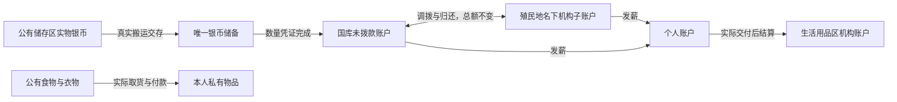

# 公有资产、机构资金与生活用品区贯通

用户选择：机构有独立拨款额度；资金归殖民地所有；国库汇总不重复计算。

## 检测结果

| 断点 | 原行为 | 修复后的权威来源 |
|---|---|---|
| 工资结算处公共资金 | 首页读取冻结的旧 EconomyAccount，国库读取新账，数值互不相通 | 首页、账户页、台账均读 PawnSettlementSaveHost |
| 公有储存区银币 | 只登记 Public 物品归属，没有实际储备交付和资金入账 | 成年 pawn 搬运真实公有银币至工资结算处；储备证明完成才记账 |
| 机构资金 | 消费收入直接进中央国库，没有机构独立额度 | PublicInstitution:建筑唯一 ID 子账户，拨款与归还使用公有资金转账 |
| 生活用品库存 | 商店只展示柜台 ThingOwner；新体系不创建旧机构模型，聚合库存页可能为空 | 实际柜台库存 + 本地图已登记公有实物，去重；排除私有、待交割和银币 |
| 公有衣物 | 原版自动穿戴绕过公共商品付款；没有从储存区走到实物的采购规划 | 原版 Wear 作业到货物处；穿戴前交付到本人背包、结算、确立私有归属，再允许原版穿戴 |
| 购买读档恢复 | 结算宿主可能先取消没有银币移动的购买行，随后货物恢复无法扣款 | 保留购买中的付款行，交给持久化实物交割凭证恢复；不凭空取消给出免费货物 |
| 银币搬运期间发生交易 | 到达时账本版本已变化，交存失败、银币被退回重跑 | 没有准备行和储备证明时，仅在实际交付处刷新版本；人员、货物、数量等绑定不变 |

## 资金与所有权规则

- 已入账总公有资金 = 国库余额 + 所有机构子账户余额 + 已经真实兑现的历史公有账户余额。个人账户不计入；同一银币不重复计算。
- 唯一储备同时担保公共和个人账上资金；界面标为“全账户实物储备”。全账户负债合计必须等于实际储备数量 × 100。
- 公有储存区中的未交存银币仍归殖民地所有，单列“待交存”。物品价值和待交存货币不直接铸造成工资资金。物品资产、公有入账资金与储备担保是不同的统计口径。
- 拨款必须真实扣减来源账户；不足、旧 UI 戳、关闭/故障状态、不属于玩家的机构均拒绝。撤销机构后，剩余子账户资金仍可通过账户页退回国库。
- 工资优先使用合同签发机构的预算。其次使用中央国库；不足时可结合本机构和工资结算处共享预算，调回所需差额后结算。其他劳务机构、商店、体检中心预算不会被自动挪作本合同工资。
- 合同起草与求职报价使用相同资金范围。已有全局合约承诺仍保守扣除，未改写既有合约的金额、履约证据或工资应付账。
- 公有储存区食品消费收入进入本地图确定选中的玩家商店子账户；没有商店时进入国库。柜台食品与衣物收入进入实际售货商店。
- 商店库存是实物查询投影，不复制或瞬移货物。食品仍走原版觅食；公有衣物使用原版行走/预约/Wear 作业，必须抵达货物或已持有它才付款。
- 自动衣物采购遵守身体部位、尸体污染、着装政策、禁止标记、危险与可达性；只补本人没有且能与当前衣物一起穿戴的衣物。拒绝非常规多件衣物堆。本人付款后的衣物保持私有，其他 pawn 无权穿用。
- 实物交付后但穿戴失败时，付过款的衣物保留在本人背包，不重复收费。购买中的物品禁止合堆；背包交付关闭自动合堆，以保留实际交付身份。
- 商品展示包含公有物品；实际自主采购本次贯通食品和衣物。其他品类未新增自主采购器。

## 改动位置

| 文件/模块 | 改动 |
|---|---|
| SettlementContracts / FundedSettlementLedger / SettlementLedgerCodec | 公有转账、机构卖方、机构工资付款方、按实际扣款账户预留、旧公有账户识别及持久化 |
| PawnSettlementSaveHost | 同步公有转账；购买恢复交由实物凭证处理 |
| ColonyPublicAssets | 公有资产查询、共享库存、机构账户/总额、工资资金范围 |
| EconomyTreasuryOperations / TreasuryOperationsSaveData | 公有银币自动交存；拨款/归还；在真实交付处刷新未准备的交存版本；携带期间验证公有归属 |
| EconomyConsumption / EconomyStoredFoodPurchase | 收入进入机构子账户；已付款货物私有化；交付不合堆；穿戴失败保留实物 |
| EconomyPublicApparel / Patch_PublicApparel | 原版穿戴付款边界与自动取公有衣物；排除无权使用的候选 |
| EconomyEmployment / EconomyVanillaWork / EconomyVanillaWorkSource | 工资来源和规划同源；工资按凭证幂等重放，保留欠薪 |
| EconomyCommands / EconomyTreasuryPresenter / EconomyWorkspaceQueries | 修复冻结旧账读数；统一账户、首页和台账；共享实物库存；拨款与归还按钮 |
| EconomyRuntime | 玩家柜台现有货物登记公有归属；接入真实交存与衣物作业规划 |
| Languages/*/Keyed/PawnEconomyPublicAssets.xml / TreasuryOperations.xml | 中英账户/资产说明、统计标签、调拨动作和实际制度筹备提示 |
| Source/PersonalChronicle.csproj | 补登记当前工作区已有的 WorkAuthority.cs（工程关闭默认编译项，该文件漏登记导致构建失败）；保持该模块现有实现 |

本次在当前工作区基础上实现；保留已有的原版市价按件计价和机构政策退役改动，没有恢复旧收费路径。

## 验证与部署证据

- 基线：1310 项通过、1 项跳过。当前工作区完整回归：1329 项通过、1 项跳过、0 失败。跳过项为已有 UI 测量项 Measure_Content_vs_Viewport。
- 本次新增 12 个定向用例：拨款/归还不重复记账、机构工资、卖方收入、超支、非法端点、按付款方预留、历史公有资金、真实储备/Scribe 往返、购买恢复、交存版本刷新、共享实际库存/排除私有、衣物归属保护、控制器工资/预算隔离（部分为同一用例内多项断言）。既有全生产 Harmony.PatchAll 验证新增 Wear 与 OptimizeApparel 两个挂点。
- 另有当前工作区已有的工作授权模块用例纳入完整回归，因此总通过数不只是本次用例增量。
- verification.json 保存编译输入、运行时配置、测试报告与 DLL 哈希；deployment.json 记录实际安装、备份和完整目标核验。
- CodeVerified 与 TestVerified 可由上述证据确认。GameVerified 尚未完成；离线原版 API、实物容器与 Scribe 测试不等同于真实存档全流程游玩验收。

## 实机验收步骤

1. 进入更新后的存档，启用原版储存区“公有化”，放入殖民地银币、食物和衣物。已有个人物品仍保持个人归属。
2. 选择工资结算处 → “账户/需求”，应显示待交存银币。成年、非征召、无强制任务、食物 ≥ 50%、休息 ≥ 40%，日程为“任何活动”且地图安全时，可自主搬运交存；也可在账户页指定搬运人交存。
3. 交存成功后国库未拨款与总公有资金增加同额，待交存减少。银币不能同时留在地图和储备中。
4. 拨款 25 银：中央国库减 25、指定机构增 25、总公有资金不变。退回反向变化。撤销机构后仍应能归还预算。
5. 若当前仍为“筹备中”，按账户页提示处理历史权益，保存并重新载入，恢复闸门通过后进入运行阶段。关闭制度、故障或未通过恢复证明时不会自行开放收费。
6. 完成合法工资合同：个人账户增实际工资、公有总额减同额、实物储备不变。重放相同劳动凭证不能再付。
7. 生活用品区应展示公有区实际食物/衣物；本人无钱不得免费取得。有钱的 pawn 取食或走至公有衣物处，结算后物品转为私有、商店收入增加。私有区/已购衣物不得被其他 pawn 直接消费或穿用。
8. 保存重载后，银币实物储备、公共/个人余额、机构额度、物品归属和凭证状态一致；再次购买已购私有物品不重复扣款。
