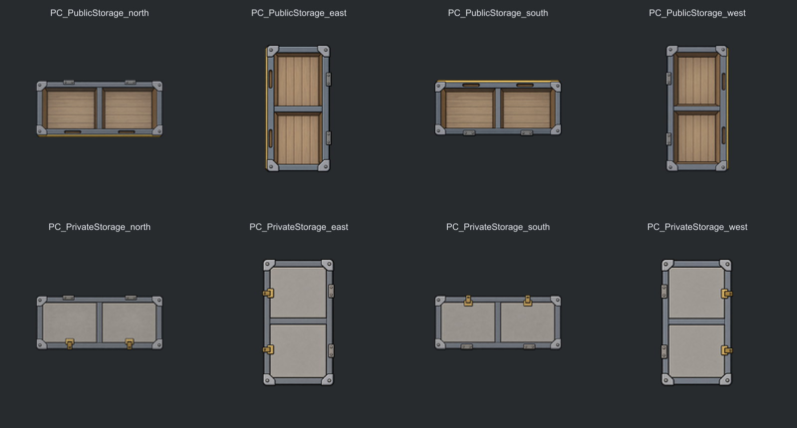
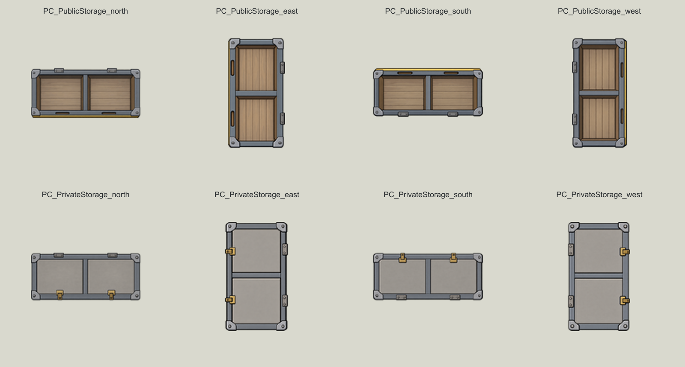

# 共有／私人物资架美术更新

> doc-id: DOC-ASSET-20261010-PUBPRIV-ART
> status: new
> supersedes: —
> approved: 2026-10-10 18:15
> author: AI（并行会话）

本次范围：PC_PublicStorage、PC_PrivateStorage，各四向建筑贴图。类型 D，路径 `Textures/Things/Building/PawnEconomy/PC_<PublicStorage|PrivateStorage>_<north|east|south|west>.png`。

## 细节健康的具体标准

- 直接正交俯视；两格乘一格占地，转向后保持同一结构。
- 共有架为两个开放分格、一条隔板、四角连接件、两个前沿握槽及两个后沿接头。私人架保留框架尺寸，用两块封闭盖板及两个前沿锁扣区别用途。
- 连接件贴合框架，盖板、接头和锁扣不漂浮；材质完整、清洁，无污损、锈蚀、破裂或污染。
- 少量平涂明暗，细节缩小后仍可辨认；无文字、数字、水印、医疗符号、灯光或假支付状态。
- 不烧录食品或其他库存；物资由游戏按真实库存叠加显示。图案只区分存储类型，不声称人物已指派或交易完成。
- 四向以母图作为同一设备参考，由内置 image_gen 分别生成；不以程序旋转、镜像或改色代替转向。
- 原始母图保留在本目录「原始母图」，最终提示词位于「生成提示词」。未采用的版本提示词带版本号，不能当成最终资产。

## 导出规则

PNG RGBA，北南画布 192×128，东西画布 128×192，对应 drawSize (3,2) 及横向转向后 (2,3)，64 像素／格。主体长边统一为 128 像素，对应两格，短边保留锁扣／铰接件的合理悬出；等比缩小并在透明画布居中，不拉伸、不超分。可见外沿比例允许 1.7～2.3，另容许母图两像素抗锯齿测量误差，具体值写入清单；外沿包含锁扣悬出，不把它当成游戏占地比例，游戏占地始终由 size (2,1) 决定。

生成图中低于 8／255 的极低透明度编码噪点不用于判定可见主体裁剪框；裁剪矩形内原始 alpha 保留。输出四周及角落必须完全透明，明显阴影、背景、光晕与截边拒绝导出。检测透明度和比例属于技术检查，不能代替部件一致性目检或游戏验证。

两种仓储保留原版按建造材料着色的行为，取消原来额外的绿／蓝图形色。辨识以开放／封闭结构及锁扣为主，避免依赖颜色。

## 接入与验收记录

八张最终贴图已完成，内置 image_gen 分别生成；原始母图、最终提示词与局部修正提示词均已保存。最终文件清单、尺寸、透明边界、连通区域及 SHA256 见 [asset-manifest.json](asset-manifest.json)。原生 Graphic_Multi 的 MeshAt 已通过本机程序集核对：独立四向素材的东西绘制尺寸交换，故导出竖向画布。

浅、深背景预览已逐张目检，开放／封闭分格可区分；共有架握槽与接头、私人架锁扣与铰接件的前后位置对应正确，木板纹理随架体转向，没有预画库存或状态文字。透明边界、RGBA 格式、八个方向引用及明显断开的部件检查通过。逐像素同一性和游戏实际尺度仍不作为已证明事项。

已定向部署八张贴图及一个 Def 到 `E:\SteamLibrary\steamapps\common\RimWorld\Mods\殖民地综合管理系统`，备份路径与部署哈希见 [deployment.json](deployment.json)。239 个其他已部署文件在本次部署操作中保持一致。Def 对比证明除 graphicData 外的字段未变。

本轮生成期间，外部构建将 DLL 更新并同步至游戏目录；本次美术部署保留当前匹配的源码／部署 DLL。当前部署程序集中的仓储建筑类、父类与扩展类引用已核对。旧版 1272 项回归结果属于历史 DLL，本次不将其改称为当前二进制的测试结果。当前二进制哈希与历史测试哈希均写入部署记录。

游戏内验收需要重启并放置两类货架，观察北东南西、蓝图、不同材料及真实库存叠加效果。未取得真实游戏截图前，GameVerified=false；资产预览不是游戏截图。
